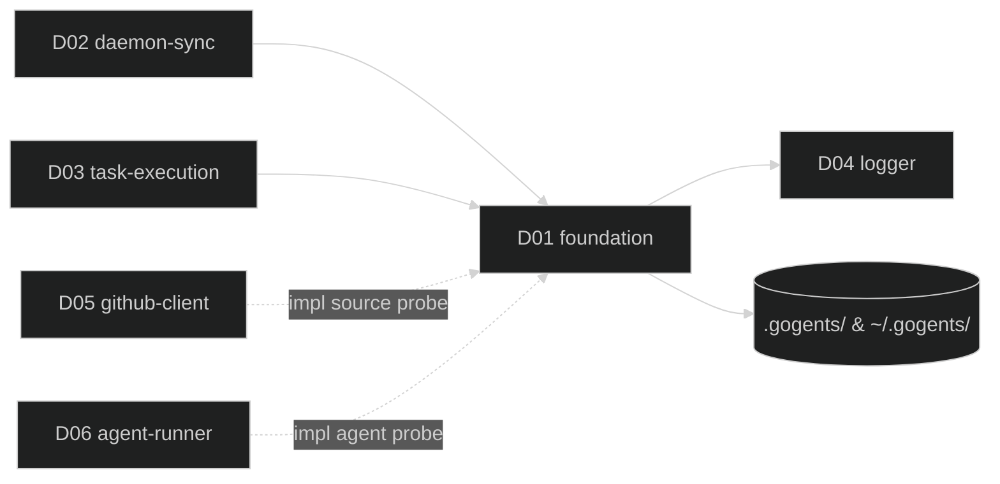

# D01 — foundation

涵蓋需求：R01（Workspace 佈局）、R02（Runtime 設定）、R03（任務狀態模型）。
本模組提供資料模型與設定層的被動 library，不含常駐行為。

## 1. 模組架構與周邊模組關聯

foundation 是系統最底層的資料與設定層，對外暴露三個核心能力：設定載入與驗證、workspace 路徑管理、任務狀態存取。所有其他模組皆透過本模組操作 `.gogents/` 下的檔案。

- **被依賴者**：D02（daemon-sync）在啟動、sync tick、重啟恢復時使用；D03（task-execution）在狀態轉換、artifact 路徑解析時使用。
- **依賴者**：僅依賴 D04（logger）輸出事件。不直接依賴 D05 / D06。
- **工具鏈檢查委派**：本模組定義 `ToolchainProbe` 介面，但不實作 source / agent 的具體檢查。D02 組裝啟動流程時，由 D05（github-client）提供 source 檢查、D06（agent-runner）提供 agent 檢查；git 檢查由 D01 內建（最小能力：`git --version`、workspace 是否為 git repo）。
- **I/O 邊界**：僅觸及 `<workspace>/.gogents/` 與全域家目錄根（預設 `~/.gogents/`，可經 `GOGENTS_HOME` 覆寫，見 §3）；不呼叫任何外部 CLI（除內建 git probe）。



## 2. 行為契約

- **B1 Load Config**：合併讀取 `~/.gogents/config.yaml` 與 `<workspace>/.gogents/runtime.yaml`，產出不可變 `Config`。欄位缺失或型別錯即拒絕。
- **B2 Preflight**：四階段驗證，任一階段失敗即拒啟並回錯：
  1. schema validate（本模組內建）
  2. source toolchain check（委派 `ToolchainProbe.CheckSource`）
  3. agent toolchain check（委派 `ToolchainProbe.CheckAgent`）
  4. git toolchain check（本模組內建）
- **B3 Init Workspace**：補齊缺少的 `.gogents/`、`.gogents/tasks/`、`~/.gogents/logs/<hash>/`；既存 `<reponame>/` 為 git repo 則略過 clone，非 git repo 拒啟（clone 行為本身由 D02 執行）。
- **B4 Atomic TaskStore**：`task.yaml` 採 `write-tmp → fsync → rename`；同一 task id 序列化寫入，不允許並發寫。
- **B5 State Machine**：資料驅動的合法轉換表；非法轉換不落檔、回 `IllegalTransitionError`，並發出 `task.illegal_transition` 事件。
- **B6 UpdateFields（同狀態欄位更新）**：供呼叫端在「狀態不變、僅需補寫 / 覆蓋欄位」情境使用（例：coding 成功但 R08 回報失敗，task 留在 `reporting`，需補寫 `execution.reporting_error` / `feedback.comment_id`）。不經合法轉換表檢查；套用 `TaskPatch` 中非 nil 欄位；序列化與原子寫入同 B4；發出 `task.updated` 事件（而非 `task.transition`）。呼叫端**不得**以 UpdateFields 規避 state machine 去改 `status` 欄位——patch 不含 status，無法被改到。

## 3. 資料結構

**Config（由 runtime.yaml + config.yaml 合併產生）**

| 欄位                          | 型別                    | 說明                             |
| ----------------------------- | ----------------------- | -------------------------------- |
| `runtime_name`                | string                  | Runtime 識別名                   |
| `project.repo.url`            | string                  | Git repo URL                     |
| `project.repo.default_branch` | string                  | 預設 base branch                 |
| `source.type`                 | enum `github_issue`, `local` | 任務來源型別                |
| `source.instance`             | string                  | 任務來源實例（`github_issue`：owner/repo） |
| `source.path`                 | string                  | ticket inbox 路徑（`local`；預設 `~/.am/tickets`） |
| `source.filter.label`         | string                  | 觸發 / 認領 label（必填）        |
| `source.sync_interval`        | duration                | Sync 間隔（例：`60s`）           |
| `agent.type`                  | enum `claude`           | Agent CLI 型別                   |
| `agent.model`                 | string                  | Agent 模型識別                   |
| `task_policy.max_failures`    | int                     | 累計失敗上限                     |
| `assignee`                    | string                  | 預設 GitHub mention 對象         |

**WorkspacePaths**

`workspace-hash` = `sha1(absolute workspace path)` 前 8 碼（hex）。

全域路徑（`GlobalConfigYaml()`、`LogsDir()` 及其下的日誌檔）皆掛在**全域家目錄根**下。此根由**單一 home 解析函式**（本模組內部）產出，供 `WorkspacePaths` 與 `GlobalConfigStore` 共用，避免兩處各自推導而指向不同目錄。解析順序：

1. 環境變數 `GOGENTS_HOME` 非空 → 逕用其值。
2. 否則 → `$HOME/.gogents`（預設，向後相容）。
3. `$HOME` 亦無法解析時 → `/tmp` fallback。

下表以預設值 `~/.gogents/` 表示全域家目錄根。per-workspace 的 `.gogents/`（`runtime.yaml` / `state.yaml` / `tasks/`）為相對路徑，不受 `GOGENTS_HOME` 影響。

| 路徑方法             | 對應檔案 / 目錄                                | 寫入者          |
| -------------------- | ---------------------------------------------- | --------------- |
| `Root()`             | `<workspace>/`                                 | -               |
| `Gogents()`          | `<workspace>/.gogents/`                        | D01 (Init)      |
| `RuntimeYaml()`      | `<workspace>/.gogents/runtime.yaml`            | 使用者          |
| `StateYaml()`        | `<workspace>/.gogents/state.yaml`              | D02             |
| `TasksDir()`         | `<workspace>/.gogents/tasks/`                  | D01 (Init)      |
| `TaskDir(id)`        | `<workspace>/.gogents/tasks/<id>/`             | D02 / D03       |
| `TaskYaml(id)`       | `<workspace>/.gogents/tasks/<id>/task.yaml`    | D01 (TaskStore) |
| `InputMd(id)`        | `<workspace>/.gogents/tasks/<id>/input.md`     | D03             |
| `OutputJsonl(id)`    | `<workspace>/.gogents/tasks/<id>/output.jsonl` | D06             |
| `ResultJson(id)`     | `<workspace>/.gogents/tasks/<id>/result.json`  | Agent           |
| `GlobalConfigYaml()` | `~/.gogents/config.yaml`                       | D01 (GlobalConfigStore) |
| `LogsDir()`          | `~/.gogents/logs/<hash>/`                      | D01 (Init)      |
| `DaemonLog()`        | `~/.gogents/logs/<hash>/daemon.jsonl`          | D04             |
| `ErrorLog()`         | `~/.gogents/logs/<hash>/error.jsonl`           | D04             |

**Task**

| 欄位群      | 子欄位                                                                              |
| ----------- | ----------------------------------------------------------------------------------- |
| 頂層        | `id`（`github-<issue-number>`）、`status`                                           |
| `source`    | `issue_number`、`title`、`labels`、`assignee`、`closed_at`                          |
| `execution` | `branch`、`started_at`、`finished_at`、`pr_url`、`failure_count`、`reporting_error` |
| `feedback`  | `comment_id`、`last_label`                                                          |

`execution.reporting_error` 僅於 coding 成功但 R08 回報失敗時有值（見 R07 Case A；task 留在 `reporting` 並以 `UpdateFields` 寫入）；其他時機為空字串。

**Status 與合法轉換**

`queued | processing | done | reporting | failed | deleted`

| From → To                          | 觸發來源                                                              |
| ---------------------------------- | --------------------------------------------------------------------- |
| `queued → processing`              | D03 任務開始                                                          |
| `processing → done`                | D03 coding + reporting 全成功                                         |
| `processing → reporting`           | coding 成功但 feedback 失敗                                           |
| `processing → failed`              | coding 失敗或 agent 異常                                              |
| `reporting → done`                 | reporting 重試成功                                                    |
| `reporting → failed`（僅強制場景） | 重試上限後降級                                                        |
| `failed → queued`                  | sync 偵測到 issue 重開 / 重加 label 且 `failure_count < max_failures` |
| 任意 → `deleted`                   | sync 偵測到 issue 刪除                                                |

其餘組合一律 `IllegalTransitionError`。

**GlobalConfig（`~/.gogents/config.yaml`）**

全域 runtime 註冊表；由 D08（`gogents start`）於啟動時 upsert 寫入、由 D08（`gogents runtime remove`）反註冊移除，供觀測 CLI 與 am 定位 runtime。**不含 `active_runtime` 欄位**。

| 欄位                        | 型別                    | 說明                                    |
| --------------------------- | ----------------------- | --------------------------------------- |
| `runtimes[]`                | `[]RuntimeRegistration` | 已註冊 runtime 列表                     |
| `runtimes[].name`           | string                  | runtime_name                            |
| `runtimes[].workspace`      | string                  | workspace 絕對路徑（**upsert 主鍵**）   |
| `runtimes[].registered_at`  | RFC3339                 | 最近一次 `start` 註冊時間               |

upsert 語義：以 `workspace` 路徑比對；已存在則覆蓋該筆 `name` / `registered_at`，否則 append。序列化與原子寫入風格同 TaskStore（write-tmp → fsync → rename）。

## 4. 關鍵介面

本節僅列**介面規格**（interface specification）：介面所包含的方法簽章（method signature = 方法名稱 + 參數型別 + 回傳型別），以及搭配使用的必要型別與常數。**不含實作邏輯**——實作層（例如檔案鎖、解析策略、欄位驗證規則）由開發者依章 2、章 5、章 6 的契約與資料流自行落實。

程式碼區塊以 Go 語法呈現，用途是精確描述型別形狀；實際實作語言以專案主語言為準。

```go
// 設定載入與驗證
type ConfigLoader interface {
    Load(workspaceDir string) (Config, error)
    Preflight(cfg Config, probe ToolchainProbe) error
}

// 工具鏈檢查（介面定義於 D01；source / agent 實作由 D05 / D06 注入）
type ToolchainProbe interface {
    CheckSource(src SourceSpec) error   // 由 D05 實作：gh 授權 / label 可見性
    CheckAgent(agt AgentSpec)   error   // 由 D06 實作：agent CLI 可執行、版本相容
    CheckGit()                  error   // 由 D01 內建：git --version + workspace 是否 git repo
}

// 路徑管理
type WorkspacePaths interface {
    Init() error                         // 建立缺少的目錄（idempotent）
    Hash() string                        // workspace-hash (sha1 前 8 碼)

    // workspace 層級
    Root() string
    Gogents() string                     // <workspace>/.gogents/
    RuntimeYaml() string                 // <workspace>/.gogents/runtime.yaml
    StateYaml() string                   // <workspace>/.gogents/state.yaml
    TasksDir() string                    // <workspace>/.gogents/tasks/
    TaskDir(id string) string
    TaskYaml(id string) string
    InputMd(id string) string
    OutputJsonl(id string) string
    ResultJson(id string) string

    // 全域（~/.gogents/）
    GlobalConfigYaml() string            // ~/.gogents/config.yaml
    LogsDir() string                     // ~/.gogents/logs/<hash>/
    DaemonLog() string                   // ~/.gogents/logs/<hash>/daemon.jsonl
    ErrorLog() string                    // ~/.gogents/logs/<hash>/error.jsonl
}

// 任務狀態存取
type TaskStore interface {
    List() ([]Task, error)
    Get(id string) (Task, error)
    Put(t Task) error                                                 // 原子寫入（完整覆寫）
    Transition(id string, to Status, patch TaskPatch) (Task, error)   // 伴隨狀態變化的欄位更新（走 state machine）
    UpdateFields(id string, patch TaskPatch) (Task, error)            // 同狀態欄位更新（不走 state machine；見 B6）
}

// TaskPatch 僅允許部分欄位，避免呼叫端繞過狀態機改動不該改的欄位
type TaskPatch struct {
    Branch         *string
    FailureCount   *int
    StartedAt      *time.Time
    FinishedAt     *time.Time
    PrURL          *string
    CommentID      *int64
    LastLabel      *string
    ReportingError *string
    Source         *SourceFields   // sync 用於同步 issue title/labels/assignee
}

var ErrIllegalTransition = errors.New("illegal task state transition")

// 全域 runtime 註冊表存取（<global-home>/config.yaml，全域家目錄根預設 ~/.gogents，
// 可經 GOGENTS_HOME 覆寫；路徑取自與 WorkspacePaths 共用的 home 解析函式）；
// 由 D08 start 呼叫 Upsert，由觀測 CLI（D08）呼叫 Load / Resolve；由 D08 runtime remove 呼叫 Remove。
// upsert 以 workspace 路徑為主鍵。
type GlobalConfigStore interface {
    Load() (GlobalConfig, error)                       // 檔案不存在回零值 + nil error
    Upsert(reg RuntimeRegistration) error              // 以 reg.Workspace 為 key 覆蓋或新增；原子寫入
    Resolve(workspaceOrName string) (RuntimeRegistration, error) // 供 CLI 以 workspace 路徑或 name 反查
    Remove(workspaceOrName string) error               // 以 Resolve 規則定位並自 runtimes[] 移除；原子寫入；未命中回 ErrRuntimeNotRegistered
}

type GlobalConfig struct {
    Runtimes []RuntimeRegistration
}

type RuntimeRegistration struct {
    Name         string
    Workspace    string      // upsert 主鍵
    RegisteredAt time.Time
}

var ErrRuntimeNotRegistered = errors.New("runtime not found in ~/.gogents/config.yaml")
```

呼叫者使用流程：由 D02 啟動時建立 `ConfigLoader`、組裝 `ToolchainProbe`（git = 本模組內建；source = D05；agent = D06）、建立 `WorkspacePaths` 與 `TaskStore`，後續傳入各模組使用。

## 5. 程式資料流

**啟動時序（由 D02 觸發）**

```
D02.Startup()
  cfg, err := D01.ConfigLoader.Load(workspaceDir)
        ├─ read ~/.gogents/config.yaml
        ├─ read <ws>/.gogents/runtime.yaml
        └─ merge + schema validate

  probe := assemble(
      source: D05.NewSourceProbe(),
      agent:  D06.NewAgentProbe(cfg.Agent.Type),
      git:    D01.builtinGitProbe,
  )

  err := D01.ConfigLoader.Preflight(cfg, probe)
        ├─ probe.CheckSource
        ├─ probe.CheckAgent
        └─ probe.CheckGit                  ── 失敗即 return，D02 拒啟

  paths := D01.NewWorkspacePaths(workspaceDir, cfg)
  paths.Init()                             ── 補齊目錄（idempotent）
  store := D01.NewTaskStore(paths)

  return (cfg, paths, store)               ── 交給 D02 主迴圈持有
```

**狀態轉換時序（由 D02 sync / D03 execution 呼叫）**

```
caller → TaskStore.Transition(id, to, patch)
  ├─ load  <task.yaml>                   (Get)
  ├─ check transition table              (from → to)
  │     └─ 非法：emit "task.illegal_transition" → return ErrIllegalTransition
  ├─ apply patch (含自動 timestamp 補欄位)
  ├─ serialize → write tmp → fsync → rename
  ├─ emit "task.transition" {id, from, to, fields}
  └─ return 新 Task
```

**同狀態欄位更新時序（B6；由 D03 R08 失敗收尾路徑等呼叫）**

```
caller → TaskStore.UpdateFields(id, patch)
  ├─ load  <task.yaml>                   (Get)
  ├─ apply patch（不變 status；patch 中 nil 欄位略過）
  ├─ serialize → write tmp → fsync → rename
  ├─ emit "task.updated" {id, status, fields=[本次寫入的欄位名]}
  └─ return 新 Task
```

UpdateFields 與 Transition 共用同一條 per-id 序列化通道，與 B4 同樣保證原子寫入；不檢查 state machine——若呼叫端誤用以替代 Transition，patch 中既無 status 欄位，也不會造成狀態漂移。

**原子寫入細節**

```
Put(t):
  tmp := <task.yaml>.tmp.<pid>.<nanos>
  write(tmp, marshal(t))
  fsync(tmp)
  rename(tmp → <task.yaml>)    ── POSIX 保證原子性
  fsync(parent dir)             ── 確保 rename 可見
```

同一 `id` 的寫入由 TaskStore 內部 per-id mutex 序列化，避免競態；不同 `id` 可並行。

## 6. 錯誤處理

本模組所有失敗都透過回傳 `error` 讓呼叫端決定後續動作，**不自行重試**（重試屬於 D02/D03 的職責，避免底層 library 隱藏副作用）。所有 error 事件同步交由 D04 logger 寫入 `daemon.jsonl` 與 `error.jsonl`。

| 情境                                   | 分類           | error 類型                             | 處理                                                            |
| -------------------------------------- | -------------- | -------------------------------------- | --------------------------------------------------------------- |
| config 檔缺失或 YAML 解析失敗          | 永久           | `ErrConfigParse`                       | 拒啟；訊息指向出錯檔名與行號                                    |
| config schema 欄位缺失 / 型別錯        | 永久           | `ErrConfigSchema`                      | 拒啟；列出缺失欄位路徑                                          |
| `probe.CheckSource` 失敗               | 永久           | 由 D05 定義                            | Preflight 中止；訊息指示使用者修復 gh 授權                      |
| `probe.CheckAgent` 失敗                | 永久           | 由 D06 定義                            | Preflight 中止；訊息指示安裝對應 CLI                            |
| `probe.CheckGit` 失敗                  | 永久           | `ErrGitNotInstalled` / `ErrNotGitRepo` | 拒啟                                                            |
| `task.yaml` fs 寫入錯（磁碟滿 / 權限） | 暫時           | `ErrTaskIO`                            | 回錯；由呼叫端（D02/D03）依策略重試或升級為任務失敗             |
| `task.yaml` parse 失敗                 | 永久（單任務） | `ErrTaskCorrupt`                       | List/Get 時跳過該任務並記 error 事件，其他任務不受影響          |
| 非法狀態轉換                           | 程式錯誤       | `ErrIllegalTransition`                 | 不落檔、不增 `failure_count`；記 `task.illegal_transition` 事件 |
| `Init()` 目錄建立失敗                  | 永久           | `ErrWorkspaceInit`                     | 拒啟                                                            |

**邊界原則**

- 原子寫入期間若程序被 kill，下次啟動讀到的必為前一個 committed 版本（tmp 檔可安全清除）。
- TaskStore 不改 `failure_count`，除非呼叫端在 `TaskPatch` 中顯式設定；避免在底層暗改計數導致 reporting / failed 語義失準。

## 7. 驗收方式

本模組為 **基礎建設 library**，對外僅暴露介面與型別，**無獨立可執行的產出**，因此不提供獨立驗收腳本。D01 的正確性由 **D02（daemon-sync）** 的端到端驗收覆蓋：當 D02 的驗收腳本跑通時，即表示 D01 的三組契約（Config、Paths、TaskStore）在真實情境下皆運作正常。

### 7.1 驗收責任對應表

| D01 契約 / 行為     | 由哪個模組的驗收覆蓋        | 預期觀察點                                                                                                                                                                                                       |
| ------------------- | --------------------------- | ---------------------------------------------------------------------------------------------------------------------------------------------------------------------------------------------------------------- |
| B1 Load Config      | D02 啟動序列                | daemon 能讀到合併後的設定並印出 runtime_name、sync_interval 等欄位                                                                                                                                               |
| B2 Preflight        | D02 啟動序列                | probe 失敗情境（破壞 runtime.yaml、缺 gh 授權、缺 agent CLI、非 git repo）daemon 拒啟並 exit ≠ 0                                                                                                                 |
| B3 Init Workspace   | D02 啟動序列                | 首次啟動後 `.gogents/tasks/` 與 `~/.gogents/logs/<hash>/` 均被建立                                                                                                                                               |
| B4 Atomic TaskStore | D02 sync 流程、D03 狀態收斂 | 新 issue 產出 `task.yaml`；kill -9 後重啟無半寫殘檔                                                                                                                                                              |
| B5 State Machine    | D02 sync、D03 execution     | 合法轉換落檔；非法轉換（例如 `queued → done`）不落檔並記 error                                                                                                                                                   |
| B6 UpdateFields     | D03 R08 失敗收尾路徑        | coding 成功但 R08 回報失敗時，task 留 `reporting`；`task.yaml.execution.reporting_error` 落地、`feedback.comment_id` / `last_label` 為 R08 部分成功值；`daemon.jsonl` 出現 `task.updated` 而非 `task.transition` |

### 7.2 可觀測訊號（供上游驗收腳本 grep）

本模組透過 D04 logger 發出下列事件，供 D02 / D03 的驗收腳本比對：

| 事件                      | 發出時機                              | 關鍵 fields                                        |
| ------------------------- | ------------------------------------- | -------------------------------------------------- |
| `config.loaded`           | `Load` 成功                           | `runtime_name`, `source.type`, `agent.type`        |
| `config.preflight_ok`     | `Preflight` 全通過                    | -                                                  |
| `config.preflight_failed` | 任一 probe 失敗                       | `stage`（schema / source / agent / git）、`reason` |
| `workspace.initialized`   | `Init()` 首次建立目錄                 | `created_paths[]`                                  |
| `task.transition`         | 合法狀態轉換落檔後                    | `id`, `from`, `to`, `failure_count`                |
| `task.updated`            | UpdateFields 落檔後（同狀態欄位更新） | `id`, `status`, `fields[]`（本次寫入的欄位名）     |
| `task.illegal_transition` | 嘗試非法轉換                          | `id`, `from`, `to_requested`                       |
| `task.corrupt`            | 讀到無法解析的 `task.yaml`            | `id`, `reason`                                     |

### 7.3 通過條件

- D02 驗收腳本全部通過時，視為 D01 通過。
- `~/.gogents/logs/<hash>/daemon.jsonl` 在正常路徑至少包含：`config.loaded`、`config.preflight_ok`、`workspace.initialized`、`task.transition`（由 sync / execution 觸發）。
- 錯誤路徑應同時出現於 `daemon.jsonl` 與 `error.jsonl`，且 `task.yaml` / `state.yaml` 不出現半寫檔案。

