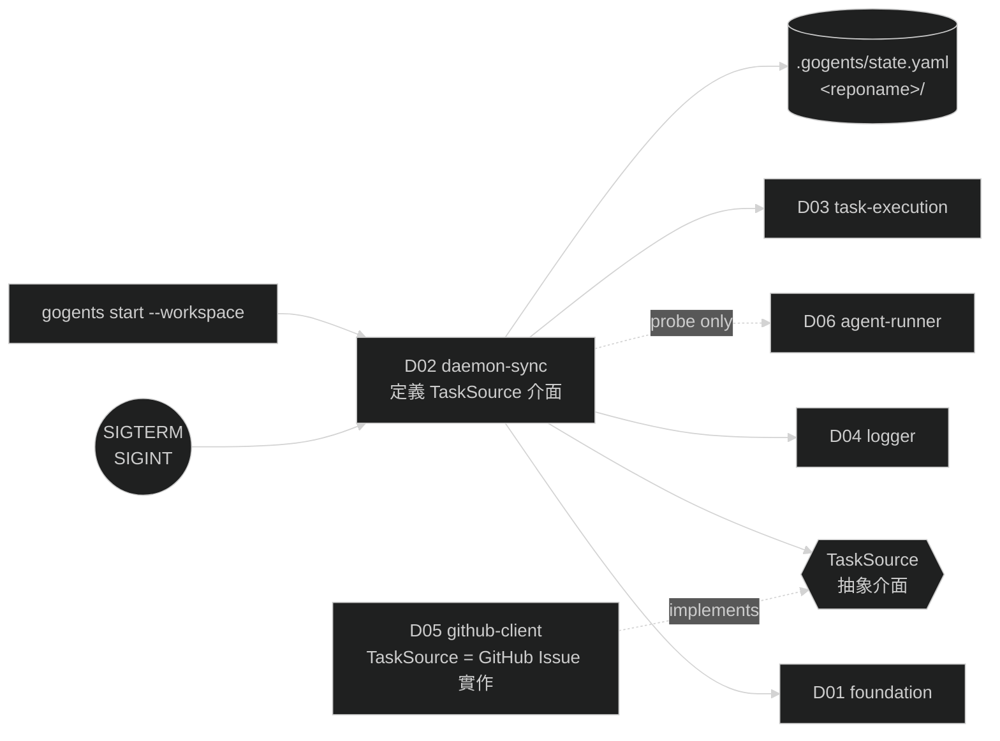

# D02 — daemon-sync

涵蓋需求：R04（Daemon 生命週期）、R05（GitHub Issue 同步）。
本模組是系統的執行骨架：提供 `gogents start` 命令、管理 daemon 生命週期、序列化驅動 sync 與任務執行。Stage 2 完成後 daemon 可獨立運作（啟動 → 同步 → 等待 → 優雅關閉 → 重啟恢復），但尚未執行 agent（D03 在 Stage 3 補上）。

## 1. 模組架構與周邊模組關聯

daemon-sync 不自行操作任何設定檔或 task 原子寫入；那是 D01 的職責。本模組只負責「**在對的時機呼叫對的介面**」與「**維護自己的狀態檔 `state.yaml`**」。

- **依賴**
  - **D01 foundation**：`ConfigLoader`（B1/B2）、`WorkspacePaths`（B3）、`TaskStore`（B4/B5，全部狀態變更都走此介面）。本模組額外持有 `state.yaml` 的原子寫入，但 **風格與 D01 TaskStore 一致**（write-tmp → fsync → rename）。
  - **D04 logger**：所有 `daemon.*`、`sync.*` 事件的唯一出口。
  - **TaskSource 抽象介面（本模組定義，§4.3）**：Syncer 只認識抽象任務來源，不直接認識 GitHub / Issue / gh CLI。具體實作（GitHub Issue 版本）由 D05 提供並在啟動時注入。
  - **D05 github-client**：提供 `TaskSource` 的 GitHub Issue 實作；提供 `SourceProbe` 注入 D01.Preflight；內部封裝 `gh` CLI 呼叫、`--json` 欄位映射、404 / auth / transient 錯誤分類。
  - **D06 agent-runner**：提供 `AgentProbe` 注入 D01.Preflight（Stage 2 僅檢查 CLI 可用性，例如 `gemini --version` 或 `claude --version`）。
- **被依賴**：**D03 task-execution** 被主迴圈在每個 tick 觸發；D02 不了解 D03 內部，只透過 `TaskExecutor` 介面呼叫。
- **I/O 邊界**：`<workspace>/.gogents/state.yaml`、`<workspace>/<reponame>/`（git clone / fetch 目標）、OS signal（SIGTERM / SIGINT）。所有任務來源 I/O 都被封裝在 TaskSource 之後，D02 自身不呼叫 `gh` 等外部 CLI。



### 1.1 Stage 2 範圍邊界（實作此模組時要什麼 / 不要做什麼）

本模組屬 **Stage 2**。為了讓 Stage 2 能獨立跑起來並收集驗收訊號，下列相依模組只需要「**Stage 2 所需的最小版本**」。**完整實作留給該模組自己的設計文件**（D03 / D05 / D06），本模組 **不得** 在 Stage 2 順手把其他模組補齊，以免後來各自一套、重複實作。

| 相依                                                   | Stage 2 需要（最小版本）                                                                                                                                                               | Stage 3+ 擴充（不屬本模組）                                                                                               | 留存方式                                                           |
| ------------------------------------------------------ | -------------------------------------------------------------------------------------------------------------------------------------------------------------------------------------- | ------------------------------------------------------------------------------------------------------------------------- | ------------------------------------------------------------------ |
| **D01 foundation**                                     | 全量。Stage 1 已完成。                                                                                                                                                                 | —                                                                                                                         | 直接呼叫                                                           |
| **D04 logger**                                         | 全量（Stage 2 的可觀測性基礎）。                                                                                                                                                       | —                                                                                                                         | 直接呼叫                                                           |
| **TaskSource 介面與 dispatcher**                       | 介面由 **本文件 §4.3 定義**（含 `List` / `Get` / `Kind`、抽象錯誤 `ErrSourceNotFound` / `ErrSourceAuth` / `ErrSourceTransient`）；dispatcher 與 concrete 分工由 **本文件 §4.4 定義**。 | 未來新增來源（如 Jira）：新增 concrete strategy 設計文件 + §4.4 dispatcher `switch` 加 case，介面與既有 concrete 皆不改。 | 本文件 §4.3、§4.4                                                  |
| **D05 github-client（TaskSource 實作 + SourceProbe）** | GitHub Issue 的 `List` / `Get`；`SourceProbe.CheckSource`（驗 `gh` 安裝、授權、repo 權限）；錯誤分類對應三種抽象錯誤。                                                                 | **R08 feedback 相關**（建 comment、切 label、mention assignee）**一律不做**；D03 在 Stage 3 自行設計並補上。              | D05 設計文件（待撰寫）標註 Stage 3 區塊                            |
| **D06 agent-runner（AgentProbe only）**                | 僅 `AgentProbe.CheckAgent`：例如 `gemini --version` 或 `claude --version` 能跑。                                                                                                       | `AgentExecutor.Run`（實際啟動 agent CLI、串流 output.jsonl、處理 exit code）**屬 Stage 3**。                              | D06 設計文件（待撰寫）標註 Stage 3 區塊                            |
| **D03 task-execution（TaskExecutor no-op）**           | 僅提供一個 no-op 實作：收到任務即記 `task.noop_executed`，**不改 status、不呼叫 agent、不動 git**。                                                                                    | 真正的 git 準備、input 組裝、agent 呼叫、result 處理、GitHub 回報**全部屬 Stage 3**。                                     | D03 設計文件（待撰寫）需同時描述 Stage 2 no-op 版與 Stage 3 完整版 |

**給實作者的紀律**：若在 Stage 2 開發過程中發現「為了讓 D02 跑起來需要 Stage 3 才有的功能」，先停下來在 D03 / D05 / D06 的設計文件補充對應條目，而**不是**在 D02 內臨時補齊；若該條目尚未有設計，回頭與需求 / 設計擁有者對齊後再實作。本文件第 7 章的驗收清單 **只驗 Stage 2 範圍內** 的行為（同步能到本地、狀態機走對、daemon 能起能停能恢復），**不驗** agent 執行、PR、GitHub 回報。

## 2. 行為契約

- **B1 啟動序列**：收到 `gogents start --workspace <path>` 後依序執行 8 步，任一失敗即 exit ≠ 0、寫 error 事件、不進主迴圈。
  1. 驗證 workspace 路徑存在且為目錄
  2. 組裝 probe（git 由 D01 內建；source 由 D05 提供；agent 由 D06 提供）
  3. 呼叫 D01：`Load` + `Preflight`
  4. 開啟 logger（建 `~/.gogents/logs/<hash>/` 與兩檔）
  5. 準備 repo 目錄：不存在 → `git clone`；為 git repo → `git fetch origin`；非 git repo → 拒啟
  6. 載入 / 初始化 `state.yaml`
  7. 重啟恢復：所有 `processing` 任務透過 `TaskStore.Transition(→ queued)`，patch 清除 `execution.started_at`，**`failure_count` 不增**；每筆寫 warning 事件 `daemon.restart_reset`
  8. 寫 `daemon.started` 事件，進入主迴圈
- **B2 主迴圈**：時間觸發、序列化、**每 tick 最多執行一個 queued 任務**。
  - 等待至下一個 `sync_interval` 觸發點
  - 呼叫 Syncer 完成一次 sync
  - `TaskStore.List()` 選字典序最小的 `queued` 任務（若有）
  - 呼叫 `TaskExecutor.Run(task)`（Stage 2 以 no-op executor 代替；Stage 3 實作）
  - 回到等待
- **B3 Sync 同步**：一輪 sync 只透過 `TaskSource` 抽象介面，與具體來源（GitHub / 其他）解耦；最後產出一筆 `sync.completed` 或 `sync.failed`。
  - **新任務偵測**：`TaskSource.List(filter)` → 本地不存在的 → 建 `task.yaml`（status=queued、failure_count=0、填 source 欄位）→ 記 event `sync.task_created`（Stage 2 僅本地落檔；對外 feedback 屬 Stage 3 由 D03 完成）。
  - **既有任務追蹤**：對每個本地 non-`deleted` 任務 `TaskSource.Get(task_id)`，比對 `updated_at` → 更新 source 欄位並依 R03 狀態轉換表套用變化。
  - **刪除偵測**：`TaskSource.Get` 回傳 `ErrSourceNotFound` → 轉 `deleted`；`ErrSourceAuth` / `ErrSourceTransient` → 不改 status、記 error、下次重試。
- **B4 優雅關閉**：收到 SIGTERM / SIGINT 後，設 draining 旗標、拒新 tick、等當前任務自然結束（不 kill agent）、寫 `daemon.stopped`、退出；第二次信號強制退出並在 log 記 `daemon.force_stopped`（當前 task 留在 `processing`，下次啟動由 B1.7 恢復）。
- **B5 state.yaml 原子寫入**：每次 sync 完成、task 開始 / 結束時更新 `state.yaml`；寫入採 `write-tmp → fsync → rename`，並發寫由本模組內部 mutex 序列化。
- **B6 序列化保證**：sync 與 task 執行不並行；sync 執行期間若 `sync_interval` 到了，不觸發下一輪——間隔從「**上一次 sync 完成時間**」起算。

## 3. 資料結構

### 3.1 CLI 參數

| 參數          | 必填 | 說明                     |
| ------------- | ---- | ------------------------ |
| `--workspace` | ✔    | workspace 根目錄絕對路徑 |

### 3.2 `state.yaml` schema（寫入者：D02）

| 欄位                      | 型別                      | 說明                       |
| ------------------------- | ------------------------- | -------------------------- |
| `daemon.pid`              | int                       | 目前 daemon 行程 PID       |
| `daemon.started_at`       | RFC3339                   | 啟動時間                   |
| `daemon.workspace`        | string                    | workspace 絕對路徑         |
| `sync.last_sync_at`       | RFC3339 / null            | 最近一次 sync 完成時間     |
| `sync.last_sync_status`   | enum `success` / `failed` | 最近一次 sync 結果         |
| `sync.last_sync_error`    | string / null             | `failed` 時的錯誤訊息      |
| `current_task.task_id`    | string / null             | 進行中任務 id（無則 null） |
| `current_task.started_at` | RFC3339 / null            | 任務開始時間               |

### 3.3 Sync 輪次產物（供事件輸出）

| 欄位                  | 型別                  | 說明                                                    |
| --------------------- | --------------------- | ------------------------------------------------------- |
| `queried_total`       | int                   | 本輪經由 `TaskSource.List` + `Get` 掃描到的來源任務總數 |
| `created[]`           | string[]              | 新增的 task_id                                          |
| `updated[]`           | string[]              | status 有變化的 task_id                                 |
| `deleted[]`           | string[]              | 本輪轉為 `deleted` 的 task_id                           |
| `unchanged`           | int                   | 無變動任務數                                            |
| `duration_ms`         | int                   | sync 持續時間                                           |
| `per_source_errors[]` | `{task_id, reason}`[] | 單筆來源查詢失敗但不中斷整輪者                          |

### 3.4 事件命名（發至 D04）

| 事件                        | 何時                                     |
| --------------------------- | ---------------------------------------- |
| `daemon.started`            | B1 第 8 步                               |
| `daemon.stopping`           | 收到第一次信號                           |
| `daemon.stopped`            | 正常退出                                 |
| `daemon.force_stopped`      | 第二次信號強制退出                       |
| `daemon.restart_reset`      | B1.7 重啟恢復重置一筆 processing         |
| `sync.started`              | 每輪 sync 開始                           |
| `sync.task_created`         | 新任務建立                               |
| `sync.task_updated`         | 既有任務 status / source 變化            |
| `sync.task_deleted`         | 轉 deleted                               |
| `sync.failure_lock_reached` | `failure_count >= max_failures` 首次偵測 |
| `sync.completed`            | 整輪 sync 成功（含 per_issue_errors）    |
| `sync.failed`               | 整輪 sync 失敗（整體查詢失敗）           |

## 4. 關鍵介面

本節列出介面規格（method signatures：名稱、參數型別、回傳型別）與必要型別。不含實作——鎖策略、tick 實作（ticker / timer）、signal channel 佈線屬實作細節。程式碼以 Go 語法呈現，語言以專案為準。

### 4.1 Daemon

```go
// Daemon 是本模組的對外入口；CLI 層負責 flag 解析後交給 Run。
type Daemon interface {
    Run(ctx context.Context, workspaceDir string) error    // 阻塞直到退出；error != nil 代表非零 exit
    // 關閉由 ctx 取消觸發；支援二次信號 → ctx 取消後再強制退出
}

// 組裝函式：把所有依賴（D01/D04/D05/D06/D03）在此處接線
func New(deps Deps) Daemon

type Deps struct {
    ConfigLoader  foundation.ConfigLoader        // D01
    NewPaths      func(ws string, cfg Config) foundation.WorkspacePaths
    NewStore      func(paths foundation.WorkspacePaths) foundation.TaskStore
    Logger        logger.Logger                  // D04
    SourceProbe   foundation.SourceProbe         // 由 §4.4 dispatcher 依 cfg.Source.Type 選定
    AgentProbe    foundation.AgentProbe          // D06 實作（注入 D01.Preflight，Stage 2 僅 CLI 可用性檢查）
    GitProbe      foundation.GitProbe            // D01 內建 / D02 自帶（git --version、是否 git repo）
    Source        source.TaskSource              // 由 §4.4 dispatcher 依 cfg.Source.Type 選定；Phase 1 為 D05 GitHub Issue 實作
    Git           gitops.Runner                  // 用於 clone / fetch（最小能力，Stage 2 自帶）
    Executor      execution.TaskExecutor         // D03；Stage 2 以 no-op 佔位
}
```

> `Deps` 是本模組的唯一接線點。每個欄位的**型別**定義在對應模組的設計文件，Stage 2 可接受 no-op / 最小版實作，**但不可在 D02 實作他們**；詳見 §1.1。

### 4.2 Syncer

```go
// Syncer 獨立成介面，讓主迴圈單純（主迴圈只負責節奏，同步邏輯在此）。
// Syncer 只依賴 TaskSource（§4.3），不認識具體來源型別。
type Syncer interface {
    Tick(ctx context.Context) (SyncOutcome, error)
}

type SyncOutcome struct {
    QueriedTotal     int
    Created          []string
    Updated          []string
    Deleted          []string
    Unchanged        int
    DurationMs       int64
    PerSourceErrors  []PerSourceError
}

type PerSourceError struct {
    TaskID string
    Reason string                  // 分類後字串（轉自 ErrSourceAuth / ErrSourceTransient 等）
}
```

### 4.3 TaskSource（本模組定義的抽象介面）

本介面由 D02 擁有並定義；Syncer 只透過此介面存取任務來源。Stage 2 的唯一實作在 D05（GitHub Issue），Stage 2 不得在其他地方實作。未來要支援新來源（例：Jira、Linear）時，新增 `TaskSource` 實作即可，D02 原始碼不動。

```go
type TaskSource interface {
    Kind() string                                                       // 例：" github_issue"；供 log fields 使用
    List(ctx context.Context, filter SourceFilter) ([]SourceTask, error) // 列出符合條件的來源任務（通常是 open + 指定 label）
    Get(ctx context.Context, taskID string) (SourceTask, error)          // 以 task_id（例：github-42）查詢單一任務
}

type SourceFilter struct {
    Labels []string                                                     // 全部符合（AND）
    State  SourceState                                                  // 一般為 SourceStateOpen
}

type SourceState string
const (
    SourceStateOpen   SourceState = "open"
    SourceStateClosed SourceState = "closed"
)

// SourceTask 是抽象任務來源在 sync 階段需要的最小欄位集合。
// 不包含 body / comments —— 那些是 R06 執行階段才需要的（Stage 3）。
type SourceTask struct {
    TaskID    string                                                    // 例："github-42"；由實作決定格式
    State     SourceState
    UpdatedAt time.Time
    URL       string
    Title     string
    Labels    []string
    Assignees []string
}

// TaskSource 實作應將底層錯誤分類為下列三種（其餘一律歸 transient）：
var (
    ErrSourceNotFound  = errors.New("source task not found")   // 明確對應「已刪除」，D02 會轉 deleted
    ErrSourceAuth      = errors.New("source auth failed")      // 授權失效；D02 僅記錄、下輪再試
    ErrSourceTransient = errors.New("source transient error")  // 網路 / 5xx / rate-limit；下輪再試
)
```

### 4.4 Strategy dispatcher（concrete strategy 選擇層）

`TaskSource`（§4.3）、`foundation.SourceProbe`（D01 §4）、`source.FeedbackReporter`（定義於 D05 §4.3）三者皆為 strategy interface；具體實作由對應 concrete strategy 模組提供（Phase 1 僅 D05 的 GitHub Issue 一套，對應 `cfg.source.type: github_issue`）。Dispatcher 是組 `Deps` 前依 `cfg.Source.Type` 選擇 concrete 實例的那一層，本節定義其介面與 concrete 分工。

**職責與邊界**

| 元件                 | 擁有者                                                               | 知道什麼                                     |
| -------------------- | -------------------------------------------------------------------- | -------------------------------------------- |
| Strategy interface   | D02（`TaskSource`）、D01（`SourceProbe`）、D05（`FeedbackReporter`） | 只定義契約；不知道有哪些 concrete strategy   |
| Concrete strategy    | D05（`github_issue`）；未來 D0X（例：`jira`）                        | 只做自己的實作；不知道自己是否被選中         |
| Dispatcher（本小節） | **D02**                                                              | 唯一知道「系統支援哪些 `source.type`」的位置 |

**介面**

三個 factory function，各自對應一個 strategy interface。dispatcher 以 `cfg` 為唯一輸入，輸出符合 interface 的實例，或明確錯誤。

```go
package source

// NewTaskSourceFromConfig 依 cfg.Source.Type 選擇 concrete TaskSource。
// cfg.Source.Type 未支援 → 回錯；呼叫端（Daemon.Run 啟動序列）視為設定錯誤，exit 3。
func NewTaskSourceFromConfig(cfg foundation.Config, lg logger.Logger) (TaskSource, error)

// NewSourceProbeFromConfig 依 cfg.Source.Type 選擇 concrete SourceProbe。
// 由 D02 啟動時組 ToolchainProbe 時呼叫並注入 D01.Preflight。
func NewSourceProbeFromConfig(cfg foundation.Config, lg logger.Logger) (foundation.SourceProbe, error)

// NewFeedbackReporterFromConfig 依 cfg.Source.Type 選擇 concrete FeedbackReporter。
// Stage 3 才被 D03 使用；Stage 2 可不呼叫。
func NewFeedbackReporterFromConfig(cfg foundation.Config, lg logger.Logger) (source.FeedbackReporter, error)
```

**Concrete 分工（Phase 1）**

| `cfg.Source.Type` | TaskSource                                                      | SourceProbe                      | FeedbackReporter                                       |
| ----------------- | --------------------------------------------------------------- | -------------------------------- | ------------------------------------------------------ |
| `github_issue`    | `github.NewGitHubIssueSource(cfg, lg)`                          | `github.NewGitHubIssueProbe(lg)` | `github.NewGitHubFeedbackReporter(cfg, lg)`（Stage 3） |
| 其他              | 回 `fmt.Errorf("unsupported source.type: %q", cfg.Source.Type)` | 同左                             | 同左                                                   |

**實作形式（`switch` 展開，僅示意）**

```go
func NewTaskSourceFromConfig(cfg foundation.Config, lg logger.Logger) (TaskSource, error) {
    switch cfg.Source.Type {
    case "github_issue":
        return github.NewGitHubIssueSource(cfg, lg), nil
    default:
        return nil, fmt.Errorf("unsupported source.type: %q", cfg.Source.Type)
    }
}
```

`NewSourceProbeFromConfig` / `NewFeedbackReporterFromConfig` 結構相同，僅呼叫的 concrete 構造函式不同。

**邊界紀律**

- Dispatcher **不執行** 任何 strategy 內部邏輯——不呼叫 `List` / `Get` / `CheckSource` / `Report`；僅回傳實例。
- Concrete strategy 設計文件（D05 等）**不得** 包含 dispatcher 邏輯：不 `switch cfg.Source.Type`、不檢查類型正確性。
- `cfg.Source.Type` 的合法值集合由 D01 schema validate（R02 階段 1）先擋下；dispatcher 的 `default` 分支為防禦性回錯，不依賴它做主要校驗。
- 新增 source type 的流程：(1) 新增 concrete strategy 設計文件（D0X-<name>-client.md）；(2) 在本小節三個 factory 的 `switch` 各加一個 case。**D02 其他章節與既有 concrete strategy 皆不改**（OCP）。
- Stage 2 驗收範圍：僅 `NewTaskSourceFromConfig` / `NewSourceProbeFromConfig` 需通過；`NewFeedbackReporterFromConfig` 於 Stage 3 由 D03 驗收。

### 4.5 StateStore

```go
// state.yaml 原子讀寫；風格與 D01.TaskStore 一致但不共用，因為 state 是 daemon 私有。
type StateStore interface {
    Load() (State, error)          // 若檔案不存在，回傳零值 + nil error
    Save(s State) error            // 原子寫入
    UpdateSync(fn func(*SyncState))          error
    UpdateCurrentTask(fn func(*CurrentTask)) error
}

type State struct {
    Daemon      DaemonState
    Sync        SyncState
    CurrentTask CurrentTask
}
```

## 5. 程式資料流

### 5.1 啟動（B1）

```
gogents start --workspace /path
  │
  ▼
Daemon.Run(ctx, ws)
  1. validate ws path                      ── 失敗 → exit 2
  2. open logger (paths from ws+hash)      ── 必須最早開啟，後續才有 log
       emit "daemon.starting"
  3. cfg := D01.ConfigLoader.Load(ws)      ── 失敗 → "config.parse_error" / exit 3
  4. probe := {git, D05.source, D06.agent}
     D01.ConfigLoader.Preflight(cfg, probe) ── 失敗 → "config.preflight_failed" / exit 4
  5. paths := NewPaths(ws, cfg); paths.Init()
  6. repo dir 檢查
        not exist  → git clone repo.url <ws>/<reponame>
        is git     → git fetch origin
        not git    → exit 5 + "daemon.repo_invalid"
  7. state := StateStore.Load()
     state.Daemon = {pid=os.getpid(), started_at=now, workspace=ws}
     StateStore.Save(state)
  8. 重啟恢復：for t in store.List() where t.status == processing:
        store.Transition(t.id, queued, patch{StartedAt=nil, FailureCount=unchanged})
        emit "daemon.restart_reset" {id}
  9. emit "daemon.started" {pid, workspace, runtime_name}
 10. go signalWatcher(ctx cancel 觸發點)
 11. mainLoop(ctx)
```

### 5.2 主迴圈（B2 + B6）

```
mainLoop:
  for ctx 未取消:
     <-time.After(sync_interval)           ── interval 從上次 sync 完成時間起算
     if draining: break                     ── 見 §5.4；不再啟動新一輪
     emit "sync.started"
     outcome, err := Syncer.Tick(ctx)
     StateStore.UpdateSync({last_sync_at=now, status=success/failed, error=err?.msg})
     if err == nil:
         emit "sync.completed" fields=outcome
     else:
         emit "sync.failed"   fields={reason}
         continue
     pick := minID( tasks where status==queued )
     if pick == nil: continue
     StateStore.UpdateCurrentTask({task_id=pick.id, started_at=now})
     Executor.Run(ctx, pick)               ── Stage 2 no-op；Stage 3 交 D03
     StateStore.UpdateCurrentTask({nil, nil})
```

### 5.3 Sync.Tick（B3）

```
Tick:
  t0 := time.Now()
  filter := SourceFilter{ Labels: [cfg.Source.Filter.Label], State: SourceStateOpen }
  remote, err := source.List(ctx, filter)
      err ≠ nil → return SyncOutcome{}, err              ── 整體失敗（下游決定是否轉 sync.failed）
  localTasks := store.List() 濾掉 status=deleted

  // 新任務
  for rt in remote:
     if rt.TaskID ∉ localTasks by id:
         store.Put(Task{ id=rt.TaskID, status=queued, failure_count=0,
                         source={ kind=source.Kind(), url=rt.URL, state=rt.State,
                                  updated_at=rt.UpdatedAt, labels=rt.Labels, assignees=rt.Assignees } })
         outcome.Created += rt.TaskID
         emit "sync.task_created" { id=rt.TaskID, kind=source.Kind(), url=rt.URL }

  // 既有任務追蹤 + 刪除偵測
  for lt in localTasks:
     rt2, err := source.Get(ctx, lt.ID)
     switch {
     case errors.Is(err, ErrSourceNotFound):
         store.Transition(lt.ID, deleted, TaskPatch{})
         outcome.Deleted += lt.ID; emit "sync.task_deleted" { id=lt.ID }
         continue
     case err != nil:                                   ── ErrSourceAuth / ErrSourceTransient / 其他
         outcome.PerSourceErrors += { lt.ID, classify(err) }
         logger error "sync.source_query_failed" { id=lt.ID, reason=classify(err) }
         continue
     }

     if rt2.UpdatedAt == lt.Source.UpdatedAt && rt2.State == lt.Source.State:
         outcome.Unchanged++; continue

     // 有變化：先更新 source 欄位，再依 R03 / R05 規則決定下一個 status
     patch := TaskPatch{ Source: &SourceFields{
                 State=rt2.State, UpdatedAt=rt2.UpdatedAt, URL=rt2.URL,
                 Labels=rt2.Labels, Assignees=rt2.Assignees } }
     nextStatus := applySourceTransition(lt.Status, rt2, lt.FailureCount, cfg.TaskPolicy.MaxFailures)
     if nextStatus == failed && 首次偵測 failure_lock:
         emit "sync.failure_lock_reached" { id=lt.ID }
     store.Transition(lt.ID, nextStatus, patch)
     outcome.Updated += lt.ID; emit "sync.task_updated" { id=lt.ID, from=lt.Status, to=nextStatus }

  outcome.QueriedTotal = len(remote) + len(localTasks)
  outcome.DurationMs   = time.Since(t0).Milliseconds()
  return outcome, nil
```

`applySourceTransition` 是**純函式**，封裝 R03 / R05 的狀態轉換規則（processing + closed → done、done + reopen → queued、failed + reopen + count < max → queued 等）。它只依賴 `SourceTask` 抽象，不含來源特定邏輯；因此不論 TaskSource 實作是 GitHub 或其他，轉換規則都一致。

### 5.4 信號與關閉（B4）

設計原則：sync 與 task 是兩個**各自原子**的工作單位；關閉時兩者都讓「**當前這一個**」自然結束，不啟動「**下一個**」。

- **Sync 是一個 tick 為單位的原子動作**：即使允許中斷也不會造成 task.yaml 資料損壞（D01 對每筆 task.yaml 都是原子寫入），但中斷會留下「一半任務已同步、一半沒」的不完整情境，徒增下次 sync 的比對成本。因此選擇**讓當前 sync tick 完成**。
- **Task 執行遵循 R04 B4**：不強制 kill agent，等其自然結束並完成 result handling / GitHub 回報（Stage 3 行為；Stage 2 的 no-op executor 秒結束）。
- **關閉後不再啟動任何新工作**：設 draining 旗標，主迴圈跳出 tick 等待，不進下一輪。

```
signalWatcher:
  first := <-signal(SIGTERM, SIGINT)
      draining = true                              ── 設旗標
      emit "daemon.stopping" { signal }
      // 不 kill sync、不 kill executor；讓當前工作自然結束
  second := <-signal(SIGTERM, SIGINT):
      emit "daemon.force_stopped"                  ── 二次信號立即退出
      os.Exit(1)

mainLoop 配合 draining:
  ... (等 sync_interval 與 sync + executor 流程)
  loop 末尾 / 等待 sync_interval 之前:
      if draining:
          break mainLoop                            ── 跳出迴圈，Run 回到呼叫端
  (若在 sync / executor 中途收到 signal，讓它跑完，下一個 loop 入口才 break)

Daemon.Run 收尾:
  emit "daemon.stopped"
  return nil                                        ── exit 0
```

**情境拆解**

| 收到 signal 時機                              | 行為                                                                                                                               |
| --------------------------------------------- | ---------------------------------------------------------------------------------------------------------------------------------- |
| Idle（在 `time.After(sync_interval)` 等待中） | 立即跳出等待；不進這一輪 tick；寫 `daemon.stopped` 退出                                                                            |
| Sync 進行中                                   | 讓當前 sync tick 跑完（寫完 `sync.completed` 或 `sync.failed`）；跳過「挑 queued 任務」；不啟動 executor；寫 `daemon.stopped` 退出 |
| Task 執行中                                   | 讓 executor 自然結束（Stage 3 含 result + feedback）；寫 `daemon.stopped` 退出                                                     |
| 連收兩次 signal                               | 立即 `daemon.force_stopped`、exit 1；未完成 task 留 `processing`，下次啟動由 B1.7 重置回 queued（failure_count 不增）              |

**為何不「sync 中立即中斷」？**

- Sync 本身是秒級操作（幾個 `gh` 查詢），「等它跑完」對關機時間無實質影響。
- 中斷 sync 後 `state.yaml.sync.last_sync_at` 更新與否語義模糊；等它完成可讓 state.yaml 的成功 / 失敗語義明確。
- 下次 daemon 啟動仍會 sync，中斷不會造成資料損失；但讓它跑完可讓**這一輪 sync 的事件完整**，利於日誌稽核。

## 6. 錯誤處理

原則：**啟動期**失敗直接 exit ≠ 0，讓使用者看見；**主迴圈期**失敗不退出 daemon，只記錄 + 等下一輪。本模組不對 `TaskSource` 做指數退避（R05 明寫暫不實作）——重試節奏就是下一輪 `sync_interval`；是否改 `task.status` 僅由錯誤分類決定。

### 6.1 啟動期（exit 非零）

| 情境                                              | exit | 事件                                                 | 處理                                         |
| ------------------------------------------------- | ---- | ---------------------------------------------------- | -------------------------------------------- |
| workspace 路徑不存在 / 非目錄                     | 2    | stderr + 尚無 logger（先 stderr，logger 開啟後補寫） | 即刻退出                                     |
| `runtime.yaml` / `config.yaml` 解析或 schema 失敗 | 3    | `config.parse_error` / `config.schema_error`         | 即刻退出                                     |
| Preflight 任一階段失敗                            | 4    | `config.preflight_failed` {stage, reason}            | 即刻退出                                     |
| repo 目錄非 git repo                              | 5    | `daemon.repo_invalid`                                | 即刻退出                                     |
| `git clone` / `git fetch` 失敗                    | 6    | `daemon.git_init_failed` {command, stderr}           | 即刻退出                                     |
| `state.yaml` 解析失敗                             | 7    | `daemon.state_corrupt`                               | 即刻退出（人工修復，不自動覆寫避免掩蓋問題） |

### 6.2 主迴圈期（不退出）

| 情境                                                              | 分類     | 處理                                                                                                        |
| ----------------------------------------------------------------- | -------- | ----------------------------------------------------------------------------------------------------------- |
| `TaskSource.List` 回 `ErrSourceTransient`                         | 暫時     | `sync.failed` {reason=transient}；不改任何 task；下個 interval 重試                                         |
| `TaskSource.List` 回 `ErrSourceAuth`                              | 授權失效 | `sync.failed` {reason=auth}；下個 interval 仍會重試，但將重複失敗——由 admin 觀察 log 介入                   |
| `TaskSource.List` 回其他錯誤                                      | 未分類   | `sync.failed` {reason=unknown}；記錄原始錯誤到 `error.jsonl`；下輪重試                                      |
| `TaskSource.Get` 回 `ErrSourceNotFound`                           | 明確刪除 | `Transition → deleted`；`sync.task_deleted`                                                                 |
| `TaskSource.Get` 回 `ErrSourceAuth` / `ErrSourceTransient` / 其他 | 暫時     | 不改 task status；`per_source_errors[]` 累積；仍發 `sync.completed`                                         |
| `TaskStore.Put` / `Transition` 回 `ErrTaskIO`                     | 暫時     | 單筆 task 失敗，列入 `per_source_errors`，整輪繼續                                                          |
| `TaskStore.Put` / `Transition` 回 `ErrIllegalTransition`          | 程式錯誤 | 不應該發生；直接記 error + 該筆略過；不退出 daemon                                                          |
| `StateStore.Save` 失敗                                            | 暫時     | 記 error `daemon.state_save_failed`；下次 tick 重試；不影響 task 狀態（task 的真實狀態以 `task.yaml` 為準） |
| `TaskExecutor.Run` panic / 非預期 error                           | 防禦性   | daemon 不崩；記 error、把 current_task 清空、下輪繼續；task 狀態交由 D03 自行處理                           |

### 6.3 關閉期

詳細語義見 §5.4。錯誤處理的額外規則：

| 情境                          | 處理                                                                                                                                                                       |
| ----------------------------- | -------------------------------------------------------------------------------------------------------------------------------------------------------------------------- |
| 首次信號；sync 正在跑         | 讓 sync 跑完（寫 `sync.completed` / `sync.failed`）；**跳過挑 queued 任務**；不啟動 executor；正常退出                                                                     |
| 首次信號；executor 正在跑     | 讓 executor 自然結束（Stage 3 包含 result + GitHub 回報）；正常退出；不強制 kill agent CLI                                                                                 |
| 首次信號；executor 卡住不返回 | 保持等待；使用者可再送一次信號強制退出                                                                                                                                     |
| 二次信號                      | `daemon.force_stopped`、exit 1；未完成 task 留 `processing`，下次啟動由 B1.7 重置為 `queued`（`failure_count` 不增）；未完成 sync 的已落檔部分保留，未處理部分留待下輪重來 |
| 關閉中 `StateStore.Save` 失敗 | 記 error，繼續退出流程；不阻擋 daemon 結束；下次啟動會重新讀 `task.yaml` 計算真實狀態                                                                                      |

### 6.4 重啟恢復

| 情境                                         | 處理                                                                                                           |
| -------------------------------------------- | -------------------------------------------------------------------------------------------------------------- |
| 多筆 `processing` 殘留                       | 逐筆轉 `queued`、寫 `daemon.restart_reset`                                                                     |
| 單筆重置時 `TaskStore.Transition` 失敗       | 寫 error `daemon.restart_reset_failed` {id}；該筆維持 processing（下次啟動再試）；不阻擋其他任務重置與進主迴圈 |
| `state.yaml.current_task` 指向的 id 已不存在 | 清空 `current_task`，寫 warning；不報錯退出                                                                    |

## 7. 驗收方式

本模組是 Stage 2 的**可執行產出**，驗收以真實命令 `gogents start` 為主，配合觀察：`~/.gogents/logs/<hash>/daemon.jsonl`、`.gogents/state.yaml`、`.gogents/tasks/*/task.yaml`、程序 exit code。D01 的契約在本節各情境中被同步覆蓋。

### 7.1 前置

- 一個真實 GitHub repo（測試用），使用者已 `gh auth login`；由 D05 提供 `TaskSource` 的 GitHub Issue 實作（Stage 2 範圍內的最小版，見 §1.1）。
- 準備合法 `runtime.yaml`（含 `source.filter.label` 例如 `gogents`、`sync_interval: 10s`、`task_policy.max_failures: 2`）；驗收時可直接設短 `sync_interval`（如 `10s`）以加快觀察。
- 空目錄作為 workspace，內含 `.gogents/runtime.yaml`。
- `TaskExecutor` 由 D03 提供 Stage 2 no-op 版（見 §1.1）：收到任務僅寫 `task.noop_executed` 後立刻返回；**不改 task 狀態、不呼叫 agent、不動 git**。如此主迴圈每輪會重複挑到同一個 queued 任務——這是預期行為，驗收關注 sync 正確性，不關注執行結果。
- 本階段**不驗收** agent 執行、PR、GitHub comment / label 回報（屬 Stage 3）。

### 7.2 正常路徑

| 步驟 | 動作                                                    | 觀察點                                                                                                                                                                         |
| ---- | ------------------------------------------------------- | ------------------------------------------------------------------------------------------------------------------------------------------------------------------------------ |
| A    | `gogents start --workspace $WS &`                       | `daemon.jsonl` 出現 `daemon.starting` → `config.loaded` → `config.preflight_ok` → `workspace.initialized` → `daemon.started`；`state.yaml.daemon.pid` 等於背景 PID             |
| B    | 在 GitHub 對應 repo 開一個 issue 並加上 `gogents` label | 下一輪 sync 內：`sync.started` → `sync.task_created` {id=github-N} → `sync.completed`；本地出現 `<ws>/.gogents/tasks/github-N/task.yaml`，status=queued                        |
| C    | 等第二輪 sync                                           | 無變化 issue 被列入 `unchanged`；`state.yaml.sync.last_sync_at` 更新                                                                                                           |
| D    | 關閉 issue                                              | 下輪 sync 產生 `sync.task_updated` {id, from=queued, to=?}；依 R05 規則（目前 queued + closed 不在表內，保持 queued 並更新 source 欄位）——或若任務已跑到 processing，則轉 done |
| E    | 刪除 issue                                              | 下輪 sync 產生 `sync.task_deleted`；`task.yaml.status=deleted`；目錄保留                                                                                                       |

**通過條件**：每輪 sync 皆產出 `sync.completed` 事件（即使無變化）；`state.yaml` 與 `task.yaml` 原子可讀（`cp` / `yq` 多次讀取不見部分寫入）。

### 7.3 關閉與重啟恢復

| 情境               | 步驟                                                                                | 觀察點                                                                                                                     |
| ------------------ | ----------------------------------------------------------------------------------- | -------------------------------------------------------------------------------------------------------------------------- |
| 無任務時收 SIGTERM | `kill -TERM $(cat state.yaml pid)`                                                  | `daemon.stopping` → `daemon.stopped`；行程 15 秒內退出、exit 0；`state.yaml.current_task` 為 null                          |
| 有任務時收 SIGTERM | 先人工把某 task.yaml 改為 `processing`、kill -9 daemon 模擬異常；再 `gogents start` | 啟動序列第 7 步：`daemon.restart_reset` {id}；`task.yaml.status=queued`、`execution.started_at=null`、`failure_count` 不變 |
| 雙 signal          | 第一次 TERM 後，立刻再送 TERM                                                       | `daemon.force_stopped`；exit 1                                                                                             |

### 7.4 錯誤路徑（逐一驗）

| 破壞                                                        | 預期結果                                                                                                    |
| ----------------------------------------------------------- | ----------------------------------------------------------------------------------------------------------- |
| 刪掉 `runtime.yaml` 必填欄位                                | exit 3；stderr / `error.jsonl` 標示欄位路徑；daemon 不啟動                                                  |
| workspace 下的 `<reponame>/` 不是 git repo（`rm -rf .git`） | exit 5；`daemon.repo_invalid`                                                                               |
| 撤銷 `gh auth`（`gh auth logout`）                          | exit 4；`config.preflight_failed` {stage=source, reason=auth}                                               |
| 啟動後中斷網路                                              | daemon 不退出；每輪 sync 發 `sync.failed`；網路恢復後自動繼續                                               |
| 啟動後刪除某 task 對應 issue                                | `sync.task_deleted`；`task.yaml.status=deleted`                                                             |
| 啟動後把 `task.yaml` 改成非法 YAML                          | D01 對該筆回 `ErrTaskCorrupt`；daemon 於 sync 時記 `task.corrupt` 並跳過該筆，不退出                        |
| `state.yaml` 寫入途中 kill -9                               | 下次啟動時 `state.yaml` 仍可解析（原子寫入保證）；若真的解析失敗 → exit 7，`daemon.state_corrupt`，人工修復 |

### 7.5 可觀測訊號彙整

驗收通過需在 `daemon.jsonl` 至少能依序 grep 到：

```
daemon.starting
config.loaded
config.preflight_ok
workspace.initialized
daemon.started
sync.started
sync.completed           (反覆出現)
sync.task_created        (開 issue 後一次)
sync.task_deleted        (刪 issue 後一次)
daemon.stopping
daemon.stopped
```

以及在 `error.jsonl` 能對應破壞情境找到：`config.preflight_failed`、`daemon.repo_invalid`、`sync.failed`、`task.corrupt` 等事件。整個 Stage 2 驗收通過即視為 D01 + D02 同時通過。
