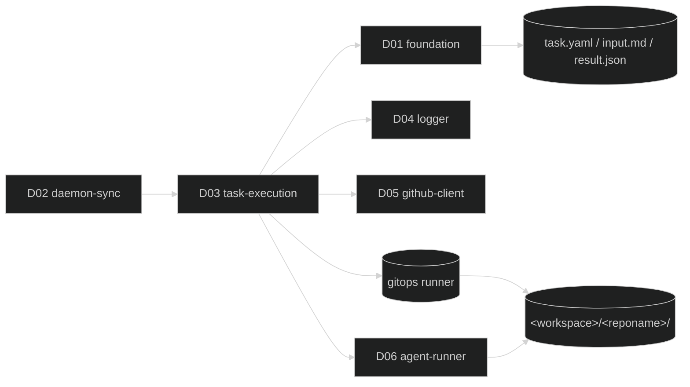

# D03 — task-execution

涵蓋需求：R06（任務執行流程）、R07（結果處理）、R08 呼叫端（狀態回報觸發時機）。

本模組是 D02 主迴圈挑中一個 `queued` 任務後的執行骨架：狀態切換 → 查 issue 全文 → 組 `input.md` → 準備 git branch → 呼叫 agent → 讀 `result.json` → 呼叫 feedback → 收斂 `task.yaml` 最終狀態。對外只暴露 `TaskExecutor` 介面（由 D02 §4.1 約定），內部協作 D01 / D04 / D05 / D06 與自帶的 gitops 適配層。

## 1. 模組架構與周邊模組關聯

task-execution 的責任邊界：接收一個 task、跑完一次完整執行流程、把任務的最終命運（`done` / `reporting` / `failed` / `deleted`）落到 `task.yaml`。本模組**不**涉及 daemon 生命週期（屬 D02）、**不**參與 sync 偵測迴圈（屬 D02 Syncer）、**不**決定任務挑選順序（屬 D02 主迴圈）。

- **依賴**
  - **D02 daemon-sync**：單向呼叫方；透過 `execution.TaskExecutor.Run(ctx, task)` 進入本模組。D02 只關心 Run 回傳是否為 daemon-level 錯誤（§2 B1）。
  - **D01 foundation**：`TaskStore`（所有 `task.yaml` 狀態變更的唯一入口，不可繞過直接寫檔）；`WorkspacePaths`（`input.md` / `output.jsonl` / `result.json` / `<workspace>/<reponame>/` 的路徑來源）；`Config`（`project.repo.branch` 作 git base、`agent.model` 傳給 D06、`assignee` / `task_policy.max_failures` 傳給 D05）。
  - **D04 logger**：`task.*` 事件唯一出口；`task.agent_*` 由 D06 發、`github.*` 由 D05 發，本模組不重複。
  - **D05 github-client**：消費 `source.FeedbackReporter`（D05 §4.3）與 `source.TaskContentFetcher`（本文件 §4.3 擁有介面、D05 實作）。
  - **D06 agent-runner**：消費 `agent.AgentExecutor`（D06 §4.2）。
  - **gitops.TaskBranchRunner**（本文件 §4.4 擁有介面）：實作由共用 gitops 套件提供；最小能力僅 `Fetch` / `CheckoutBranch`。
- **I/O 邊界**
  - 讀 / 寫 `<workspace>/.gogents/tasks/<id>/task.yaml`（透過 D01）
  - 寫 `<workspace>/.gogents/tasks/<id>/input.md`（本模組負責；覆寫）
  - 讀 `<workspace>/.gogents/tasks/<id>/result.json`（由 agent 寫，本模組只讀）
  - `<workspace>/<reponame>/`：agent 工作目錄與 git 指令執行目錄
  - **不觸碰** `output.jsonl`（由 D06 以 `O_TRUNC` 開檔）；**不觸碰** `state.yaml`（由 D02 管）



### 1.1 目前範圍邊界

本模組執行涵蓋 R06 + R07 + R08 呼叫端的完整流程，並非獨立可切分的最小版。下表列出本模組對相依在目前版本需要具備的能力——若發現相依尚未設計對應契約，回頭補相依的設計文件，不就地實作。

| 相依                                               | 目前需要                                                                                                                                                                                                                                                                                                                                                                              | 留存位置                                                                      |
| -------------------------------------------------- | ------------------------------------------------------------------------------------------------------------------------------------------------------------------------------------------------------------------------------------------------------------------------------------------------------------------------------------------------------------------------------------- | ----------------------------------------------------------------------------- |
| D01 foundation                                     | 全量：`TaskStore.Transition` 支援 `reporting` / `failed` / `done` / `deleted` 所有目標狀態；`TaskStore.UpdateFields` 供同狀態欄位更新（Case A R08 失敗時寫 `reporting_error`，避免 `reporting → reporting` 自我轉換）；`TaskPatch` 含 `Branch` / `FinishedAt` / `PrURL` / `FailureCount` / `CommentID` / `LastLabel` / `ReportingError`；`Task.execution` 含 `reporting_error` 子欄位 | D01 §3、§4、§5                                                                |
| D04 logger                                         | 全量                                                                                                                                                                                                                                                                                                                                                                                  | D04 §4                                                                        |
| D05 `TaskContentFetcher` 實作（GitHub Issue 版本） | 取得 issue body + comments；錯誤分類沿用 `ErrSourceNotFound` / `ErrSourceAuth` / `ErrSourceTransient`                                                                                                                                                                                                                                                                                 | 介面本文件 §4.3；實作由 D05 於 `github` 子包補 `NewGitHubIssueContentFetcher` |
| D05 `FeedbackReporter` 實作                        | 全量（`TaskCreated` 由 D02 Syncer 呼叫；本模組呼叫 `CodingSuccess` / `CodingFailed`）                                                                                                                                                                                                                                                                                                 | D05 §4.3、§5.5                                                                |
| D05 dispatcher                                     | 補一個 `NewTaskContentFetcherFromConfig`（依 `cfg.source.type` 選 concrete）                                                                                                                                                                                                                                                                                                          | D02 §4.4 factory 表新增一列                                                   |
| D06 `AgentExecutor` 實作                           | 全量（Gemini 或 Claude Code concrete 提供 `Run`）                                                                                                                                                                                                                                                                                                                                     | D06 §4.2、§4.3、§4.5                                                          |
| gitops runner                                      | `Fetch` / `CheckoutBranch` 兩個 method；不含 clone（clone 屬 D02 啟動期責任）                                                                                                                                                                                                                                                                                                         | 本文件 §4.4                                                                   |
| 啟動期組裝                                         | `execution.TaskExecutor` 實例由 CLI 入口（`cmd/gogents`）以 `execution.New(Deps{...})` 組裝後傳入 D02 `Deps.Executor`；其內部 deps（`ContentFetcher` / `FeedbackReporter` / `AgentExecutor` / `Git`）由 CLI 入口呼叫各模組 dispatcher 後填入。**D02 不認識** 這些內部欄位，其 `Deps` 結構維持 D02 §4.1 原樣                                                                           | 本文件 §4.2 Deps；D02 §4.1 不變                                               |

## 2. 行為契約

- **B1 Run 入口語義**：`Run(ctx, task)` 回傳 `error` **僅**於下列情況非 nil——(i) `ctx` 取消、(ii) `TaskStore` 回傳不可忽略的 IO 錯誤使狀態無法落地、(iii) 偵測到 daemon 級不變量破壞（例如 task 進入時 status 非 `queued`）。**任務級失敗**（git 失敗、agent 異常、result.json 缺失、R08 回失敗）一律透過更新 `task.yaml` 呈現，**回 nil**；D02 主迴圈不需分辨兩者。
- **B2 狀態轉換唯一入口**：所有 `task.yaml` 變更皆透過 `D01.TaskStore.Transition`；本模組不讀寫 `task.yaml` 檔案本體。
- **B3 執行步驟序列**：固定 6 步（§5.1），任一步失敗立即跳到收尾分支（§5.2 finalize），不繼續後續步驟；收尾分支負責狀態落地 + feedback 回報。
- **B4 input.md 組裝契約**
  - 單一檔案：`<task-dir>/input.md`；以 `O_WRONLY|O_CREATE|O_TRUNC`、mode `0644` 開啟
  - 由兩段組成：R06 §「區塊 1 Base Prompt」固定英文 + `\n---\n` 分隔 + R06 §「區塊 2 Task Content」原樣內容
  - Base Prompt 中 `<absolute-task-dir>` 以 `paths.TaskDir(id)` 的**絕對路徑**替入
  - Task Content 的 `<issue-url>` / `<issue-title>` / `<issue-author>` / `<issue-body>` / 每條 comment 皆**原樣**帶入（不翻譯、不改寫）
  - 寫入成功後才進下一步；失敗走任務級錯誤處理
- **B5 Git 分支準備契約**
  - 工作目錄固定為 `paths.Root() / <reponame>`；不接受呼叫端覆寫
  - 執行 `git fetch origin` 再 `git checkout -B task/<task-id> origin/<cfg.project.repo.branch>`
  - 兩指令任一失敗即視為 git 準備失敗；不重試（R10：任務級操作屬 D03 自身策略，目前不重試）
  - 成功後 `task.yaml.execution.branch` 在 B1→B3 的 Step 1 已設為 `task/<task-id>`；本步僅確認分支於真實 repo 已就位
- **B6 Agent 呼叫契約**
  - 唯一入口：`D06.AgentExecutor.Run(ctx, RunRequest{...})`
  - `WorkDir` / `InputPath` / `OutputPath` / `Model` 皆由本模組依 `paths` 與 `cfg` 填入；不透給呼叫端
  - agent exit code ≠ 0 **不代表** 任務失敗；成敗判定以 `result.json` 為準（R07 Case A–D）
  - `ErrAgentSpawn` / `ErrAgentIO` 視為任務級失敗；`ctx.Err()` 視為 daemon-level 取消（B1 第 i 項）
- **B7 結果判定契約**：以 R07 §「Coding 階段判定」四個 Case 為權威規則。result.json 不存在 / 解析失敗 / 必填欄位缺失 / `status` 非預期值 / `status=success` 但 `pr_url` 為空，皆視為 Case C（coding 失敗），`task.failed` 的 `reason` 欄位依來源明確標示類別。
- **B8 回報收斂契約**
  - `CodingSuccess`（Case A）：**先**以 `TaskStore.Transition(processing → reporting)` 把 `execution.pr_url` / `finished_at` 落到 `task.yaml`；**再**呼 `FeedbackReporter.Report`；依 `FeedbackOutcome.Result` 決定最終：`success` → `Transition(reporting → done)`，回填 `comment_id` / `last_label`；`failure` → 狀態維持 `reporting`，以 `TaskStore.UpdateFields` 寫入 `comment_id` / `last_label`（部分成功值）與 `execution.reporting_error`（**不**再呼 `Transition`，避免自我轉換；走 D01 §2 B6 同狀態欄位更新路徑）
  - `CodingFailed`（Case B / C / D）：先 `Transition(processing → failed)` 並 `failure_count` +1、設 `finished_at`；再呼 `FeedbackReporter.Report`（`Trigger=CodingFailed`，帶本次 `failure_count` 與 `cfg.TaskPolicy.MaxFailures`）；無論 R08 成敗皆**不**再改 task status（已是 `failed` 終點）
  - `TaskCreated` trigger **不由本模組呼叫**；屬 D02 Syncer 於新任務落地時觸發（D02 §2 B3 已規範）
- **B9 失敗計數規則**：`failure_count` 於 B7 判定為 coding 失敗（Case B / C）或前置步驟失敗（git / input / content fetch 非 NotFound）時 **+1**；`reporting` 轉入不增；`ctx` 取消不增（task 留 `processing`，由 D02 B1.7 重啟恢復重置為 `queued` 不增）。
- **B10 ctx 取消語義**：執行中 ctx 取消時，讓當前步驟自然收斂——Agent 階段由 `D06.AgentExecutor` 將子行程送 signal 後回 `ctx.Err()`，其他階段的外部呼叫（`ContentFetcher` / `FeedbackReporter`）應在 ctx 取消時立即返回。收到 ctx.Err() 後**不**繼續後續步驟、**不**改 task status、**不**寫 `task.canceled` 之外的任何事件；task 留 `processing`，由 D02 B1.7 於下次啟動重置為 `queued`。
- **B11 輸入不變量防護**：Run 入口若讀到 `task.Status != queued`，視為 B1 第 iii 項 daemon-level 異常，emit `task.input_invariant_violated` error 後回錯給 D02；不在本模組嘗試修正（避免與 sync 競態導致雙寫）。

## 3. 資料結構

### 3.1 執行上下文

進入 Run 時，D02 傳入的 `foundation.Task` 已含 `source` / `feedback` 子欄位；本模組**不**重新查一次 `task.yaml`。執行過程中會累積：

| 名稱          | 型別   | 來源                                                                           |
| ------------- | ------ | ------------------------------------------------------------------------------ |
| `taskDir`     | string | `paths.TaskDir(task.ID)`                                                       |
| `repoDir`     | string | `paths.Root() + "/" + reponame(cfg.Project.Repo.URL)`                          |
| `branch`      | string | `"task/" + task.ID`                                                            |
| `base`        | string | `"origin/" + cfg.Project.Repo.Branch`                                          |
| `issueNumber` | int    | 由 `task.ID` 剝 `github-` 前綴解析（目前版本；未來其他 source 需各自解析規則） |

### 3.2 input.md 模板（固定版本）

**區塊 1 Base Prompt**（英文、daemon 內嵌、不可覆寫）：

```text
You are a coding agent running inside a prepared workspace.

## Project Context
Read `AGENTS.md` at the repository root before starting. It describes
the project conventions, architecture, and constraints you must follow.

## Task Workflow
1. Implement the task described in the "Task Content" section below
   on the current git branch.
2. Commit with message format: `<type>: #<issue-number> <description>`.
   Allowed types: feat, fix, chore, docs, refactor, test.
3. Push the branch: `git push origin <current-branch>`.
4. Open a PR via `gh pr create`.
5. When finished (success or unrecoverable failure), write a result
   report to `<absolute-task-dir>/result.json` with fields:
   { "status": "success"|"failed", "pr_url": "...", "message": "..." }

If you cannot complete the task, still write result.json with
status=failed and a clear message explaining why.

The following "Task Content" section contains the original issue
as written by the reporter; it may be in any language. Treat its
language as-is, do not translate.

---
```

**區塊 2 Task Content**（動態組裝，每段原樣內容）：

```text
# Task Content

Source: <content.URL>
Issue Title: <content.Title>
Reporter: @<content.Author>

## Description
<content.Body>

## Comments
### @<c.Author> at <c.CreatedAt Asia/Taipei ISO8601>
<c.Body>

...（依 content.Comments 順序列出）
```

Comments 為空時省略 `## Comments` 整段。`<absolute-task-dir>` 於區塊 1 渲染時替入；渲染僅字串代換，**無**條件分支、**無**巢狀模板。

### 3.3 result.json schema（由 agent 寫、本模組讀）

與 R07 §「result.json 格式」一致。型別：

| 欄位      | 型別                        | 必填                    |
| --------- | --------------------------- | ----------------------- |
| `status`  | string `success` / `failed` | 是                      |
| `pr_url`  | string                      | `status=success` 時必填 |
| `message` | string                      | 是                      |

解析策略：UTF-8；未知欄位忽略；多餘空白允許；**不**接受 JSON5 / YAML。

### 3.4 TaskPatch 欄位用法

| 使用時機                                        | 寫入路徑                      | 設定欄位                                                  |
| ----------------------------------------------- | ----------------------------- | --------------------------------------------------------- |
| Step 1：queued → processing                     | Transition                    | `Branch` = `"task/" + id`、`StartedAt` = now(Asia/Taipei) |
| Step 6 Case A 第 1 次（processing → reporting） | Transition                    | `FinishedAt` = now、`PrURL` = result.pr_url               |
| Step 6 Case A 回填（reporting → done）          | Transition                    | `CommentID`、`LastLabel`                                  |
| Step 6 Case A R08 失敗（狀態維持 reporting）    | **UpdateFields**（D01 §2 B6） | `CommentID`、`LastLabel`（部分成功值）、`ReportingError`  |
| Step 6 Case B / C / D（→ failed）               | Transition                    | `FinishedAt`、`FailureCount`（= 原值 + 1）                |
| Content NotFound（→ deleted）                   | Transition                    | 無 patch（僅換狀態）                                      |
| ctx 取消                                        | —                             | 不下 patch；status 留 processing 由 D02 B1.7 啟動時重置   |

### 3.5 事件命名（發至 D04）

本模組 domain 採 `task.*`；`github.*` 由 D05 發、`task.agent_*` 由 D06 發，本模組不重複。

| 事件                            | level   | 何時                                                 | 關鍵 fields                                                               |
| ------------------------------- | ------- | ---------------------------------------------------- | ------------------------------------------------------------------------- |
| `task.started`                  | info    | Step 1 `queued → processing` 成功後                  | `task_id`, `branch`                                                       |
| `task.content_fetched`          | info    | Step 2 `ContentFetcher.Fetch` 成功                   | `task_id`, `comment_count`                                                |
| `task.content_fetch_failed`     | warning | Step 2 失敗且非 NotFound                             | `task_id`, `reason`（`auth` / `transient` / `unknown`）                   |
| `task.input_prepared`           | info    | Step 3 input.md 寫入完成                             | `task_id`, `bytes`                                                        |
| `task.input_write_failed`       | warning | Step 3 寫入失敗                                      | `task_id`, `reason`                                                       |
| `task.git_prepared`             | info    | Step 4 成功                                          | `task_id`, `branch`, `base`                                               |
| `task.git_failed`               | warning | Step 4 `fetch` 或 `checkout` 失敗                    | `task_id`, `command`, `stderr`（前 1 KiB）                                |
| `task.result_missing`           | warning | R07 Case C 且 result.json 不存在                     | `task_id`                                                                 |
| `task.result_parse_failed`      | warning | R07 Case C 且檔案存在但解析 / 驗證失敗               | `task_id`, `reason`                                                       |
| `task.completed`                | info    | R07 Case A + R08 成功 → done                         | `task_id`, `pr_url`, `duration_ms`                                        |
| `task.reporting_failed`         | warning | R07 Case A + R08 失敗 → reporting                    | `task_id`, `pr_url`, `reporting_error`                                    |
| `task.failed`                   | warning | R07 Case B / C 或 Step 1/2/3/4/5 前置失敗            | `task_id`, `reason`, `failure_count`, `agent_exit_code`（無 agent 時 -1） |
| `task.canceled`                 | warning | ctx 取消路徑                                         | `task_id`, `step`（`content` / `input` / `git` / `agent` / `feedback`）   |
| `task.input_invariant_violated` | error   | Run 入口 task.status ≠ queued                        | `task_id`, `got_status`                                                   |
| `task.deleted_during_exec`      | info    | Step 2 `ContentFetcher.Fetch` 回 `ErrSourceNotFound` | `task_id`                                                                 |

## 4. 關鍵介面

本節列出介面規格（method signature = 方法名稱 + 參數型別 + 回傳型別）與搭配型別。**不含實作**——子行程佈線、YAML patch 執行、retry、排程細節由實作者依 §2、§5、§6 落實。程式碼以 Go 語法呈現。

### 4.1 TaskExecutor（由 D02 §4.1 擁有；本節補語義）

```go
// TaskExecutor 由 D02 主迴圈每 tick 至多呼叫一次。
// Run 只在 daemon-level 異常時回 error；任務級失敗一律透過 task.yaml 呈現。
type TaskExecutor interface {
    Run(ctx context.Context, task foundation.Task) error
}
```

### 4.2 構造函式與相依接線

```go
package execution

type Deps struct {
    Store           foundation.TaskStore
    Paths           foundation.WorkspacePaths
    Config          foundation.Config
    Logger          logger.Logger
    ContentFetcher  source.TaskContentFetcher   // §4.3
    Git             gitops.TaskBranchRunner     // §4.4
    Agent           agent.AgentExecutor         // D06 §4.2
    Feedback        source.FeedbackReporter     // D05 §4.3
}

// New 組 TaskExecutor。所有 Deps 欄位非 nil；nil 視為程式錯誤，由呼叫端在 D02
// daemon 啟動組裝時先行保證。本模組不做 nil check（§2 B1 不變量）。
func New(deps Deps) TaskExecutor
```

### 4.3 TaskContentFetcher（本模組擁有介面）

```go
package source

// TaskContentFetcher 取得任務執行階段所需的完整內容（body + comments）。
// 與 TaskSource（D02 §4.3）分工：TaskSource 提供 sync 所需最小欄位，
// TaskContentFetcher 提供執行階段 input.md 組裝所需的長文字。
// 介面本身與來源類型解耦；concrete 實作（例：github）處理欄位映射與 CLI 呼叫。
type TaskContentFetcher interface {
    Fetch(ctx context.Context, taskID string) (TaskContent, error)
}

type TaskContent struct {
    URL      string
    Title    string
    Body     string       // issue 原始 body，不翻譯
    Author   string       // issue 作者 login / 識別碼
    Comments []Comment    // 依建立時間遞增
}

type Comment struct {
    Author    string
    CreatedAt time.Time   // RFC3339；呼叫端渲染時轉 Asia/Taipei
    Body      string
}

// Fetch 錯誤一律歸為 TaskSource 已定義的三種抽象錯誤（D02 §4.3），
// 以便與 sync 層統一分類：
//   - ErrSourceNotFound  → issue 已刪除；呼叫端轉 task deleted
//   - ErrSourceAuth      → 授權失效；呼叫端轉 task failed
//   - ErrSourceTransient → 網路 / 5xx / rate-limit；呼叫端轉 task failed
// 其他未分類錯誤由實作歸入 Transient（保守）。
```

對應 concrete 由 D05 `github` 子包提供 `NewGitHubIssueContentFetcher(cfg, lg)`；dispatcher `source.NewTaskContentFetcherFromConfig` 新增於 D02 §4.4 factory 表。

### 4.4 gitops.TaskBranchRunner（本模組擁有介面）

```go
package gitops

// TaskBranchRunner 封裝 R06 Step 4 所需的最小 git 指令集。
// 與 D02 自帶的 clone / fetch runner 可共用底層 exec 封裝；介面拆分
// 是為了在 D03 明確宣告「執行期只需要這兩個動作」，避免誤用 clone。
type TaskBranchRunner interface {
    // Fetch 相當於 `git fetch origin`；stderr / stdout 由實作截斷後填入錯誤訊息。
    Fetch(ctx context.Context, repoDir string) error

    // CheckoutBranch 相當於 `git checkout -B <branch> <base>`；
    // `-B` 為強制重置，若 branch 已存在則以 base 為基底重建（R06 Step 4 明訂）。
    CheckoutBranch(ctx context.Context, repoDir, branch, base string) error
}

var (
    ErrGitFetch    = errors.New("git fetch failed")
    ErrGitCheckout = errors.New("git checkout failed")
)
```

實作時以共用 `gitops` 套件提供；底層以 `exec.CommandContext` 執行 `git`，cwd 設為 `repoDir`、環境變數繼承 daemon。ctx 取消時於指令返回後傳回 `ctx.Err()`。

### 4.5 內部錯誤常數

```go
package execution

// 供 finalize 分流使用；不從 Run 回傳給 D02（B1）。
var (
    ErrResultMissing     = errors.New("result.json missing")
    ErrResultParse       = errors.New("result.json parse failed")
    ErrResultFieldMissing = errors.New("result.json required field missing")
    ErrResultBadStatus   = errors.New("result.json status not recognized")
    ErrGitPrepare        = errors.New("git prepare failed")   // wraps ErrGitFetch / ErrGitCheckout
    ErrInputWrite        = errors.New("input.md write failed")
    ErrContentFetch      = errors.New("task content fetch failed") // wraps ErrSource*（非 NotFound）
)
```

## 5. 程式資料流

### 5.1 Run 全流程

```
Run(ctx, task):
  0. invariant:
     if task.Status != queued:
        emit error "task.input_invariant_violated" { task_id, got_status }
        return fmt.Errorf("task %s entered executor with status=%s", task.ID, task.Status)

  1. transition queued → processing
     _, err := store.Transition(task.ID, processing, TaskPatch{
         StartedAt: &now, Branch: &("task/"+task.ID),
     })
     if err != nil:
        (IO 類)  return err                  // B1 第 ii 項
        (Illegal) emit error; return err     // B1 第 iii 項
     emit "task.started" { task_id, branch="task/"+task.ID }

  2. content, err := ContentFetcher.Fetch(ctx, task.ID)
     switch err:
       ErrSourceNotFound:
         store.Transition(task.ID, deleted, TaskPatch{})
         emit "task.deleted_during_exec" { task_id }
         return nil
       ErrSourceAuth / ErrSourceTransient / other (非 nil 且非 NotFound):
         emit "task.content_fetch_failed" { task_id, reason=classify(err) }
         finalize(task, failureOf("content_fetch", err), agentExit=-1, prURL="", msg=err.Error())
         return nil
       nil:
         emit "task.content_fetched" { task_id, comment_count=len(content.Comments) }

  3. bytes := renderInputMd(BASE_PROMPT, content, absTaskDir)
     err := os.WriteFile(paths.InputMd(task.ID), bytes, 0644)  // O_TRUNC 由 WriteFile 保證
     if err != nil:
        emit "task.input_write_failed" { task_id, reason=err }
        finalize(task, failureOf("input_write", err), -1, "", "input.md write failed: "+err)
        return nil
     emit "task.input_prepared" { task_id, bytes=len(bytes) }

  4. err = Git.Fetch(ctx, repoDir)
     if err == nil: err = Git.CheckoutBranch(ctx, repoDir, "task/"+task.ID, "origin/"+cfg.Project.Repo.Branch)
     if err != nil:
        if errors.Is(ctx.Err(), context.Canceled) or DeadlineExceeded:
           emit "task.canceled" { task_id, step="git" }; return ctx.Err()
        emit "task.git_failed" { task_id, command=?, stderr=truncate(err,1KB) }
        finalize(task, failureOf("git", err), -1, "", err.Error())
        return nil
     emit "task.git_prepared" { task_id, branch, base }

  5. res, err := Agent.Run(ctx, RunRequest{
         TaskID:     task.ID,
         WorkDir:    repoDir,
         InputPath:  paths.InputMd(task.ID),
         OutputPath: paths.OutputJsonl(task.ID),
         Model:      cfg.Agent.Model,
     })
     // D06 已發 task.agent_invoked / task.agent_exited
     if err != nil:
        if errors.Is(err, ctx.Err()):
           emit "task.canceled" { task_id, step="agent" }; return err
        // ErrAgentSpawn / ErrAgentIO
        finalize(task, failureOf("agent_spawn", err), -1, "", err.Error())
        return nil

  6. verdict := judge(paths.ResultJson(task.ID), res.ExitCode)
     finalize(task, verdict, res.ExitCode, verdict.prURL, verdict.message)
     return nil
```

### 5.2 judge（R07 Case A–C 權威規則）

```
judge(resultPath, agentExit) → Verdict:
  b, err := os.ReadFile(resultPath)
  if os.IsNotExist(err):      return Verdict{Case: Missing}
  if err != nil:              return Verdict{Case: Missing, Reason: err}   // 視同不存在

  var r struct { Status string; PrURL string `json:"pr_url"`; Message string }
  if json.Unmarshal(b, &r) != nil:
                              return Verdict{Case: ParseFailed, Reason: err}

  switch r.Status:
    case "success":
      if strings.TrimSpace(r.PrURL) == "":
        return Verdict{Case: Invalid, Reason: "status=success but pr_url missing"}
      return Verdict{Case: CodingSuccess, PrURL: r.PrURL, Message: r.Message}
    case "failed":
      return Verdict{Case: CodingFailed, Message: r.Message}
    case "":
      return Verdict{Case: Invalid, Reason: "status field missing"}
    default:
      return Verdict{Case: Invalid, Reason: "unexpected status: "+r.Status}
```

### 5.3 finalize（依 Verdict 收斂）

```
finalize(task, v, agentExit, prURL, msg):
  switch v.Case:

  case CodingSuccess:
    // B8：先 Transition processing → reporting，再呼 R08
    store.Transition(task.ID, reporting, TaskPatch{
        FinishedAt: &now, PrURL: &prURL,
    })
    fout := Feedback.Report(ctx, FeedbackInput{
        TaskID: task.ID, IssueNumber: parseIssueNumber(task.ID),
        Trigger:    TriggerCodingSuccess,
        PrURL:      prURL,
        Message:    msg,
        CommentID:  task.Feedback.CommentID,
        Assignee:   cfg.Assignee.GithubUsername,
    })
    if fout.Result == FeedbackSuccess:
        store.Transition(task.ID, done, TaskPatch{
            CommentID: &fout.CommentID, LastLabel: &fout.LastLabel,
        })
        emit "task.completed" info { task_id, pr_url=prURL, duration_ms=since(task.Execution.StartedAt) }
    else:
        // 狀態維持 reporting；以 UpdateFields 寫入部分成功資料 + reporting_error
        // （不走 Transition，避免 reporting → reporting 自我轉換被 D01 state machine 擋下）
        store.UpdateFields(task.ID, TaskPatch{
            CommentID: &fout.CommentID, LastLabel: &fout.LastLabel,
            ReportingError: &fout.Error,
        })
        emit "task.reporting_failed" warning {
            task_id, pr_url=prURL, reporting_error=fout.Error,
        }

  case CodingFailed / Missing / ParseFailed / Invalid:
    reason := reasonString(v)            // 見 §3.5 task.failed 的 reason 類別
    nextCount := task.Execution.FailureCount + 1
    store.Transition(task.ID, failed, TaskPatch{
        FinishedAt: &now, FailureCount: &nextCount,
    })
    // 先發本地事件
    switch v.Case:
      case Missing:     emit "task.result_missing" warning { task_id }
      case ParseFailed: emit "task.result_parse_failed" warning { task_id, reason=v.Reason }
      case Invalid:     emit "task.result_parse_failed" warning { task_id, reason=v.Reason }
    emit "task.failed" warning {
        task_id, reason, failure_count=nextCount,
        agent_exit_code=agentExit,
    }
    // 呼叫 R08 通知失敗；成敗皆不再改 status（B8）
    _ = Feedback.Report(ctx, FeedbackInput{
        TaskID: task.ID, IssueNumber: parseIssueNumber(task.ID),
        Trigger:      TriggerCodingFailed,
        Message:      reason,
        FailureCount: nextCount,
        MaxFailures:  cfg.TaskPolicy.MaxFailures,
        CommentID:    task.Feedback.CommentID,
        Assignee:     cfg.Assignee.GithubUsername,
    })
    // fout.Result == Failure 時 D05 已發 github.cli_failed；本模組不補
```

### 5.4 前置步驟失敗（Step 2 auth/transient、Step 3、Step 4、Step 5 spawn）

走同一 `finalize` 分支（`CodingFailed` 路徑）——將 `v` 偽造為 `{Case: CodingFailed, Message: reason}`，`agentExit` 視情境為 `-1`（未啟動 agent）或 agent 實際 exit。`reason` 字串格式：

| 來源                                  | reason 字串                                   |
| ------------------------------------- | --------------------------------------------- |
| Step 2 非 NotFound                    | `content_fetch: <auth / transient / unknown>` |
| Step 3 寫入失敗                       | `input_write: <errno>`                        |
| Step 4 Fetch 失敗                     | `git_fetch: <stderr 前 512B>`                 |
| Step 4 CheckoutBranch 失敗            | `git_checkout: <stderr 前 512B>`              |
| Step 5 `ErrAgentSpawn` / `ErrAgentIO` | `agent_spawn: <reason>`                       |
| judge Missing                         | `result.json missing`                         |
| judge ParseFailed                     | `result.json parse failed: <err>`             |
| judge Invalid                         | R07 §Case C 指定字串之一（依 `v.Reason`）     |

## 6. 錯誤處理

原則：**daemon-level** 錯誤回給 D02（Run 回 error）；**任務級** 錯誤全部落地 `task.yaml` 並回 nil。本模組**不**重試任何外部操作——`ContentFetcher` / `AgentExecutor` / `FeedbackReporter` / gitops 內部各自負責重試（R10）；本模組看到錯誤即視為「已經重試耗盡」，直接收斂任務狀態。

| 情境                                                | 分類               | 事件                                                           | 處理                                                                                                                                 |
| --------------------------------------------------- | ------------------ | -------------------------------------------------------------- | ------------------------------------------------------------------------------------------------------------------------------------ |
| Run 入口 `task.Status != queued`                    | 程式錯誤           | `task.input_invariant_violated` error                          | 回 Run error 給 D02；D02 §6.2 防禦性分支記 error、清 current_task、下輪繼續                                                          |
| Step 1 `Transition` 回 `ErrTaskIO`（磁碟滿 / 權限） | 暫時               | 由 D01 發                                                      | 回 Run error；D02 同上處理；**不**改 `failure_count`（還沒進主流程）                                                                 |
| Step 1 回 `ErrIllegalTransition`                    | 程式錯誤           | 由 D01 發                                                      | 回 Run error；D02 同上                                                                                                               |
| Step 2 `ErrSourceNotFound`                          | 明確               | `task.deleted_during_exec` info                                | `→ deleted`；Run 回 nil；`failure_count` 不增                                                                                        |
| Step 2 `ErrSourceAuth`                              | 永久（runtime）    | `task.content_fetch_failed` warning + `task.failed` warning    | `→ failed`、`failure_count` +1；呼 `FeedbackReporter.Report`                                                                         |
| Step 2 `ErrSourceTransient` / 其他                  | 暫時               | 同上                                                           | 同上；下次 sync 若 `failure_count < max_failures` 且 issue 仍 open，issue 重加 label / reopen 才會重排（R05）                        |
| Step 3 寫檔失敗（磁碟滿 / 權限）                    | 暫時               | `task.input_write_failed` + `task.failed` warning              | `→ failed` +1；R08 通知失敗                                                                                                          |
| Step 4 `Fetch` / `CheckoutBranch` 失敗              | 任務級（可能暫時） | `task.git_failed` + `task.failed` warning                      | `→ failed` +1；R08 通知失敗                                                                                                          |
| Step 5 `ErrAgentSpawn` / `ErrAgentIO`               | 程式 / 環境錯誤    | `agent.spawn_failed`（D06 發） + `task.failed` warning         | `→ failed` +1；R08 通知失敗                                                                                                          |
| Step 5 agent exit ≠ 0                               | **非** 錯誤路徑    | `task.agent_exited` warning（D06 發）                          | 繼續 judge；以 `result.json` 為主判定                                                                                                |
| Step 6 judge Missing                                | R07 Case C         | `task.result_missing` + `task.failed`                          | `→ failed` +1；R08 通知失敗                                                                                                          |
| Step 6 judge ParseFailed / Invalid                  | R07 Case C         | `task.result_parse_failed` + `task.failed`                     | 同上                                                                                                                                 |
| Step 6 judge CodingFailed                           | R07 Case B         | `task.failed`                                                  | 同上                                                                                                                                 |
| Step 6 judge CodingSuccess + R08 `FeedbackSuccess`  | 正常路徑           | `task.completed` info                                          | `Transition → done`，回填 `comment_id` / `last_label`                                                                                |
| Step 6 judge CodingSuccess + R08 `FeedbackFailure`  | 部分成功           | `task.reporting_failed` warning                                | 狀態維持 `reporting`；以 `UpdateFields` 寫 `comment_id` / `last_label` / `execution.reporting_error`；`failure_count` **不**增（B9） |
| Step 6 CodingFailed 路徑 + R08 `FeedbackFailure`    | 已 failed 不翻轉   | D05 發 `github.cli_failed`                                     | 不再改 status（B8）                                                                                                                  |
| ctx 取消（任何步驟）                                | 暫時（非錯誤）     | `task.canceled` warning                                        | Run 回 `ctx.Err()`；task 留 `processing`；D02 B1.7 重啟時重置為 `queued`，`failure_count` 不增（R07 §與 failure_count 的互動）       |
| `FeedbackReporter.Report` panic                     | 防禦性             | 本模組 recover 後發 `task.failed` 並補 reason=`feedback_panic` | 不崩 daemon；不改已落地的 status（已是 reporting / failed）                                                                          |
| `AgentExecutor.Run` panic                           | 防禦性             | 同上                                                           | 同上                                                                                                                                 |

**邊界**

- 本模組**不自行重試**：`ContentFetcher` / `FeedbackReporter` / gitops 內部套 R10；本模組收錯即認輸。
- `failure_count` 的 `+1` 於每個任務級失敗分支**僅一次**；若實作誤在多處 +1 會偏離 R07 §「與 failure_count 的互動」。驗收腳本於 §7.4 以實測驗證。
- **Case A 第 1 次 Transition（processing → reporting）寫 task.yaml 失敗**：回 Run error（B1 第 ii 項）；D02 防禦性分支接住；task 仍為 `processing` 但 agent 已真的執行完、PR 已開立——此不變量破壞屬罕見 IO 故障。daemon 不重啟時 task 不會自行恢復；下次 daemon 重啟時 D02 B1.7 將其重置為 `queued`，由下一輪重跑（覆蓋同分支、覆蓋 input.md、agent 可能再開一次 PR——目前版本接受此重複代價，待 Stage 4 觀察）。
- **Case A R08 失敗後 UpdateFields 寫 task.yaml 失敗**：回 Run error（B1 第 ii 項）；task 已在 `reporting` 且 `pr_url` / `finished_at` 已落地（第 1 次 Transition 成功），僅 `comment_id` / `last_label` / `reporting_error` 未落地；GitHub 實際狀態與 task.yaml 不完全同步。daemon 不退出但 current_task 由 D02 防禦性分支清空；task 留在 `reporting` 不會自動重試 R08（無 `reporting → reporting` 重試路徑），需人工觀察 `error.jsonl` 介入。

## 7. 驗收方式

本模組屬**階段可執行產出**（是端到端驗證的最後一棒）。驗收採真實命令：真實 GitHub repo（已 `gh auth login`）、真實 `gemini` 或 `claude` CLI、真實 `git`。所有觀察點皆為：`~/.gogents/logs/<hash>/daemon.jsonl` / `error.jsonl` 事件、`.gogents/tasks/<id>/task.yaml`、`.gogents/tasks/<id>/input.md` / `result.json`、實際 GitHub repo 上的 PR / comment / label、以及 `<workspace>/<reponame>/` 的 git branch 狀態。

### 7.1 前置

- `runtime.yaml` 合法：`source.type: github_issue`、`source.filter.label: gogents`、`source.sync_interval: 10s`（加速觀察）、`agent.type` 為 `gemini` 或 `claude`、`agent.model` 為有效模型、`task_policy.max_failures: 2`、`assignee.github_username: <測試帳號>`、`project.repo.url` / `project.repo.branch` 指向測試 repo
- Workspace 已完成 D02 驗收（`gogents start` 能起能停）
- 測試 repo 中尚未存在 `gogents:*` 系列 label（用以驗 D05 §2 B8 自動建立）
- Agent 能真實開 PR（測試帳號具備 repo push 權限）

### 7.2 正常路徑

| 步驟 | 動作                                                                             | 觀察點                                                                                                                                                                                                                                          |
| ---- | -------------------------------------------------------------------------------- | ----------------------------------------------------------------------------------------------------------------------------------------------------------------------------------------------------------------------------------------------- |
| A    | `gogents start --workspace $WS &`                                                | D02 驗收範圍事件（`daemon.started` 等）                                                                                                                                                                                                         |
| B    | 對測試 repo 開一個簡單 issue（例：`新增 README 一行文字`）並加上 `gogents` label | 下一輪 sync：`sync.task_created` + `github.comment_created` + `github.label_changed {to: gogents:queued}`（後兩者由 D02 Syncer + D05 產生；確認 Syncer 已串起 TaskCreated trigger）                                                             |
| C    | 等主迴圈挑到該任務並開始執行                                                     | 依序出現：`task.started` → `task.content_fetched` → `task.input_prepared` → `task.git_prepared` → `task.agent_invoked`（D06） → agent 跑完 → `task.agent_exited` → `task.completed`；同時 `<workspace>/<reponame>/` 出現 `task/github-<N>` 分支 |
| D    | 於 GitHub 對應 issue 頁面觀察                                                    | 單則 comment 內容符合 R08 §「coding_success」模板、含 `@<assignee>`；label 切換為 `gogents:done`；PR 已開立且 `result.json` 中的 pr_url 與 GitHub 實際 URL 一致                                                                                 |
| E    | `cat <WS>/.gogents/tasks/github-<N>/task.yaml`                                   | `status: done`、`execution.finished_at` 非空、`execution.pr_url` 非空、`feedback.comment_id` 與 `feedback.last_label=gogents:done` 已回填、`failure_count: 0`                                                                                   |

**通過條件**：`task.completed` 出現一次；`task.failed` / `task.reporting_failed` 不出現；GitHub PR 頁面可直接點擊開啟；task.yaml 最終狀態為 `done`。

### 7.3 錯誤路徑（逐一驗）

| 破壞                                                                                   | 預期結果                                                                                                                                                                                                                                                                                                                      |
| -------------------------------------------------------------------------------------- | ----------------------------------------------------------------------------------------------------------------------------------------------------------------------------------------------------------------------------------------------------------------------------------------------------------------------------- |
| 開 issue 後立即刪除 issue（在 agent 開始前）                                           | 下輪 sync 或本次執行 Step 2：若在 sync 階段偵測→ `sync.task_deleted`；若在執行階段偵測 → `task.deleted_during_exec` + `task.yaml.status=deleted`；兩者皆**不**增 `failure_count`                                                                                                                                              |
| 讓 agent 故意不寫 `result.json`（例：於 input.md 注入「請直接 exit 1」再開一個 issue） | agent exit ≠ 0 後 `task.result_missing` warning + `task.failed` warning；`failure_count: 1`；GitHub 出現 `coding_failed_未達上限` 模板 comment + `gogents:failed` label                                                                                                                                                       |
| 讓 agent 寫一個 `status: success` 但 `pr_url` 缺失的 result.json                       | `task.result_parse_failed` warning `{reason: "status=success but pr_url missing"}` + `task.failed`                                                                                                                                                                                                                            |
| 讓 `git checkout -B` 失敗（例：工作目錄下事先留下 untracked 同名檔案阻擋）             | `task.git_failed` + `task.failed`；`failure_count: 1`；GitHub 出現 failed comment                                                                                                                                                                                                                                             |
| 刪掉 `<workspace>/<reponame>/.git`（模擬 repo 被破壞）                                 | `task.git_failed`（`git fetch` 失敗） + `task.failed`                                                                                                                                                                                                                                                                         |
| `gh auth logout` 後重新開 issue 並啟動執行                                             | D02 啟動階段即被 Preflight 擋下；若 daemon 已在跑則 `task.content_fetch_failed {reason=auth}` + `task.failed`；驗 R08 通知亦會在 `ErrSourceAuth` 下失敗                                                                                                                                                                       |
| `FeedbackReporter` 部分失敗（撤銷測試帳號對 repo label 管理權限，保留 comment 權限）   | coding 成功後：`github.comment_updated` info + `github.cli_failed {classification=transient/auth}`（D05 發）；`task.updated`（D01 發；fields 含 `comment_id` / `last_label` / `reporting_error`）+ `task.reporting_failed` warning；`task.yaml.status=reporting`、`execution.reporting_error` 非空；`failure_count` **不** 增 |
| 連續失敗直到 `failure_count == max_failures`                                           | 每次失敗 `failure_count` +1；達上限後 GitHub comment 切為 `coding_failed_達上限` 模板；`sync.failure_lock_reached` 於下次 sync 首次偵測時發出（D02）                                                                                                                                                                          |
| Agent 執行中 `kill -TERM $(daemon PID)`                                                | `task.agent_exited {signaled=true}` + `task.canceled {step=agent}`；daemon 正常退出；task 留 `processing`；再次 `gogents start` → D02 B1.7 發 `daemon.restart_reset`、`task.yaml.status=queued`、`failure_count` 不變；主迴圈重跑該 task 可成功                                                                               |

### 7.4 `failure_count` 規則驗證清單

驗證「每次任務級失敗恰 +1 一次」：

1. 以「agent 直接 exit 1 不寫 result.json」重跑同一 issue 三輪：`failure_count` 應依序為 1 → 2 → 2（第三輪達上限被 R05 停排）
2. 連續一次 coding 成功、一次 R08 失敗：`failure_count` 應保持 0（reporting 不增）
3. ctx 取消三次後重啟：`failure_count` 應保持 0（B9）

### 7.5 可觀測訊號彙整

`daemon.jsonl` 於一次完整成功執行應可依序 grep：

```
task.started
task.content_fetched
task.input_prepared
task.git_prepared
task.agent_invoked          (D06 發)
task.agent_exited           (D06 發)
github.comment_updated      (D05 發；coding_success 更新既有 comment)
github.label_changed        (D05 發；→ gogents:done)
task.completed
```

一次完整失敗執行應出現：`task.failed`（reason 依來源而異）、`github.comment_updated`（coding_failed 模板）、`github.label_changed {to: gogents:failed}`；達上限時追加 `sync.failure_lock_reached`（下輪 sync 發）。

`error.jsonl` 於錯誤路徑破壞時應含：`task.input_invariant_violated`（極罕見）、`agent.spawn_failed`（D06）、`github.cli_failed`（D05，耗盡時為 error level）。

### 7.6 通過條件

- §7.2 正常路徑端到端成功；`task.yaml.status=done` 且 GitHub PR / comment / label 與模板一致
- §7.3 每個破壞情境觀察到對應事件與 `task.yaml` 終態
- §7.4 `failure_count` 三項規則皆符合
- 整個驗收過程中 `daemon.jsonl` JSON 合法（`jq -c . daemon.jsonl > /dev/null` 無錯）；未出現非 §3.5 登記的 `task.*` 事件名稱（視為實作漂移）；未出現「半寫」`task.yaml`（D01 原子寫入保證）
