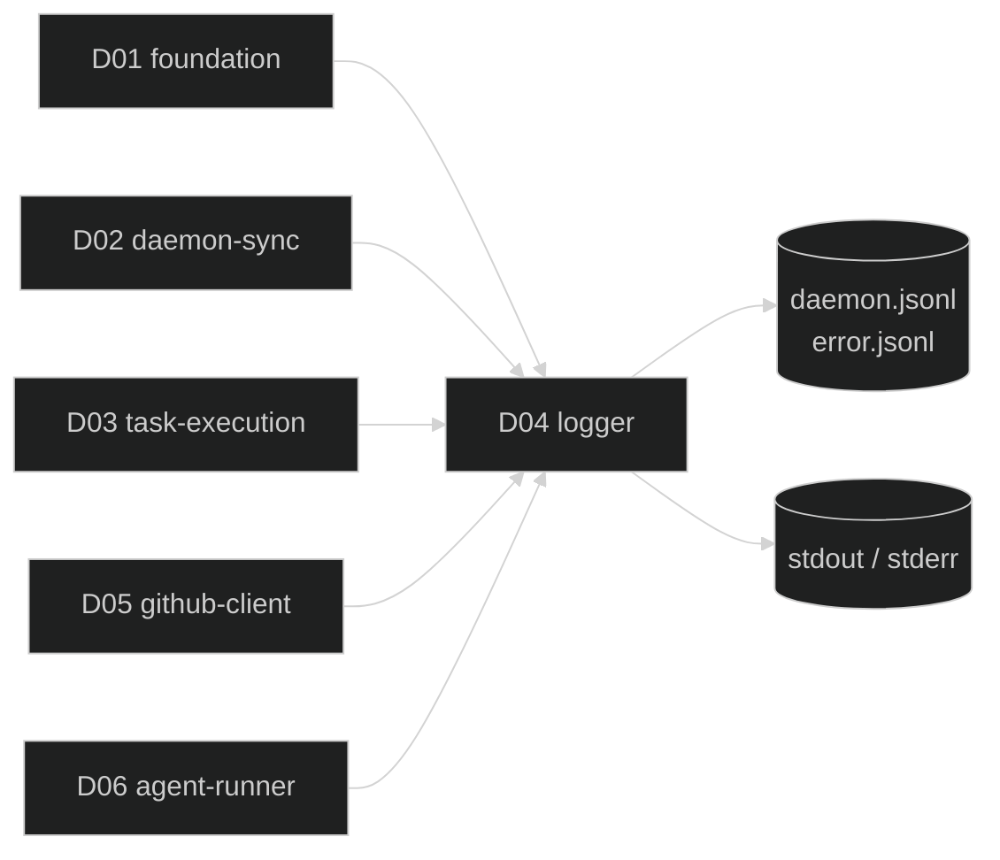

# D04 — logger

涵蓋需求：R09（日誌規範）。
本模組提供 JSONL 雙檔日誌輸出的被動 library，不含常駐行為；為所有其他模組發出事件的唯一出口。

## 1. 模組架構與周邊模組關聯

logger 是系統橫切共用層，責任僅有一件：把結構化事件落到正確的 sinks。介面固定、欄位 schema 早期釘死，讓 D01 / D02 / D03 / D05 / D06 在設計階段即可以明確事件命名呼叫，避免日誌格式隨模組擴增而漂移。

- **被依賴者**：D01 / D02 / D03 / D05 / D06 全部；凡需要發事件的模組皆透過本模組。
- **依賴者**：無。本模組不依賴任何其他 gogents 模組，避免循環依賴。
- **I/O 邊界**：`~/.gogents/logs/<hash>/daemon.jsonl`、`~/.gogents/logs/<hash>/error.jsonl`、stdout、stderr；路徑由 D01 `WorkspacePaths` 提供（本模組僅接收字串路徑，不自行解析）。
- **不負責**：rotation、採樣、限流、遠端轉發、結構化查詢——皆明列於 R09「不做的部分」。



## 2. 行為契約

- **B1 Dual-sink 分流**：每筆事件一律寫 `daemon.jsonl` 與 stdout；若 `level = error`，同一筆再複寫到 `error.jsonl` 與 stderr。四個 sinks 接收的 JSON 內容**完全相同**（同一 bytes）。
- **B2 JSONL 格式**：每筆事件序列化為單行 JSON，以 `\n` 結尾；欄位順序固定、未使用欄位省略（`task_id` / `fields`）。
- **B3 欄位 schema**：固定 6 欄位（見 §3），呼叫端不可新增頂層欄位；結構化補充資訊一律放 `fields`。
- **B4 順序與互斥**：單 logger 實例內所有寫入經由單一 mutex（或單 writer goroutine）序列化，保證行不交錯；不同 workspace 對應不同 logger 實例互不影響。
- **B5 永不打斷上游**：寫檔失敗時降級 stderr 一條 fallback，**不回傳 error、不重試、不 panic**。呼叫端無需處理 logger 錯誤。
- **B6 時區**：所有 `ts` 採 Asia/Taipei（UTC+8），ISO 8601 毫秒精度；由 logger 內部統一產生，呼叫端不提供時間戳。
- **B7 生命週期**：`Open` 打開 append-only file handle；`Close` flush 並釋放；關閉後呼叫 `Log` 為 no-op（避免關閉順序競態造成 panic）。

## 3. 資料結構

**LogEntry（對應 JSONL 單行）**

```json
{
  "ts": "2026-04-07T18:05:00.123+08:00",
  "level": "info",
  "event": "sync.completed",
  "task_id": "github-42",
  "message": "sync completed: 2 new, 1 updated, 0 deleted",
  "fields": { "new_count": 2, "updated_count": 1, "deleted_count": 0, "duration_ms": 1234 }
}
```

| 欄位 | 型別 | 必填 | 說明 |
|---|---|---|---|
| `ts` | string | 是 | ISO 8601 + `+08:00`，毫秒精度；由 logger 內部產生 |
| `level` | enum | 是 | `info` / `warning` / `error` |
| `event` | string | 是 | `<domain>.<action>` 格式 |
| `task_id` | string | 否 | 與任務相關事件必填；daemon / config / workspace 層級可省略 |
| `message` | string | 是 | 人可讀的一行訊息 |
| `fields` | object | 否 | 結構化補充；型別由事件決定 |

**Level enum**

| Level | 使用時機 |
|---|---|
| `info` | 正常運作事件（sync 完成、任務完成、daemon 啟動） |
| `warning` | 非預期但 daemon 可繼續（重啟恢復、達失敗門檻、單 issue 處理失敗、task 轉 reporting） |
| `error` | daemon 無法完成關鍵動作（啟動失敗、整體 sync 失敗、檔案寫入失敗） |

**事件命名規範**

`<domain>.<action>`，domain 對應模組責任域。事件清單採登記制：每份設計文件 §3 / §7 明列本模組發出的事件，總覽散落於各設計，不在 D04 集中維護（避免成為雙份維護來源）。

| Domain | 來源模組 | 代表事件 |
|---|---|---|
| `daemon.*` | D02 | `daemon.start` / `daemon.shutdown` / `daemon.recover_processing` |
| `sync.*` | D02 | `sync.started` / `sync.completed` / `sync.task_created` |
| `task.*` | D01 / D03 | `task.transition` / `task.started` / `task.completed` / `task.failed` |
| `github.*` | D05 | `github.comment_created` / `github.label_changed` / `github.cli_failed` |
| `config.*` | D01 | `config.loaded` / `config.preflight_ok` / `config.preflight_failed` |
| `workspace.*` | D01 | `workspace.initialized` |
| `state.*` | D02 | `state.write_failed` |

## 4. 關鍵介面

本節僅列介面規格（interface specification）：方法簽章（method signature = 方法名稱 + 參數型別 + 回傳型別）與搭配型別。**不含實作**——mutex 佈線、writer goroutine、緩衝策略由實作者依 §2、§5、§6 自行落實。程式碼以 Go 語法呈現。

```go
// Level 採 string 而非 int，便於直接序列化與 grep
type Level string

const (
    LevelInfo    Level = "info"
    LevelWarning Level = "warning"
    LevelError   Level = "error"
)

// Logger 是所有模組唯一對外事件出口
type Logger interface {
    // 核心：呼叫端自行指定 level / event / task_id / message / fields
    // task_id 可為空字串，表示 daemon 層級事件
    // fields 可為 nil；內容應可 JSON marshal
    Log(level Level, event, taskID, message string, fields map[string]any)

    // 便利方法（語法糖；實作上轉呼叫 Log）
    Info(event, taskID, message string, fields map[string]any)
    Warning(event, taskID, message string, fields map[string]any)
    Error(event, taskID, message string, fields map[string]any)

    // 生命週期
    Close() error
}

// 建構 logger（由 D02 啟動時呼叫；路徑由 D01 WorkspacePaths 提供）
// 同時打開 daemon.jsonl 與 error.jsonl（append-only、O_CREATE）
// 若檔案不存在則建立；目錄須由呼叫端（D01.Init）先備妥
func Open(daemonPath, errorPath string) (Logger, error)
```

**設計理由**

- **無 context 參數**：logger 不做 cancel / timeout；寫入即時，不存在長時間阻塞。
- **無 error 回傳（Log 除外）**：B5 保證永不打斷上游；開發者不必為每次 Log 檢查錯誤。
- **`Open` 回傳 error**：開檔失敗代表日誌目錄或權限有問題，屬啟動期可修復錯誤，交由 D02 啟動序列決定是否中止。

## 5. 程式資料流

**初始化（由 D02 啟動序列觸發）**

```
D02.Startup()
  paths  := D01.NewWorkspacePaths(...)
  paths.Init()                          ── 確保 logs 目錄存在
  logger := D04.Open(paths.DaemonLog(), paths.ErrorLog())
        ├─ os.OpenFile(daemon.jsonl, APPEND|CREATE, 0644)
        └─ os.OpenFile(error.jsonl,  APPEND|CREATE, 0644)
  → 交由 D02 持有並注入其他模組
```

**寫入（任一模組呼叫 Log）**

```
caller → logger.Log(level, event, task_id, msg, fields)
  ├─ entry := LogEntry{
  │      ts:       time.Now().In(AsiaTaipei).Format(ISO8601_MS),
  │      level, event, task_id, message: msg, fields,
  │  }
  ├─ bytes := json.Marshal(entry) + "\n"
  ├─ <acquire mutex>
  ├─ write(daemonFile, bytes) ;  write(os.Stdout, bytes)
  ├─ if level == error:
  │      write(errorFile, bytes) ;  write(os.Stderr, bytes)
  └─ <release mutex>

  // 任一 write 失敗 → fmt.Fprintln(os.Stderr, "[logger] write failed: <err>") ；不重試、不回傳
```

**關閉（由 D02 shutdown 觸發）**

```
D02.shutdown()
  logger.Close()
        ├─ mark closed flag（後續 Log 變 no-op）
        ├─ daemonFile.Sync() + daemonFile.Close()
        └─ errorFile.Sync()  + errorFile.Close()
```

## 6. 錯誤處理

本模組的設計原則是「失敗不影響上游」：任何寫入錯誤只走 stderr fallback，呼叫端完全無感。

| 情境 | 分類 | 處理動作 |
|---|---|---|
| `Open` 時目錄不存在 / 無寫權限 | 永久（啟動期） | 回 `ErrLogOpen`；D02 啟動序列中止並 exit（此為唯一會向上回錯的情境） |
| `Log` 期間 daemon.jsonl 寫入失敗（磁碟滿 / 檔案被外部刪除） | 暫時 | stderr 印 fallback 一行；不重試、不 panic、不影響 stdout 輸出 |
| `Log` 期間 error.jsonl 寫入失敗 | 暫時 | 同上；stderr 正常輸出維持 |
| `json.Marshal` 失敗（fields 含不可序列化值） | 程式錯誤 | stderr 印 fallback 含 event 名稱，方便追查呼叫端；entry 丟棄 |
| 呼叫 `Log` 時間點晚於 `Close` | 程式錯誤 | no-op；不 panic。代表模組關閉順序有 bug，但不應讓 daemon 崩潰 |
| `fields` 含非預期巨型物件 | 視為呼叫端責任 | 不截斷、不檢查大小；呼叫端自律 |

**邊界原則**

- **不重試**：本模組不知道失敗是否為暫時性；重試由呼叫端上下文決定。實際上呼叫端也不會為 Log 加重試（B5 已保證無 error 回傳）。
- **不快取事件**：落盤失敗的事件**不進入記憶體 buffer**，直接丟棄並 stderr fallback。避免記憶體洩漏或下游恢復後突然湧出大量 backfill 干擾時間序。
- **不 panic**：即使 marshal 失敗、writer 已關閉，一律走 fallback 分支。

## 7. 驗收方式

本模組為 **基礎建設 library**，對外僅暴露 `Logger` 介面與 `Open` 建構函式，**無獨立可執行的產出**。D04 的正確性由 **D02 / D03 的端到端驗收覆蓋**：當上游驗收腳本跑通並能在 `daemon.jsonl` / `error.jsonl` 觀察到預期事件時，即表示 D04 三個 sink 行為、schema、時區、互斥保護皆運作正常。

### 7.1 驗收責任對應表

| D04 契約 / 行為 | 由哪個模組的驗收覆蓋 | 預期觀察點 |
|---|---|---|
| B1 Dual-sink 分流 | D02 端到端驗收 | 正常 sync 事件在 `daemon.jsonl` 與 stdout 出現；破壞 runtime.yaml 造成的 error 事件同時出現於 `daemon.jsonl` / `error.jsonl` / stderr |
| B2 JSONL 格式 | D02 / D03 | `jq . ~/.gogents/logs/<hash>/daemon.jsonl` 可完整解析，無半行 / 非 JSON 列 |
| B3 欄位 schema | 全模組 | 所有事件皆有 `ts` / `level` / `event` / `message`；`task_id` 僅 task 相關事件出現 |
| B4 互斥順序 | D02 / D03 | 並發觸發 sync 與 execution（Stage 3 驗收）時日誌行不交錯；每行均為完整 JSON |
| B5 永不打斷上游 | D04 自身不可獨立驗證 | 若故意將 `~/.gogents/logs/<hash>/` 改為唯讀，daemon 主迴圈仍繼續運行（sync / execution 不中斷），stderr 可見 `[logger] write failed` fallback |
| B6 時區 | D02 | `ts` 結尾必為 `+08:00`；毫秒三位數字 |

### 7.2 可觀測訊號（供上游驗收腳本 grep）

D04 自身不發事件，僅轉發呼叫端事件。上游驗收腳本透過以下 pattern 驗證 logger 正常：

| 驗證目標 | 指令範例 |
|---|---|
| 雙檔一致性 | `diff <(jq -c 'select(.level=="error")' daemon.jsonl) error.jsonl` 應為空 |
| JSON 合法性 | `jq -c . daemon.jsonl > /dev/null` 無錯 |
| 時區正確 | `jq -r .ts daemon.jsonl \| grep -vE '\+08:00$'` 應為空 |
| stdout / stderr 對應 | daemon 啟動時 `gogents start ... 2>err 1>out`，比對 out 與 daemon.jsonl、err 與 error.jsonl 的 event 集合一致 |

### 7.3 通過條件

- D02 的 Stage 2 端到端驗收腳本通過時，視為 D04 通過。
- 正常路徑：`daemon.jsonl` 至少含 `daemon.start`、`config.loaded`、`workspace.initialized`、`sync.started`、`sync.completed`。
- 錯誤路徑（刻意破壞 runtime.yaml 或撤銷 gh 授權）：`error.jsonl` 含對應 `config.preflight_failed` / `sync.failed`，且內容與 `daemon.jsonl` 中同 `ts` 行完全一致。
- 永不打斷：將 logs 目錄改為唯讀後，daemon 不退出、主迴圈繼續；stderr 可見 fallback 訊息。
