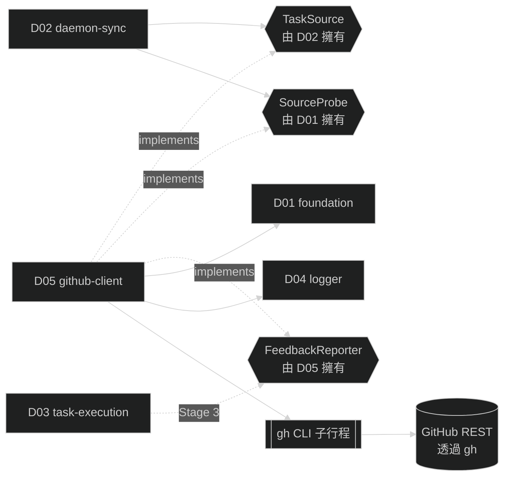

# D05 — github-client

涵蓋需求：R05（GitHub Issue 同步，支援面）、R08（GitHub 狀態回報）。

本模組是 `cfg.source.type: github_issue` 的實作：提供 GitHub Issue 版本的 `TaskSource`（介面由 D02 擁有）、`SourceProbe`（介面由 D01 擁有）、`FeedbackReporter`（介面與實作皆在本模組，consumer 為 D03）。**依 `cfg.source.type` 選擇實作的 dispatcher 不在本模組**；其介面、concrete 分工與 factory 契約定義於 D02 §4.4。本模組是 gogents 與 GitHub 的唯一邊界：封裝 `gh` CLI 呼叫、欄位映射、錯誤分類；其他模組**一律不直接呼叫 `gh`**，也不需認識 GitHub 特有欄位。

## 1. 模組架構與周邊模組關聯

github-client 是**適配層**：上游只看抽象介面（`TaskSource` / `SourceProbe` / `FeedbackReporter`），下游只看 `gh` 子指令與 stderr。本模組負責跨越這兩個世界——做欄位映射、指令參數組裝、exit code / stderr 分類為抽象錯誤、並依 R10 對暫時性錯誤重試。

- **依賴**
  - **D01 foundation**：僅讀取 `Config.Source.Instance` / `Config.Source.Filter.Label` / `Config.Assignee.GithubUsername`；不寫檔、不觸碰 `task.yaml` 或 `state.yaml`。
  - **D04 logger**：`github.*` 事件唯一出口；失敗事件（`github.cli_failed`）依重試最終結果寫 warning / error。
- **實作 / 被依賴**
  - **D01.SourceProbe**（實作）：由 D02 組 probe 時注入 D01.Preflight。
  - **D02.TaskSource**（實作）：由 D02 Syncer 主迴圈呼叫 `List` / `Get`。
  - **D03 task-execution**（Stage 3 消費者）：R07 成敗結束時呼叫 `FeedbackReporter.Report`，依回傳結果決定 task status 為 `done` 還是 `reporting`。
- **I/O 邊界**：子行程 `gh`（stdin / stdout / stderr / exit code）與網路（透過 `gh` 間接存取 GitHub REST）。本模組**不直接操作 HTTP / token / OAuth**，也不碰檔案系統。



### 1.1 Stage 範圍邊界（本模組跨 Stage 2 與 Stage 3）

本模組的公開面分兩批實作。**Stage 2** 僅到「唯讀」：驗證環境、列出與查詢 issue；**Stage 3** 加入「寫入」：comment / label / mention。在 Stage 2 完成前**不得預先實作** `FeedbackReporter`，避免 D03 尚未定案時誤鎖介面形狀（R08 comment 模板、label 命名、回傳契約皆來自 R08，設計穩定；實作順延至 Stage 3）。

| 子能力 | Stage 2 | Stage 3 | 留存方式 |
|---|---|---|---|
| `SourceProbe.CheckSource` | ✔（§2 B1） | — | 由 D02 啟動序列驗收 |
| `TaskSource.Kind / List / Get` | ✔（§2 B2–B4） | — | 由 D02 sync 驗收 |
| 錯誤分類（三種抽象錯誤） | ✔（§2 B5，§3.5） | — | D02 依分類決定 task 狀態 |
| 單一指令重試（R10） | ✔（§2 B6） | ✔ 相同策略 | — |
| `FeedbackReporter.Report` | **不做**（Stage 3 才有消費端） | ✔（§2 B7） | 本文件 §4.3、§5.5 給完整契約，留待 Stage 3 實作 |
| Label 自動建立（`gogents:*`） | **不做** | ✔（§2 B8） | 同上 |

**紀律**：Stage 2 驗收腳本只觀察 probe + list + get 的行為；若實作者在 Stage 2 過程中「順手」接上 comment / label，會造成 Stage 3 行為偏移 R08 契約——禁止。

## 2. 行為契約

- **B1 SourceProbe.CheckSource**：R02 階段 2 的四項檢查，全部通過才回 nil，任一失敗回永久錯誤並附人話 reason。
  1. `gh` 在 PATH 中可執行（`gh --version`）
  2. `gh auth status` 顯示已登入
  3. `gh api user` 可連線且回 200（驗證網路與 token）
  4. `gh repo view <instance>` 成功（驗證 repo 可見性與讀權限）
- **B2 TaskSource.Kind**：固定回傳字串 `github_issue`。
- **B3 TaskSource.List**：以 `gh issue list --label <labels...> --state open --json number,state,updatedAt,url,title,labels,assignees` 取得清單；映射為 `[]SourceTask`，`TaskID` 格式 `github-<number>`；不查 body / comments（留給 D03 於執行階段再查）。
- **B4 TaskSource.Get**：接受 `github-<number>` 形式 task_id，剝出 number 後以 `gh issue view <number> --json number,state,updatedAt,url,title,labels,assignees` 查詢；404 → `ErrSourceNotFound`，auth 問題 → `ErrSourceAuth`，其他網路 / 5xx / rate-limit → `ErrSourceTransient`。
- **B5 錯誤分類**：exit code + stderr pattern → 三種抽象錯誤（詳見 §3.5）。未匹配任何 pattern 的 non-zero exit 一律歸 `ErrSourceTransient`（保守：寧可下輪重試，也不誤判為已刪除）。
- **B6 單一指令重試（R10）**：對單次 gh 呼叫內部套用帶抖動指數退避（1s / 2s / 4s，抖動 0.5–1.5×，最多 3 次）；**僅對暫時性錯誤**重試，404 / auth 不重試。重試過程中每次失敗寫 warning `github.cli_failed`；耗盡仍失敗才回錯給呼叫端。本模組**不對整輪 sync 重試**（R05 明寫：下一個 `sync_interval` 才是 sync-level 重試）。
- **B7 FeedbackReporter.Report（Stage 3）**：依 `Trigger` 執行 comment + label 子步驟；只要**任一子步驟失敗**即整體回 `failure`，`Error` 描述具體失敗子步驟；全部成功回 `success` 並將最終 `comment_id` / `last_label` 回填給呼叫端寫入 task.yaml。**不改本地 task 狀態**（狀態由 R05 / R07 依回傳值決定）。
- **B8 Label 命名空間（Stage 3）**：所有 daemon 寫入的 label 使用 `gogents:` 前綴（`gogents:queued` / `:processing` / `:done` / `:failed` / `:reporting`）。切換 label 時先移除所有 `gogents:*` 再加新的；target label 在 repo 中不存在 → 先以 `gh label create` 建立（無色彩指定），建立失敗計為子步驟失敗。觸發 label（使用者自訂）**本模組不讀也不動**。
- **B9 身份與 token**：所有 gh 呼叫以 daemon 啟動者當下登入的使用者身份執行；本模組**不讀取、不傳遞、不儲存 token**，token 生命週期屬 `gh` 自身管轄。

## 3. 資料結構

### 3.1 Task ID 與 issue number 互換

| 方向 | 規則 |
|---|---|
| `SourceTask.TaskID` ← issue | `fmt.Sprintf("github-%d", number)` |
| number ← task_id | 以 `strings.TrimPrefix("github-")` + `strconv.Atoi`；若 prefix 或數字解析失敗 → 回 `ErrSourceProgrammer`（不應發生，屬程式錯誤） |

### 3.2 `--json` 欄位 → SourceTask 映射

| `gh issue view/list --json` 欄位 | SourceTask 欄位 | 備註 |
|---|---|---|
| `number` | （合成 TaskID） | — |
| `state` | `State` | `OPEN` → `SourceStateOpen`；`CLOSED` → `SourceStateClosed` |
| `updatedAt` | `UpdatedAt` | RFC3339 UTC → `time.Time` |
| `url` | `URL` | — |
| `title` | `Title` | — |
| `labels[].name` | `Labels[]` | 僅取名稱 |
| `assignees[].login` | `Assignees[]` | 僅取 login |

Body / comments / author 不在此階段查詢；D03 Stage 3 組 `input.md` 時另發 `gh issue view --json body,comments` 查詢。

### 3.3 `gh` 子指令組裝（Stage 2）

| 行為 | 指令 |
|---|---|
| List | `gh issue list --repo <instance> --label <label> --state open --json number,state,updatedAt,url,title,labels,assignees --limit 200` |
| Get | `gh issue view <number> --repo <instance> --json number,state,updatedAt,url,title,labels,assignees` |
| Probe 網路 | `gh api user` |
| Probe repo | `gh repo view <instance>` |

`--limit 200` 為安全上限；Phase 1 預期單 runtime 同時活躍任務 < 50，足夠。若未來超限屬可觀測議題，R05 再議。

### 3.4 `gh` 子指令組裝（Stage 3）

| 行為 | 指令 |
|---|---|
| 建 comment | `gh issue comment <number> --repo <instance> --body <body>` → stdout 取 comment URL → 解析尾碼為 comment_id |
| 更新 comment | `gh api repos/<instance>/issues/comments/<comment_id> -X PATCH -f body=<body>` |
| 加 label | `gh issue edit <number> --repo <instance> --add-label <label>` |
| 移除 label | `gh issue edit <number> --repo <instance> --remove-label <label>` |
| 建 label | `gh label create <name> --repo <instance>` |

子指令細節由實作階段確認；契約只鎖「每個 trigger 做了什麼」，不鎖具體 flag 組合。

### 3.5 錯誤分類規則

| 觸發條件（exit code + stderr / stdout pattern） | 抽象錯誤 | 重試 |
|---|---|---|
| exit 0 但 stdout 空（僅 `Get` 情境）or stderr 含 `not found` / `Could not resolve to an Issue` | `ErrSourceNotFound` | 否 |
| stderr 含 `authentication` / `401` / `Bad credentials` / `gh auth` | `ErrSourceAuth` | 否 |
| stderr 含 `rate limit` / `abuse detection` | `ErrSourceTransient`（視 `X-RateLimit-Reset` 若可讀） | 是 |
| exit ≠ 0 且 stderr 含 `network` / `timeout` / `5\d\d` / `could not resolve host` | `ErrSourceTransient` | 是 |
| 其他 non-zero exit | `ErrSourceTransient`（保守預設） | 是 |
| 子行程無法 spawn（ENOENT、permission denied） | `ErrSourceAuth`（視為環境錯誤；實務上 probe 階段會先擋下） | 否 |

分類函式為**純函式**，輸入 `(exitCode, stdout, stderr)`，輸出 `error`；不觸發重試、不發事件。重試由外層 runner 依分類結果決定。

### 3.6 Feedback 模板（Stage 3；引用 R08）

trigger × 狀態 → 模板：`task_created` / `coding_success` / `coding_failed_未達上限` / `coding_failed_達上限`。模板字串完整版本見 R08 §「Comment 內容模板」；本模組複製該定義，不自行改動。所有時間戳以 Asia/Taipei (+08:00) 呈現。

### 3.7 事件命名（發至 D04）

| 事件 | Stage | level | 何時 | 關鍵 fields |
|---|---|---|---|---|
| `github.cli_failed` | 2 + 3 | warning（重試中）／error（耗盡） | 任一 gh 呼叫失敗 | `command`, `exit_code`, `stderr`, `classification`（not_found / auth / transient / unknown）, `attempt`, `max_attempts` |
| `github.comment_created` | 3 | info | `UpsertComment` 新建成功 | `task_id`, `issue_number`, `comment_id` |
| `github.comment_updated` | 3 | info | `UpsertComment` 更新既有 comment 成功 | `task_id`, `issue_number`, `comment_id` |
| `github.label_changed` | 3 | info | label 切換成功 | `task_id`, `issue_number`, `from`, `to` |
| `github.label_created` | 3 | info | 首次偵測 label 不存在並自動建立成功 | `issue_number`, `label` |

Stage 2 的 List / Get 成功不發 info 事件（避免日誌噪音；D02 已在 `sync.completed` 中攜帶統計）。

## 4. 關鍵介面

本節列出介面規格（method signatures：方法名稱 + 參數型別 + 回傳型別）。**不含實作**——子行程執行、stdout 解析、重試迴圈佈線、template 渲染細節由實作者依 §2、§3、§5、§6 落實。程式碼以 Go 語法呈現。

`TaskSource` / `SourceProbe` 由其他模組擁有（分別為 D02 §4.3、D01 §4），本文件不重複定義——僅提供構造函式回傳符合該介面的實例。`FeedbackReporter` 由本模組定義（消費端 D03 於 Stage 3 使用）。

### 4.1 構造函式（Stage 2）

構造函式冠 `GitHubIssue` 前綴，明示這是 `github_issue` 實作的實例化點。呼叫端為 D02 §4.4 的 dispatcher；本函式**不檢查 `cfg.Source.Type`**（型別校驗屬 dispatcher 責任）。

```go
// NewGitHubIssueProbe 回傳符合 D01.SourceProbe 介面的 GitHub 實作。
// 由 dispatcher 在 D02 啟動時（cfg.Source.Type == "github_issue"）產出，注入 D01.Preflight。
// 探測本身不需要 cfg.Source.Filter.Label；Instance 在 CheckSource 的 SourceSpec 參數中傳入。
func NewGitHubIssueProbe(logger logger.Logger) foundation.SourceProbe

// NewGitHubIssueSource 回傳符合 D02.source.TaskSource 介面的 GitHub 實作。
// cfg 僅讀 Source.Instance 與 Source.Filter.Label（List 用）。
func NewGitHubIssueSource(cfg foundation.Config, logger logger.Logger) source.TaskSource
```

### 4.2 內部 gh runner（實作細節，不對外暴露）

為遵守「不為測試引入抽象」原則，本模組**不將 gh runner 提升為介面**；以 package-internal struct 集中 gh 呼叫與重試迴圈即可。若未來需要替換底層（例：改走 GitHub GraphQL），再就地重構——屆時上游 `TaskSource` / `FeedbackReporter` 介面不變。

### 4.3 FeedbackReporter（Stage 3）

```go
// FeedbackReporter 對 GitHub issue 進行 comment + label + mention 的組合操作。
// 由 D03 在 R07 結束（coding 成敗已定）與 R05 新任務建立時呼叫。
// 回傳結構化結果（不回 error），呼叫端依 Result 決定 task status。
type FeedbackReporter interface {
    Report(ctx context.Context, in FeedbackInput) FeedbackOutcome
}

type FeedbackTrigger string

const (
    TriggerTaskCreated    FeedbackTrigger = "task_created"
    TriggerCodingSuccess  FeedbackTrigger = "coding_success"
    TriggerCodingFailed   FeedbackTrigger = "coding_failed"
)

type FeedbackInput struct {
    TaskID       string           // 例："github-42"
    IssueNumber  int              // D03 可從 task.yaml 解出，避免 D05 再拆 task_id
    Trigger      FeedbackTrigger
    PrURL        string           // Trigger=CodingSuccess 必填
    Message      string           // comment body 的「摘要 / 原因」欄位
    FailureCount int              // Trigger=CodingFailed 必填
    MaxFailures  int              // Trigger=CodingFailed 必填
    CommentID    int64            // 既有 comment_id；0 表示首次建立
    Assignee     string           // "@<user>" 來源；空字串省略 mention
}

type FeedbackResult string

const (
    FeedbackSuccess FeedbackResult = "success"
    FeedbackFailure FeedbackResult = "failure"
)

type FeedbackOutcome struct {
    Result    FeedbackResult
    Error     string              // Result=Failure 時說明子步驟失敗（例："label_change: transient"）
    CommentID int64               // 最終 comment_id（新建或沿用）；供呼叫端寫回 task.yaml
    LastLabel string              // 最終 gogents:* label；部分失敗時可能仍為舊值
}

// NewGitHubFeedbackReporter 於 Stage 3 實作；Stage 2 本構造函式不存在
// （避免 Stage 2 開發者誤呼叫到尚未實作的路徑）。
func NewGitHubFeedbackReporter(cfg foundation.Config, logger logger.Logger) FeedbackReporter
```

`FeedbackReporter` 介面本身非 GitHub 專屬（純契約），GitHub 命名僅出現在構造函式。`FeedbackOutcome` 以值回傳而非 error：R08 明訂「部分成功亦整體視為 failure」且需區分哪個子步驟失敗——結構化表達比 error 字串包裝清楚。

### 4.4 Dispatcher 邊界

依 `cfg.source.type` 選擇 concrete strategy 的 dispatcher **不在本模組**；其介面、concrete 分工與 factory 契約定義於 **D02 §4.4**。

對本模組的約束：

- 僅暴露 GitHub 專屬構造函式（§4.1、§4.3），不暴露 `source.type` 判斷邏輯
- 構造函式**不檢查 `cfg.Source.Type`**——被呼叫到即代表 dispatcher 已選定 GitHub
- 新增其他來源 strategy 時，本模組零變更

## 5. 程式資料流

### 5.1 SourceProbe.CheckSource（Stage 2）

```
CheckSource(spec SourceSpec):
  steps := [
    gh_version    : gh --version
    gh_auth       : gh auth status
    gh_api_user   : gh api user
    gh_repo_view  : gh repo view <spec.Instance>
  ]
  for s in steps:
    out, stderr, code := run(s, timeout=10s)   // 不做 R10 重試：啟動期間要快失敗
    if code != 0:
       cls := classify(code, out, stderr)
       return &SourceProbeError{ Stage: s.Name, Reason: humanize(cls, stderr) }
  return nil
```

啟動期探測**不套用 R10 退避**：若第一次就失敗即回錯，由 D02 拒啟、使用者看到明確 reason 後修復。

### 5.2 TaskSource.List（Stage 2）

```
List(ctx, filter):
  args := [issue, list,
           --repo, cfg.Source.Instance,
           --label, filter.Labels[0],         // Phase 1 僅支援單一 label（與 R05 一致）
           --state, "open",
           --json, "number,state,updatedAt,url,title,labels,assignees",
           --limit, "200"]
  stdout, err := runWithRetry(ctx, "gh", args)
    ── 每次失敗依 classify 決定是否重試；attempt<=3 且 cls=transient 才重試
    ── 每次失敗皆 emit "github.cli_failed" { attempt, classification, ... }
  if err != nil: return nil, err            // err 已是 ErrSourceAuth / ErrSourceTransient
  var raw []ghIssue; json.Unmarshal(stdout, &raw)
  return mapToSourceTasks(raw), nil
```

### 5.3 TaskSource.Get（Stage 2）

```
Get(ctx, taskID):
  number, ok := parseGitHubNumber(taskID)
  if !ok: return SourceTask{}, ErrSourceProgrammer  // 不應發生
  args := [issue, view, number, --repo, cfg.Source.Instance,
           --json, "number,state,updatedAt,url,title,labels,assignees"]
  stdout, err := runWithRetry(ctx, "gh", args)
  if err != nil: return SourceTask{}, err     // NotFound / Auth / Transient
  var raw ghIssue; json.Unmarshal(stdout, &raw)
  return mapOneToSourceTask(raw), nil
```

### 5.4 runWithRetry（核心重試迴圈，Stage 2 與 Stage 3 共用）

```
runWithRetry(ctx, cmd, args):
  for attempt in 1..3:
    stdout, stderr, code := exec(ctx, cmd, args, timeout=30s)
    if code == 0: return stdout, nil
    cls := classify(code, stdout, stderr)
    level := warning if attempt < 3 else error
    logger.Log(level, "github.cli_failed", taskID?, msg,
               { command, exit_code: code, stderr: truncate(stderr,1KB),
                 classification: cls, attempt, max_attempts: 3 })
    switch cls:
      case not_found:  return nil, ErrSourceNotFound
      case auth:       return nil, ErrSourceAuth
      case transient:  if attempt == 3: return nil, ErrSourceTransient
                       sleep(backoff(attempt))   // 1s, 2s, 4s × jitter[0.5,1.5]
      case unknown:    (同 transient)
```

**邊界**：`ctx` 取消（daemon 收到 SIGTERM、D02 B4 draining 中）→ 立刻放棄、回 `ctx.Err()`；不再等剩餘 sleep。R10 未定義 cancel 語意，由本模組以「優先 ctx」實作。

### 5.5 FeedbackReporter.Report（Stage 3）

依 trigger 展開不同子步驟序列。每個子步驟各自套 `runWithRetry`；任一耗盡失敗即中止後續並回 `failure`，但**已完成的子步驟副作用不回滾**（例如 comment 已建、label 失敗——comment 保留，下次重試會走 update 路徑）。

```
Report(ctx, in):
  body := renderTemplate(in)              // 依 trigger + 參數組模板
  switch in.Trigger:
  case TaskCreated:
    // 1. 建 comment
    commentID, err := createComment(ctx, in.IssueNumber, body)
    if err != nil: return Failure("create_comment", err, 0, "")
    // 2. 切 label → gogents:queued
    err = switchLabel(ctx, in.IssueNumber, "", "gogents:queued")
    if err != nil: return Failure("label_change", err, commentID, "")
    return Success(commentID, "gogents:queued")

  case CodingSuccess:
    cid, err := upsertComment(ctx, in.IssueNumber, in.CommentID, body)
    if err != nil: return Failure("upsert_comment", err, cid, "")
    err = switchLabel(ctx, in.IssueNumber, "gogents:*", "gogents:done")
    if err != nil: return Failure("label_change", err, cid, "")
    return Success(cid, "gogents:done")

  case CodingFailed:
    cid, err := upsertComment(ctx, in.IssueNumber, in.CommentID, body)
    if err != nil: return Failure("upsert_comment", err, cid, "")
    err = switchLabel(ctx, in.IssueNumber, "gogents:*", "gogents:failed")
    if err != nil: return Failure("label_change", err, cid, "")
    return Success(cid, "gogents:failed")
```

```
upsertComment(ctx, issueN, existingID, body):
  if existingID == 0:
    return createComment(ctx, issueN, body)
  err := patchComment(ctx, existingID, body)
  if errors.Is(err, ErrSourceNotFound):        // comment 被人工刪除
    return createComment(ctx, issueN, body)    // 改走新建 → 回傳新 comment_id
  if err != nil: return existingID, err
  emit "github.comment_updated" { ... }
  return existingID, nil

switchLabel(ctx, issueN, fromPattern, to):
  // 1. 若 to label 不存在 → 建立
  err := ensureLabel(ctx, to)                  // 內部查並視情況呼叫 gh label create
  if err != nil: return err
  // 2. 移除所有 gogents:* label、加上 to
  err = removeLabelsMatching(ctx, issueN, "gogents:*")
  if err != nil: return err
  err = addLabel(ctx, issueN, to)
  if err != nil: return err
  emit "github.label_changed" { from: fromPattern, to }
  return nil
```

Assignee mention 透過 template 直接嵌入 comment body（`@<username>`），不是獨立 gh 指令；空 assignee 直接略過該段。因此 mention 不是「子步驟」、不獨立計失敗。

## 6. 錯誤處理

本模組所有失敗最終皆走 D04 logger 的 `github.cli_failed` 事件；**不自行 panic、不隱藏暫時性錯誤為 nil**。重試屬**本模組責任**（R10 規定的指數退避），但 sync-level / task-level 的後續決策**不屬本模組**——本模組僅忠實回傳抽象錯誤給上游。

### 6.1 Stage 2（probe / list / get）

| 情境 | 分類 | 抽象錯誤 | 處理動作 |
|---|---|---|---|
| `gh` 未安裝 | 永久（啟動期） | `SourceProbeError{Stage: gh_version}` | Preflight 回錯；D02 exit 4；`config.preflight_failed` |
| `gh auth status` 未登入 / token 過期 | 永久（啟動期） | `SourceProbeError{Stage: gh_auth}` | 同上；訊息提示 `gh auth login` |
| `gh api user` 網路失敗 | 永久（啟動期） | `SourceProbeError{Stage: gh_api_user}` | 同上；訊息提示檢查網路 |
| `gh repo view <instance>` 404 / 403 | 永久（啟動期） | `SourceProbeError{Stage: gh_repo_view}` | 同上；訊息指明 repo 不存在或無權限 |
| List 暫時錯（網路 / 5xx / rate-limit） | 暫時 | `ErrSourceTransient` | R10 退避；3 次皆失敗回錯，D02 該輪 `sync.failed` |
| List 授權失效 | 永久（runtime） | `ErrSourceAuth` | 不重試；D02 該輪 `sync.failed`；由 admin 看 log 介入 |
| Get 回 404 | 明確刪除 | `ErrSourceNotFound` | 不重試；D02 轉 task `deleted`、發 `sync.task_deleted` |
| Get 暫時錯 | 暫時 | `ErrSourceTransient` | R10 退避；耗盡列入 D02 的 `per_source_errors[]`，不改 task 狀態 |
| Get 授權失效 | 永久（runtime） | `ErrSourceAuth` | 不重試；同上列入 per_source_errors |
| 非法 task_id（無 `github-` prefix） | 程式錯誤 | `ErrSourceProgrammer` | 不重試；emit error；D02 當成 per-source error 累計（不應發生） |
| `ctx` 取消（daemon 關閉中） | 暫時（非錯誤） | `ctx.Err()` | 立刻放棄重試；上游清理後結束 |

### 6.2 Stage 3（feedback）

| 情境 | 分類 | 處理動作 |
|---|---|---|
| `createComment` 暫時失敗 | 暫時 | R10 退避；耗盡 → 回 `FeedbackOutcome{Result: Failure, Error: "create_comment: <cls>"}`；CommentID=0；**不改 task 狀態**（D03 依回傳決定 reporting / failed 維持） |
| `patchComment` 回 404 | 明確（comment 被刪） | 改走 `createComment`；若重建成功，整體視成功；若重建失敗 → Failure |
| `ensureLabel` 發現 label 不存在 | 預期分支（非錯誤） | 以 `gh label create` 建；成功 emit `github.label_created`；失敗計為 `label_create` 子步驟失敗 |
| `switchLabel` 中「移除舊 label」暫時失敗 | 暫時 | R10 退避；耗盡 → Failure；comment 已新建的副作用保留（下次重試會走 update） |
| `switchLabel` 中「加新 label」暫時失敗 | 暫時 | 同上 |
| 任一子步驟 `ErrSourceAuth` | 永久（runtime） | 不重試；Failure；error 欄位標 `<step>: auth` |
| Trigger 非法（非三值之一） | 程式錯誤 | emit error `github.cli_failed` classification=programmer；Failure；error=`bad_trigger` |

### 6.3 共通

- **重試計數不跨指令**：`List` 與 `Get` 各自獨立 3 次；feedback 的每個子步驟各自獨立 3 次（與 R10 「各自套用重試」一致）。
- **`github.cli_failed` level 規則**：重試過程中每次失敗寫 `warning`；最終 attempt 失敗寫 `error`；若某次重試後成功，**不補寫** info 事件（成功本身由 `github.comment_*` / `label_*` 事件代表，或在 Stage 2 由 sync 層級事件承載）。
- **stderr 截斷**：寫入 `github.cli_failed.fields.stderr` 的 stderr 上限 1 KiB，避免單行 JSON 過大。

## 7. 驗收方式

本模組屬 **基礎建設 library**（封裝 CLI 與對外介面），**無獨立可執行產出**。正確性由上游端到端驗收覆蓋：

- **Stage 2 範圍**（`SourceProbe` + `TaskSource`）：由 **D02 Stage 2 驗收腳本** 覆蓋——對真實 GitHub repo 執行 `gogents start`，觀察 daemon 啟動探測、sync 新任務 / 狀態變化 / 刪除偵測行為。
- **Stage 3 範圍**（`FeedbackReporter`）：由 **D03 Stage 3 驗收腳本** 覆蓋——端到端從開 issue 到 PR 產生後觀察 issue 下的 comment、label、mention。

### 7.1 驗收責任對應表

| D05 契約 / 行為 | 由哪個模組的驗收覆蓋 | 預期觀察點 |
|---|---|---|
| B1 SourceProbe 四項檢查 | D02 Stage 2 | 正常：`config.preflight_ok`；破壞各項（`gh auth logout` / 改錯 instance / 切斷網路）→ `config.preflight_failed` {stage} 對應 |
| B2–B4 TaskSource List / Get | D02 Stage 2 | 新開 issue → `sync.task_created`；關 / 刪 issue → `sync.task_updated` / `sync.task_deleted`；task.yaml.source 欄位值與 GitHub 狀態一致 |
| B5 錯誤分類 | D02 Stage 2 | 斷網情境：`github.cli_failed` 出現 `classification=transient`；`gh auth logout`：`classification=auth`；刪 issue：`classification=not_found` |
| B6 單一指令重試 | D02 Stage 2 | 短暫斷網時 attempt=1/2 寫 warning、恢復後 sync 成功；整輪斷網時 attempt=3 寫 error + `sync.failed` |
| B7 FeedbackReporter.Report | D03 Stage 3 | 新任務 → 對應 issue 下出現單則 comment + `gogents:queued` label；任務完成 → 同一 comment 更新內容 + label 切為 `gogents:done` + 出現 `@<assignee>` 字樣 |
| B8 Label 命名空間與自動建立 | D03 Stage 3 | repo 初始無 `gogents:*` label；首次任務完成後在 repo 的 labels 頁面可見 `gogents:queued` / `:done` 等被自動建立 |

### 7.2 可觀測訊號（供上游驗收腳本 grep）

**Stage 2**：

```
github.cli_failed     (故意斷網 / logout / 刪 issue 後出現)
```

Stage 2 正常路徑**不發** github.* info 事件——若驗收腳本誤以為「沒事件 = 沒運作」，應改觀察 D02 層級的 `sync.task_created` 等事件確認 TaskSource 有被呼叫。

**Stage 3**：

```
github.comment_created    (首次任務建立後)
github.label_changed      (狀態轉換時，可 grep from/to fields 確認 gogents:* 切換)
github.label_created      (首次 Stage 3 驗收時，每個 gogents:* label 各出現一次)
github.comment_updated    (任務完成時)
github.cli_failed         (刻意 revoke token 或斷網時)
```

### 7.3 通過條件

- **Stage 2**：D02 Stage 2 驗收腳本全部通過；`daemon.jsonl` 在錯誤情境下能 grep 到 `github.cli_failed` 且 `classification` 欄位與破壞情境對應；正常路徑下 `github.*` 事件**不過度噪音**（每輪 sync 不應產生 info 事件）。
- **Stage 3**：D03 Stage 3 驗收腳本全部通過；實際 GitHub repo 的 issue 頁面可肉眼確認 comment 內容符合 R08 模板、label 命名皆為 `gogents:*` 前綴、@mention 對象為 `runtime.yaml.assignee.github_username`。
- 任何階段：`FeedbackReporter.Report` 在部分成功情境（例：comment 成功但 label 失敗）必須回 `Failure` 且 `Error` 欄位具體指向 `label_change`——驗收時可人工撤銷 repo 的 label 管理權限觀察此行為。
