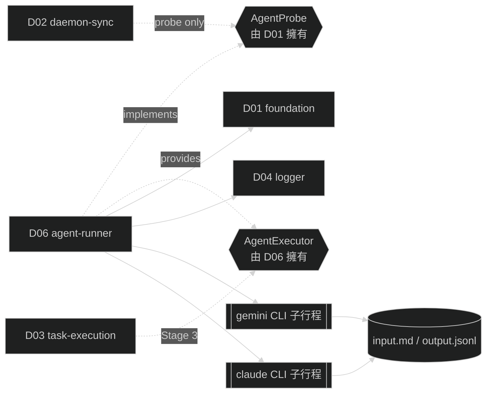

# D06 — agent-runner

涵蓋需求：R06（任務執行流程，支援面）。

本模組是 `cfg.agent.type` 的**適配層**：對外提供抽象的 `AgentProbe`（介面由 D01 擁有）與 `AgentExecutor`（介面本模組擁有），對下封裝具體 agent CLI 的子行程執行。目前支援的 concrete strategies 為 Gemini 與 Claude Code；依 `cfg.agent.type` 選擇 concrete 的 dispatcher 由本模組內部提供（§4.4）。其他模組**一律不直接呼叫 agent CLI**，也不需認識 `gemini` 或 `claude` 特有參數。

## 1. 模組架構與周邊模組關聯

agent-runner 僅負責「拉起正確的 agent 子行程、接好 stdin / stdout / stderr、等結束」這一件事。輸入（`input.md` 內容）、輸出（`output.jsonl` 落檔）路徑與工作目錄皆由呼叫端（D03）依 D01.`WorkspacePaths` 算好後傳入；本模組不自行決定任何路徑。

- **依賴**
  - **D01 foundation**：僅讀取 `Config.Agent.Type` / `Config.Agent.Model`；不寫檔、不觸碰 `task.yaml` / `state.yaml`。
  - **D04 logger**：`task.agent_*` 與 `agent.*` 事件的唯一出口。
- **實作 / 被依賴**
  - **D01.AgentProbe**（實作）：由 D02 啟動時組 probe 注入 D01.Preflight。
  - **D06.AgentExecutor**（本模組定義）：由 D03 Stage 3 在 R06 Step 5 呼叫。
- **I/O 邊界**：子行程（agent CLI）的 stdin / stdout / stderr / exit code；呼叫端提供的檔案路徑（`input.md` 讀、`output.jsonl` 寫）。不觸碰 git、不讀 `result.json`（屬 R07 / D03 責任）。



### 1.1 Stage 範圍邊界（本模組跨 Stage 2 與 Stage 3）

本模組公開面分兩批實作。**Stage 2** 僅到 probe：驗證 agent CLI 可被 daemon 啟動。**Stage 3** 才補上真正拉起 agent 的 `AgentExecutor` 與 Gemini 具體實作。在 Stage 2 完成前**不得預先實作** `AgentExecutor`，避免 D03 尚未定案時誤鎖介面形狀（R06 Step 5 的 stdin / stdout 導向、事件 schema 需等 R06 / R07 對齊後才穩定）。

| 子能力                                        | Stage 2                        | Stage 3       | 留存方式                                         |
| --------------------------------------------- | ------------------------------ | ------------- | ------------------------------------------------ |
| `AgentProbe.CheckAgent`                       | ✔（§2 B1）                     | —             | 由 D02 啟動序列驗收                              |
| `AgentExecutor.Run`                           | **不做**（Stage 3 才有消費端） | ✔（§2 B2–B5） | 本文件 §4.2、§5.2 給完整契約，實作順延至 Stage 3 |
| Gemini concrete（`gemini.NewGeminiProbe`）    | ✔                              | —             | §4.3                                             |
| Gemini concrete（`gemini.NewGeminiExecutor`） | **不做**                       | ✔             | §4.3                                             |
| Claude concrete（`claude.NewClaudeProbe`）    | ✔                              | —             | §4.5                                             |
| Claude concrete（`claude.NewClaudeExecutor`） | **不做**                       | ✔             | §4.5                                             |
| Dispatcher `NewAgentProbeFromConfig`          | ✔                              | —             | §4.4                                             |
| Dispatcher `NewAgentExecutorFromConfig`       | **不做**                       | ✔             | §4.4                                             |

**紀律**：Stage 2 驗收腳本只觀察 probe 行為；若實作者「順手」接上 `Run` 以便手動試跑 gemini，會造成介面與日誌事件契約在 D03 正式設計前被先定型——禁止。

## 2. 行為契約

- **B1 AgentProbe.CheckAgent**（Stage 2）：依 `AgentSpec.Type` 選 concrete probe；
  - `gemini`：依序檢查 (a) `gemini` 在 PATH 中可執行、(b) `gemini --version` exit 0。
  - `claude`：依序檢查 (a) `claude` 在 PATH 中可執行、(b) `claude --version` exit 0。
  任一失敗回永久錯誤並附人話 reason。10 秒 timeout。**不檢查 model 名稱可用性**。
- **B2 AgentExecutor.Run — 工作目錄**（Stage 3）：子行程的 cwd 設為 `req.WorkDir`（由 D03 傳入 **workspace 根 `<workspace>/`**，使 workspace 級 `.claude/`、`.mcp.json` 生效；repo 為其 `./<reponame>` 子目錄）；本模組**不自行決定路徑**、不 `chdir` daemon 行程、不影響 daemon。
- **B3 AgentExecutor.Run — I/O 接線**（Stage 3）：
  - **stdin**：以 `O_RDONLY` 開啟 `req.InputPath`，串接至子行程 stdin；EOF 由子行程自行感知。
  - **stdout + stderr**：以 `O_WRONLY|O_CREATE|O_TRUNC` 開啟 `req.OutputPath`，stderr **合併** 導向同一檔（Stage 3 簡化：所有 agent 輸出統一落檔，避免多檔同步問題）。
  - 環境變數繼承 daemon 行程，不額外注入（含 `PATH` / `HOME` 等）。
  - **身份證明**：依賴 daemon 行程環境中已完成的 `auth` 狀態。
- **B4 AgentExecutor.Run — 等待**（Stage 3）：同步等待子行程結束，**不設 timeout**、不主動 kill。呼叫端（D03）透過 `ctx` 取消；ctx 取消時本模組對子行程送 `SIGTERM`、再等子行程退出後回 `ctx.Err()`。
- **B5 AgentExecutor.Run — 回傳**（Stage 3）：回 `RunResult{ExitCode, StartedAt, FinishedAt, DurationMs}`；exit code 原封帶回，**不**依 exit 值改寫為 error。呼叫端依 exit + `result.json` 判定任務成敗（R06 / R07）。只有**無法 spawn**（ENOENT、permission denied）才回 error（`ErrAgentSpawn`）。
- **B6 不做的事**：不讀 `input.md` 內容、不解析 `output.jsonl`、不讀 `result.json`、不改 `task.yaml`、不做 git 操作、不做重試（agent 執行屬一次性動作，失敗由 D03 計 `failure_count` + 下次 sync 重排）。
- **B7 身份**：子行程以 daemon 使用者身份執行；不 sudo、不切換 UID；token / API key 由 agent CLI 自身環境（例：`~/.gemini/`、`GEMINI_API_KEY`）管理，本模組不讀取、不傳遞。

## 3. 資料結構

### 3.1 `AgentSpec`（D01 擁有，此處補述欄位）

| 欄位    | 型別   | 說明                                                |
| ------- | ------ | --------------------------------------------------- |
| `Type`  | string | `cfg.agent.type`（合法值：`gemini` / `claude`）     |
| `Model` | string | `cfg.agent.model`（probe 不使用；Stage 3 Run 使用） |

### 3.2 `gemini` 子指令組裝（Stage 3）

| 行為         | 指令（示意）                                                                                    |
| ------------ | ----------------------------------------------------------------------------------------------- |
| Gemini probe | `gemini --version`                                                                              |
| Gemini run   | `gemini -m <model> --yolo -o stream-json`                                                       |
| Claude probe | `claude --version`                                                                              |
| Claude run   | `claude -p <prompt> --model <model> --dangerously-skip-permissions --output-format=stream-json` |

註 1：實際 flag 名稱與順序由實作階段依具體 CLI 版本決定。
註 2：Claude Code 採用 `-p` (print) 模式達成非互動式執行，並以 `--dangerously-skip-permissions` 達成 YOLO 自動確認模式。

### 3.3 事件命名（發至 D04）

| 事件                 | Stage | level                             | 何時                                    | 關鍵 fields                                                                       |
| -------------------- | ----- | --------------------------------- | --------------------------------------- | --------------------------------------------------------------------------------- |
| `agent.spawn_failed` | 3     | error                             | 子行程無法啟動（`exec.Cmd.Start` 失敗） | `task_id`, `agent_type`, `reason`（e.g. `not_found` / `permission_denied`）       |
| `task.agent_invoked` | 3     | info                              | 子行程 `Start` 成功後立即               | `task_id`, `agent_type`, `model`, `pid`, `work_dir`                               |
| `task.agent_exited`  | 3     | info（exit=0）／warning（exit≠0） | 子行程 `Wait` 返回後                    | `task_id`, `exit_code`, `duration_ms`, `signaled`（bool）, `signal`（name / nil） |

Stage 2 的 probe 成功**不發** info 事件（covered by `config.preflight_ok`）；probe 失敗由 D01 發 `config.preflight_failed`，本模組不重複發事件。

### 3.4 錯誤型別

| 錯誤                             | Stage | 語意                                                                             |
| -------------------------------- | ----- | -------------------------------------------------------------------------------- |
| `AgentProbeError{Stage, Reason}` | 2     | probe 階段失敗（`stage`：`lookup` / `version`）                                  |
| `ErrAgentSpawn`                  | 3     | 子行程無法啟動；屬**程式/環境錯誤**（應在 probe 階段即被擋下）                   |
| `ErrAgentIO`                     | 3     | 開啟 `InputPath` / `OutputPath` 失敗（檔案不存在 / 權限）；交 D03 計為 task 失敗 |
| `ErrAgentUnsupportedType`        | 2 / 3 | dispatcher 收到未知 `cfg.agent.type`                                             |
| `ctx.Err()`                      | 3     | 呼叫端取消；非錯誤路徑（D03 draining 時的正常回收）                              |

## 4. 關鍵介面

本節僅列介面規格（method signature = 方法名稱 + 參數型別 + 回傳型別）與搭配型別。**不含實作**——子行程 FD 繫結、signal forwarding、cwd 設定的 syscall 細節由實作者依 §2、§5、§6 落實。程式碼以 Go 語法呈現。

`AgentProbe` 由 D01 擁有（見 D01 §4），本文件不重複定義，僅提供符合該介面的 concrete 構造函式與 dispatcher。`AgentExecutor` 由本模組擁有。

### 4.1 Constructor（Gemini concrete，Stage 2）

構造函式冠 `Gemini` 前綴，明示這是 `cfg.agent.type == "gemini"` 的實例化點。呼叫端為 §4.4 dispatcher；本函式**不檢查 `cfg.Agent.Type`**（型別校驗屬 dispatcher 責任）。

```go
// NewGeminiProbe 回傳符合 D01.foundation.AgentProbe 介面的 Gemini 實作。
// 由 dispatcher 在 D02 啟動時（cfg.Agent.Type == "gemini"）產出，注入 D01.Preflight。
func NewGeminiProbe(lg logger.Logger) foundation.AgentProbe
```

### 4.2 `AgentExecutor` 介面與型別（Stage 3）

```go
// AgentExecutor 將 input.md 餵給 agent CLI、收集 stdout 到 output.jsonl、回傳執行結果。
// 介面本身與 agent 廠商解耦；Gemini 僅是 Phase 1 的 concrete 實作。
type AgentExecutor interface {
    Run(ctx context.Context, req RunRequest) (RunResult, error)
}

type RunRequest struct {
    TaskID     string // 例："github-42"；僅供事件 fields 使用
    WorkDir    string // 子行程 cwd = workspace 根 <workspace>/（R06；repo 為其 ./<reponame> 子目錄）
    InputPath  string // 子行程 stdin 來源；呼叫端負責先寫好 input.md
    OutputPath string // 子行程 stdout + stderr 去向；本模組以 O_TRUNC 開檔
    Model      string // cfg.agent.model；由 executor 轉為 CLI 參數
}

type RunResult struct {
    ExitCode   int
    Signaled   bool      // 是否因 signal 結束（含本模組因 ctx 送的 SIGTERM）
    Signal     string    // Signaled=true 時填，例："terminated"；否則 ""
    StartedAt  time.Time // task.agent_invoked 發出時間
    FinishedAt time.Time // task.agent_exited 發出時間
    DurationMs int64
}

var (
    ErrAgentSpawn           = errors.New("agent process spawn failed")
    ErrAgentIO              = errors.New("agent io setup failed")
    ErrAgentUnsupportedType = errors.New("unsupported agent.type")
)
```

**設計理由**

- **以 path 而非 `io.Reader/Writer` 入參**：R06 明訂 `output.jsonl` 採 truncate 後 append，語意綁定檔案本體；以路徑傳入能讓本模組集中控制開檔模式，避免呼叫端因忘記 O_TRUNC 造成跨次執行污染。
- **Exit code 不等同 error**：`Run` 對 exit≠0 仍回 `nil` error；`failure_count` 計數與 task status 判定屬 D03 的 R07 邏輯，不宜在本模組預判。
- **無 `Kill` / `Pid` 對外暴露**：外部不應干涉 agent 生命週期；取消透過 `ctx` 表達，已足夠 R04 B4 的 graceful shutdown 需求。

### 4.3 Gemini concrete（Stage 3）

```go
// NewGeminiExecutor 回傳符合 AgentExecutor 介面的 Gemini 實作。
// cfg 僅讀 Agent.Model（Model 亦可由 RunRequest.Model 覆寫；Phase 1 兩者恆等）。
// Stage 2 本函式不存在（避免開發者誤呼叫到尚未實作的路徑）。
func NewGeminiExecutor(cfg foundation.Config, lg logger.Logger) AgentExecutor
```

### 4.4 Dispatcher（本模組內部）

與 D02 §4.4 同構：依 `cfg.Agent.Type` 選擇 concrete。dispatcher **不執行** `CheckAgent` / `Run`，僅回傳實例。

```go
package agent

// NewAgentProbeFromConfig 依 cfg.Agent.Type 選擇 concrete AgentProbe。
// 由 D02 啟動時組 probe 呼叫；未支援的 type 回 ErrAgentUnsupportedType。
func NewAgentProbeFromConfig(cfg foundation.Config, lg logger.Logger) (foundation.AgentProbe, error)

// NewAgentExecutorFromConfig 依 cfg.Agent.Type 選擇 concrete AgentExecutor（Stage 3）。
// 由 D03 在 R06 Step 5 前呼叫一次，executor 實例於該 task 執行期間持有。
func NewAgentExecutorFromConfig(cfg foundation.Config, lg logger.Logger) (AgentExecutor, error)
```

**Concrete 分工**

| `cfg.Agent.Type` | AgentProbe                  | AgentExecutor                       |
| ---------------- | --------------------------- | ----------------------------------- |
| `gemini`         | `gemini.NewGeminiProbe(lg)` | `gemini.NewGeminiExecutor(cfg, lg)` |
| `claude`         | `claude.NewClaudeProbe(lg)` | `claude.NewClaudeExecutor(cfg, lg)` |
| 其他             | `ErrAgentUnsupportedType`   | `ErrAgentUnsupportedType`           |

**邊界紀律**

- Dispatcher **不檢查** agent CLI 存在性、**不讀取** 環境變數——僅純粹依 `cfg.Agent.Type` 分流。
- Concrete（`gemini` 子包）**不得** 包含 dispatcher 邏輯：不 `switch cfg.Agent.Type`、不驗型別正確性。
- `cfg.Agent.Type` 合法值集合由 D01 schema validate 先擋下。
- 新增 agent type 的流程：(1) 新增 concrete 子包（例：`claude/`）並實作 `AgentProbe` / `AgentExecutor`；(2) 在本節兩個 factory 的 `switch` 各加一個 case。**D03 / D02 / 既有 concrete 皆不改**（OCP）。

## 4.5 Claude concrete（Stage 3 預留）

```go
// NewClaudeProbe / NewClaudeExecutor 之語法結構比照 Gemini。
// 其 Run 核心邏輯為呼叫 claude -p 並帶入組裝好的參數。
```

## 5. 程式資料流

### 5.1 AgentProbe.CheckAgent（Stage 2，Gemini 實作）

```
CheckAgent(spec AgentSpec):
  steps := [
    lookup  : exec.LookPath("gemini")
    version : exec.Command("gemini", "--version"), timeout=10s
  ]
  for s in steps:
    err := s.Run()
    if err != nil:
      return &AgentProbeError{ Stage: s.Name, Reason: humanize(s, err) }
  return nil
```

啟動期探測**不套用重試**：若第一次失敗即回錯，由 D02 拒啟、使用者看到明確 reason 後修復（例如 `gemini: command not found` → 指示使用者安裝 gemini CLI）。

### 5.2 AgentExecutor.Run（Stage 3，Gemini 實作）

```
Run(ctx, req):
  t0 := time.Now()

  // 1. 開 I/O 檔案
  stdin, err := os.Open(req.InputPath)
  if err != nil: return RunResult{}, ErrAgentIO
  defer stdin.Close()

  out, err := os.OpenFile(req.OutputPath, O_WRONLY|O_CREATE|O_TRUNC, 0644)
  if err != nil: return RunResult{}, ErrAgentIO
  defer out.Close()

  // 2. 組 cmd
  cmd := exec.CommandContext(ctx, "gemini", "-m", req.Model) // --yolo -o stream-json
  cmd.Dir    = req.WorkDir
  cmd.Stdin  = stdin
  cmd.Stdout = out
  cmd.Stderr = out                                   // B3：合併

  // 3. Start → 發事件
  if err := cmd.Start(); err != nil:
    emit error "agent.spawn_failed" { task_id, agent_type: "gemini", reason: classify(err) }
    return RunResult{}, ErrAgentSpawn

  emit info "task.agent_invoked" {
    task_id, agent_type: "gemini", model: req.Model,
    pid: cmd.Process.Pid, work_dir: req.WorkDir,
  }

  // 4. Wait（可能因 ctx 取消造成 SIGTERM）
  waitErr := cmd.Wait()

  // 5. 計算結果
  result := RunResult{
    StartedAt: t0, FinishedAt: time.Now(),
    DurationMs: since(t0),
    ExitCode:   cmd.ProcessState.ExitCode(),
  }
  if ws, ok := cmd.ProcessState.Sys().(syscall.WaitStatus); ok && ws.Signaled():
    result.Signaled = true
    result.Signal   = ws.Signal().String()

  level := info if result.ExitCode == 0 else warning
  emit level "task.agent_exited" {
    task_id, exit_code: result.ExitCode,
    duration_ms: result.DurationMs,
    signaled: result.Signaled, signal: result.Signal,
  }

  // 6. ctx 取消回 ctx.Err()；其他情況一律回 nil（exit≠0 也不是 error）
  if ctx.Err() != nil: return result, ctx.Err()
  return result, nil
```

**`ctx` 取消語義**

- `exec.CommandContext` 會在 ctx 取消時對子行程送 `SIGKILL`——目前簡化採用，不自行實作 SIGTERM + grace period。若 R04 B4 觀察到 agent 無法優雅結束造成資料遺失，再於 Stage 4 補 `SIGTERM → 10s → SIGKILL` 的 graceful kill（屬錯誤處理強化，非本模組主契約）。
- ctx 取消路徑仍發 `task.agent_exited`，`signaled=true`、`signal=killed`；D03 看到 signal=killed + ctx.Err() 即知屬 daemon 關閉導致，不計 `failure_count`（由 D03 決策，本模組只忠實回報）。

## 6. 錯誤處理

原則：**probe 階段**失敗回永久錯誤給 D01，由 D02 拒啟；**執行階段**失敗區分「子行程**無法啟動**」（程式/環境錯誤）與「子行程**啟動後異常結束**」（走 exit code 回傳，非 error）。本模組**不重試**——agent 執行屬一次性 side-effectful 動作，重試風險高於收益；是否重試由 R03 的 `failure_count < max_failures` 與下次 sync 重排決定。

### 6.1 Stage 2（probe）

| 情境                                       | 分類           | 錯誤                                               | 處理                                                |
| ------------------------------------------ | -------------- | -------------------------------------------------- | --------------------------------------------------- |
| `exec.LookPath("gemini")` 回 `ErrNotFound` | 永久（啟動期） | `AgentProbeError{Stage: lookup}`                   | Preflight 回錯；D02 exit 4；訊息提示安裝 gemini CLI |
| `gemini --version` exit ≠ 0                | 永久（啟動期） | `AgentProbeError{Stage: version}`                  | 同上；訊息含 stderr 前 512 B                        |
| `gemini --version` 10s 內未返回            | 永久（啟動期） | `AgentProbeError{Stage: version, Reason: timeout}` | 同上；視為環境異常                                  |
| dispatcher 收到未知 `cfg.agent.type`       | 程式錯誤       | `ErrAgentUnsupportedType`                          | 由 D01 schema 先擋下；此分支為防禦性回錯            |

### 6.2 Stage 3（執行）

| 情境                                           | 分類                       | 事件                                           | 回傳                    | 後續（由 D03 決策）                                         |
| ---------------------------------------------- | -------------------------- | ---------------------------------------------- | ----------------------- | ----------------------------------------------------------- |
| 開 `InputPath` 失敗（檔不存在）                | 程式錯誤                   | `agent.spawn_failed` { reason: input_missing } | `ErrAgentIO`            | D03 計 `failure_count` + 1、轉 `failed`                     |
| 開 `OutputPath` 失敗（權限 / 磁碟滿）          | 暫時 / 永久皆可能          | `agent.spawn_failed` { reason: output_open }   | `ErrAgentIO`            | 同上；管理者觀察磁碟                                        |
| `cmd.Start` 失敗（ENOENT / permission denied） | 程式錯誤（probe 應先擋下） | `agent.spawn_failed` { reason: classify(err) } | `ErrAgentSpawn`         | 同上                                                        |
| `cmd.Wait` 回 exit ≠ 0（agent 自身錯）         | agent 側錯誤               | `task.agent_exited` warning                    | `(result, nil)`         | D03 讀 `result.json`；若無 → `failed` + `failure_count` + 1 |
| `cmd.Wait` 回 signaled（ctx 取消）             | 暫時（非錯誤）             | `task.agent_exited` warning + `signal` fields  | `(result, ctx.Err())`   | D03 區分「daemon 關閉」vs「他人 kill」；前者不計 failure    |
| `cmd.Wait` 自身錯誤（kernel 級）               | 程式錯誤                   | `task.agent_exited` warning + reason           | `(partial result, err)` | 同 exit≠0 處理                                              |
| `output.jsonl` 寫入中磁碟滿                    | agent 側錯誤               | 由 agent 自行決定行為                          | 透過 exit code 表達     | 同 exit≠0 處理                                              |

**邊界**

- **不讀 `result.json`**：該檔由 agent 自行寫、由 D03 在 R07 讀；本模組完全不觸碰（避免兩處語意漂移）。
- **不檢驗 `output.jsonl` 內容格式**：agent 若產出非 JSONL 也照寫；格式正確性屬 agent 側問題，不在 D06 驗證範圍。
- **子行程洩漏防護**：`exec.CommandContext` 於 ctx 取消時負責送 signal；本模組不額外維護 pid table。若 agent 在 SIGKILL 後仍殘留（僵屍），屬 kernel 級異常，Phase 1 不處理。

## 7. 驗收方式

本模組屬 **基礎建設 library**（封裝 agent CLI 子行程），**無獨立可執行產出**。正確性由上游端到端驗收覆蓋：

- **Stage 2 範圍**（`AgentProbe`）：由 **D02 Stage 2 驗收腳本** 覆蓋——對真實 workspace 執行 `gogents start`，觀察 daemon 啟動探測行為（含破壞情境：卸載 gemini / 改 PATH）。
- **Stage 3 範圍**（`AgentExecutor`）：由 **D03 Stage 3 驗收腳本** 覆蓋——端到端從開 issue 到 agent 跑完 → 觀察 `output.jsonl` 被 truncate 寫入、`task.agent_invoked` / `task.agent_exited` 事件成對出現、exit code 正確反映 agent 結果。

### 7.1 驗收責任對應表

| D06 契約 / 行為          | 由哪個模組的驗收覆蓋 | 預期觀察點                                                                                                                                                                                                                                |
| ------------------------ | -------------------- | ----------------------------------------------------------------------------------------------------------------------------------------------------------------------------------------------------------------------------------------- |
| B1 AgentProbe.CheckAgent | D02 Stage 2          | 正常：`config.preflight_ok`；卸載 gemini / PATH 移除 → `config.preflight_failed` {stage=agent, reason=lookup}；故意讓 `gemini --version` 失敗（chmod -x）→ {stage=agent, reason=version}                                                  |
| B2 工作目錄              | D03 Stage 3          | agent 於 **workspace 根 `<workspace>/`** 下執行、可讀到 workspace 級 `.claude/` / `.mcp.json`，並於 `./<reponame>` 子目錄操作 git（可由 agent 的 `pwd` / `git status` 自檢訊號在 output.jsonl 中觀察）                                    |
| B3 I/O 接線              | D03 Stage 3          | 每次執行 `output.jsonl` 被 truncate（先人工塞 garbage → 執行後該 garbage 消失）；agent 看到的 stdin 與 `input.md` bytes 一致                                                                                                              |
| B4 不設 timeout          | D03 Stage 3          | 長時間 agent 執行不被本模組主動中止；daemon 送 SIGTERM 後才收尾（signaled=true）                                                                                                                                                          |
| B5 回傳語意              | D03 Stage 3          | agent exit 0 → `task.agent_exited` info、無 error；agent 人工 exit 1 → warning、exit_code=1、**Run 仍回 nil error**（由 D03 決定是否轉 failed）                                                                                           |
| B6 不做的事              | 全模組               | `task.yaml` / `result.json` 在 Run 期間不被 D06 修改（可用 inotify / mtime 觀察）                                                                                                                                                         |
| Dispatcher（§4.4）       | D02 Stage 2          | 將 `runtime.yaml` `agent.type` 改為未知值（例：`claude`）→ D01 schema 階段即擋下（先於 dispatcher）；將 `agent.type` 合法但 concrete 未註冊的偽情境 → dispatcher 回 `ErrAgentUnsupportedType`、exit 3（此情境需實作時以測試用 type 觸發） |

### 7.2 可觀測訊號（供上游驗收腳本 grep）

**Stage 2**：

本模組成功路徑**不發** info 事件；驗收透過 D01 層級的 `config.preflight_ok` / `config.preflight_failed`（含 `stage=agent`）觀察。

**Stage 3**：

```
task.agent_invoked     (每個任務執行一次)
task.agent_exited      (必與 invoked 成對；可比對 task_id 確認)
agent.spawn_failed     (刻意破壞 input.md / output dir 權限時出現)
```

### 7.3 通過條件

- **Stage 2**：D02 Stage 2 驗收腳本全部通過；`daemon.jsonl` 在破壞 gemini 安裝的情境下能 grep 到 `config.preflight_failed` 且 `stage=agent`；正常路徑下 `agent.*` / `task.agent_*` **不出現**（Stage 2 不執行 agent）。
- **Stage 3**：D03 Stage 3 驗收腳本全部通過；每個任務於 `daemon.jsonl` 均出現成對 `task.agent_invoked` / `task.agent_exited`；`output.jsonl` 於每次執行開頭被清空（可用「先塞 canary 字串 → 執行後消失」驗證）；daemon 於 agent 執行中送 SIGTERM，agent 被 kill 後 `task.agent_exited` 含 `signaled=true`，daemon 正常寫 `daemon.stopped` 後退出。
- 任何階段：本模組**不**自行發 info 事件於正常路徑（除 `task.agent_invoked` / `task.agent_exited`）；驗收時若日誌出現未列於 §3.3 的 `agent.*` 事件名稱，視為實作漂移。
