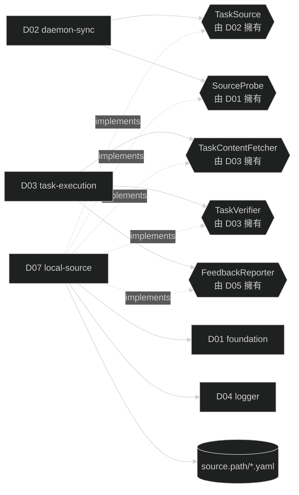

# D07 — local-source

涵蓋需求：R11（本地任務源 local）。

本模組是 `cfg.source.type: local` 的實作，與 D05（github-client）並列為 `source.type` 的 concrete strategy。提供 local 版本的 `TaskSource`（介面由 D02 擁有）、`SourceProbe`（介面由 D01 擁有）、`TaskContentFetcher`（介面由 D03 擁有）、`FeedbackReporter`（介面由 D05 擁有）、`TaskVerifier`（介面由 D03 擁有）。本模組是 gogents 與本地 ticket inbox 的唯一邊界：封裝 ticket 檔的讀取、欄位映射、label 過濾、終態回寫;其他模組不直接讀寫 inbox。依 `source.type` 選 concrete 的 dispatcher 不在本模組（定義於 D02 §4.4）。

## 1. 模組架構與周邊模組關聯

local-source 是**適配層**：上游只看抽象介面（五個 strategy interface），下游只看檔案系統的 ticket YAML 檔。本模組負責跨越這兩個世界——ticket 欄位映射、依 `worker` label 過濾、終態與 result 原子回寫。

- **依賴**
  - **D01 foundation**：讀取 `Config.Source.Path`（省略時預設 `GlobalHome()/tickets`，見 D01 §3）/ `Config.Source.Filter.Label`；不寫 `task.yaml` / `state.yaml`。
  - **D04 logger**：`source.*` 事件出口。
- **實作 / 被依賴**
  - **D01.SourceProbe**（實作）：由 dispatcher 於啟動時注入 D01.Preflight。
  - **D02.TaskSource**（實作）：由 D02 Syncer 主迴圈呼叫 `List` / `Get`。
  - **D03.TaskContentFetcher / D03.TaskVerifier**（實作）：由 D03 執行階段呼叫。
  - **D05.FeedbackReporter**（實作 D05 定義的介面）：由 D03 於任務終態呼叫，回寫 ticket。
- **I/O 邊界**：檔案系統 `<source.path>/*.yaml`（讀 ticket、原子回寫終態）；`verify.cmd` 由 D03 執行，本模組僅提供 spec，不執行子行程。



### 1.1 目前範圍邊界

本模組五個公開面同批交付（無跨階段拆分）。ticket schema 契約與欄位擁有權見 R11：gogents 只讀執行所需欄位、只回寫 `status` / `result` / `updated_at`；契約未定義的欄位本模組**不讀不寫**，回寫時原樣保留。

## 2. 行為契約

- **B1 SourceProbe.CheckSource**：確認 `source.path`（省略時 `GlobalHome()/tickets`）存在且可讀（`os.Stat` + 可列目錄）；失敗回永久錯誤並附人話 reason。**不建立目錄**——inbox 由 producer 擁有，代建會讓路徑打錯時 daemon 靜默空轉。
- **B2 TaskSource.Kind**：固定回傳 `local`。
- **B3 TaskSource.List**：列出 `source.path` 下 `*.yaml`，解析各 ticket，僅回傳同時滿足 `worker == cfg.source.filter.label` **且** `status == "queued"` 者；過濾順序先 label 後 status。只認領 `queued`，其餘值（含空值、未知）一律不認領，dispatch 時機由 producer 以 `status` 掌控。映射為 `[]SourceTask`，`TaskID` = ticket `id`。單一 ticket 解析失敗不中斷整輪，記 `source.ticket_parse_failed` 後略過。被認領、執行中的 ticket 其 `status` 仍為 `queued`（gogents 於 `processing_started` 不回寫），會持續出現在 List，由上游「以 task id 去重」吸收，不重複執行；終態回寫後 `status != queued` 即自動不再回傳。
- **B4 TaskSource.Get**：以 task_id 定位 `<source.path>/<id>.yaml`；檔案不存在 → `ErrSourceNotFound`（對應 producer 刪除 ticket）；讀取 / 解析失敗 → `ErrSourceTransient`（下輪重試，保守）。
- **B5 錯誤分類**：本模組只產生 `ErrSourceNotFound`（檔案不存在）與 `ErrSourceTransient`（IO / 解析）；無 `ErrSourceAuth`（本地檔案無授權概念）。與 D02 抽象錯誤對齊，Syncer 邏輯不需區分來源。
- **B6 TaskContentFetcher.Fetch**：讀 ticket 的 `goal`（→ Title）與 `context`（→ Body）組 `TaskContent`；`Comments` 恆為空；`Author` 固定為 `local`。原始文字不翻譯。
- **B7 TaskVerifier.VerifySpec**：讀 ticket `verify.cmd`；有值回 `(VerifySpec{Cmd}, true, nil)`，無 `verify` 回 `(_, false, nil)`（D03 走 result.json fallback）。
- **B8 FeedbackReporter.Report**：依 `Trigger` 原子回寫 ticket 檔（read-modify-write-tmp → rename）。`CodingSuccess` → `status: done` + `result`；`CodingFailed` → `status: failed` + 失敗 `result`/message；一律更新 `updated_at`。回寫成功回 `FeedbackSuccess`；IO 失敗回 `FeedbackFailure`（D03 據此留 `reporting`）。**只寫執行段欄位**，契約未定義的欄位原樣保留。
- **B9 result 型別**：pr_url 非空 → `result: {type: code, pr_url, branch, commit}`；pr_url 空（verify pass 但無 PR，例如 artifacts 型任務）→ `result: {type: artifacts, items: [...]}`。items 來源由實作於 result.json / ticket 約定欄位取得。
- **B10 併發**：多 worker daemon 共讀同一 inbox、各取各 label；每個 daemon 只回寫自己認領的 ticket 檔，無跨 daemon 寫爭用。回寫採原子寫入避免與 producer 讀取競態。

## 3. 資料結構

### 3.1 ticket 檔 → SourceTask / TaskContent 映射

| ticket 欄位   | 映射                          | 備註                         |
| ------------- | ----------------------------- | ---------------------------- |
| `id`          | `SourceTask.TaskID`           | 原樣（task_id = ticket id）  |
| `worker`      | 過濾鍵                        | 與 `filter.label` 比對       |
| `updated_at`  | `SourceTask.UpdatedAt`        | RFC3339                      |
| `status`      | List 認領閘門（僅 `queued`）  | 不映射為 SourceTask.State;List 讀取過濾、終態由 gogents 回寫 |
| 其他任何欄位  | 不映射                        | 回寫時原樣保留（見 §5.2）    |
| `goal`        | `TaskContent.Title`           | input.md 標題                |
| `context`     | `TaskContent.Body`            | input.md 內容                |
| `verify.cmd`  | `VerifySpec.Cmd`              | 無則 fallback                |

`SourceTask.URL` 以 `file://<absolute ticket path>` 表示（供 log / input.md Source 欄位）；`Labels` = `[worker]`；`Assignees` 空。

### 3.2 回寫欄位（本模組寫入 ticket 檔）

| ticket 欄位  | 寫入值                                                        |
| ------------ | ------------------------------------------------------------ |
| `status`     | `done`（coding 成功且回報成功）/ `failed`                    |
| `result`     | `{type: code, pr_url, branch, commit}` 或 `{type: artifacts, items: [...]}` |
| `updated_at` | 回寫當下（Asia/Taipei RFC3339）                              |

### 3.3 事件命名（發至 D04）

| 事件                         | level   | 何時                              | 關鍵 fields                        |
| ---------------------------- | ------- | --------------------------------- | ---------------------------------- |
| `source.ticket_parse_failed` | warning | List / Get 單一 ticket 解析失敗   | `path`, `reason`                   |
| `source.ticket_reported`     | info    | Report 回寫成功                   | `task_id`, `status`, `result_type` |
| `source.ticket_report_failed`| warning | Report 回寫 IO 失敗               | `task_id`, `reason`                |

## 4. 關鍵介面

本模組不定義新介面——五個 strategy interface 分別由 D01 / D02 / D03 / D05 擁有；本節僅提供符合各介面的 concrete 構造函式。構造函式冠 `LocalTicket` 前綴，明示這是 `source.type: local` 實例化點;**不檢查 `cfg.Source.Type`**（型別校驗屬 D02 §4.4 dispatcher）。

```go
package local

// 皆由 D02 §4.4 dispatcher 於對應 factory 呼叫。
func NewLocalTicketProbe(lg logger.Logger) foundation.SourceProbe
func NewLocalTicketSource(cfg foundation.Config, lg logger.Logger) source.TaskSource
func NewLocalTicketContentFetcher(cfg foundation.Config, lg logger.Logger) source.TaskContentFetcher
func NewLocalTicketVerifier(cfg foundation.Config, lg logger.Logger) source.TaskVerifier
func NewLocalTicketReporter(cfg foundation.Config, lg logger.Logger) source.FeedbackReporter
```

內部以 package-internal struct 集中 ticket 檔讀寫與 YAML 映射;不為測試提升為介面（比照 D05 §4.2「不為測試引入抽象」）。

## 5. 程式資料流

### 5.1 List / Get

```
List(ctx, filter):
  entries := readDir(cfg.Source.Path, "*.yaml")
  out := []
  for e in entries:
     t, err := parseTicket(e)
     if err != nil: emit "source.ticket_parse_failed" {path, reason}; continue
     if t.Worker != filter.Labels[0]: continue          // 先依 label 認領
     if t.Status != "queued": continue                  // 再依 am dispatch 閘門(僅 queued)
     out += mapToSourceTask(t)
  return out, nil

Get(ctx, taskID):
  p := cfg.Source.Path + "/" + taskID + ".yaml"
  if !exists(p): return SourceTask{}, ErrSourceNotFound  // am 刪除 ticket
  t, err := parseTicket(p)
  if err != nil: return SourceTask{}, ErrSourceTransient
  return mapToSourceTask(t), nil
```

### 5.2 Report（終態回寫，原子）

```
Report(ctx, in):
  p := cfg.Source.Path + "/" + in.TaskID + ".yaml"
  raw := readTicket(p)                          // 保留契約未定義的欄位
  switch in.Trigger:
    case CodingSuccess:
      raw.status = "done"
      raw.result = (in.PrURL != "") ? {type: code, pr_url: in.PrURL, branch, commit}
                                     : {type: artifacts, items: parseItems(in)}
    case CodingFailed:
      raw.status = "failed"
      raw.result = {type: error, message: in.Message}
  raw.updated_at = now(Asia/Taipei)
  err := atomicWrite(p, raw)                     // write-tmp → fsync → rename
  if err != nil:
     emit "source.ticket_report_failed" {task_id, reason}
     return FeedbackOutcome{Result: FeedbackFailure, Error: "ticket_write: "+err}
  emit "source.ticket_reported" {task_id, status, result_type}
  return FeedbackOutcome{Result: FeedbackSuccess}
```

`TaskCreated` trigger 對 local 為 no-op（ticket 已由 producer 建立）;`processing_started` 亦為 no-op——gogents 只回寫終態。

## 6. 錯誤處理

| 情境                                 | 分類     | 抽象錯誤 / 回傳                    | 處理                                                    |
| ------------------------------------ | -------- | --------------------------------- | ------------------------------------------------------- |
| `source.path` 不存在 / 不可讀（啟動） | 永久     | `SourceProbeError`                | Preflight 回錯；D02 拒啟                                |
| List 單一 ticket 解析失敗            | 局部     | 略過該筆                          | `source.ticket_parse_failed`;整輪繼續                  |
| Get 檔案不存在                       | 明確刪除 | `ErrSourceNotFound`               | D02 轉 task `deleted`、發 `sync.task_deleted`           |
| Get / Fetch 讀取或解析失敗           | 暫時     | `ErrSourceTransient`              | 下輪重試;不改 task 狀態（保守）                        |
| Report 回寫 IO 失敗                  | 暫時     | `FeedbackFailure`                 | D03 留 `reporting`、寫 `reporting_error`;人工或下次介入 |
| `ctx` 取消                           | 非錯誤   | `ctx.Err()`                       | 立即返回                                                |

本模組**不重試**——檔案 IO 失敗交上游（D02 下輪 sync / D03 reporting 狀態）處理，與 D05 對 gh 的重試策略不同（本地檔案 IO 無網路暫時性，重試收益低）。

## 7. 驗收方式

本模組屬 **基礎建設 library**（封裝 ticket 檔存取與五個介面），**無獨立可執行產出**;正確性由上游端到端驗收覆蓋。

### 7.1 驗收責任對應表

| 契約 / 行為                | 由哪個模組驗收 | 預期觀察點                                                              |
| -------------------------- | -------------- | ---------------------------------------------------------------------- |
| B1 SourceProbe             | D02 啟動序列   | `source.path` 不存在時 `config.preflight_failed {stage=source}`        |
| B2–B5 TaskSource List/Get  | D02 sync       | 於 inbox 放一張本 label 且 `status: queued` 的 ticket → `sync.task_created`;其他非 queued 狀態者不觸發;刪除 ticket → `sync.task_deleted` |
| B6 ContentFetcher          | D03 執行       | input.md 內含 ticket `goal` / `context`;無 Comments 段                 |
| B7 TaskVerifier            | D03 執行       | ticket 宣告 `verify.cmd` → `task.verifying` / `task.verified`;未宣告走 result.json |
| B8/B9 FeedbackReporter     | D03 執行       | 任務終態後 ticket 檔 `status` 轉 `done`/`failed`、`result` 依型別寫入、`updated_at` 更新;契約未定義的欄位不變 |
| B10 併發                   | 多 daemon      | 兩個不同 label 的 daemon 共讀同一 inbox，各認領各 label，互不回寫對方 ticket |

### 7.2 可觀測訊號（供上游驗收腳本 grep）

```
source.ticket_parse_failed    (放入壞格式 ticket 時)
source.ticket_reported        (任務終態回寫成功時)
source.ticket_report_failed   (回寫目錄設唯讀時)
```

### 7.3 通過條件

- 端到端：producer 放 ticket → 本 label 的 daemon 認領執行 → verify → ticket 檔終態 `status` / `result` 正確;producer 讀 inbox 即得結果。
- `<source.path>/<id>.yaml` 回寫後仍為合法 YAML、契約未定義的欄位保持不變（原子寫入 + 保留未知欄位）。
