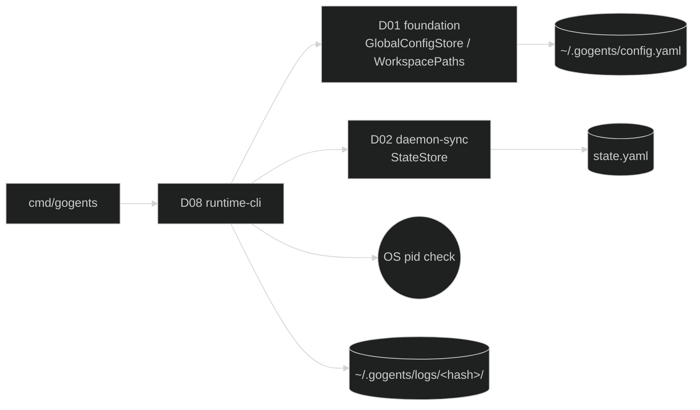

# D08 — runtime-cli

涵蓋需求：R12（Runtime 註冊與觀測）。

本模組提供 `gogents` 的 runtime 註冊與觀測介面：`gogents start` 於啟動時將 runtime 註冊寫入 `~/.gogents/config.yaml`（以 workspace 路徑為 key）；`gogents runtime list` / `gogents runtime status` / `gogents logs` 供使用者與 agent-manager (am) 列出、查詢、匯出 runtime 狀態與日誌。am 不維護執行狀態副本,一律經此介面查詢（單向 `am → gogents`）。

## 1. 模組架構與周邊模組關聯

runtime-cli 是**唯讀觀測層 + 註冊寫入點**。註冊寫入的實際落檔由 D01 `GlobalConfigStore` 執行；本模組定義 `start` 呼叫它的時機（D02 §5.1 啟動序列）與三個查詢子指令。查詢一律讀既有檔案（config.yaml / state.yaml / logs），不改變 daemon 執行行為。

**實作套件**：所有子指令（`start` / `runtime list` / `runtime status` / `logs`）集中於 `internal/cli` 命令層——`cli.Dispatch` 依 `os.Args` 分派，`cmd/gogents/main.go` 僅為薄進入點。本文件（D08）規範 R12 的註冊與觀測子指令；`start` 的生命週期行為屬 D02，`internal/cli` 內僅承載其組裝（composition root）接線。

- **依賴**
  - **D01 foundation**：`GlobalConfigStore`（Load / Upsert / Resolve，見 D01 §4）;`WorkspacePaths`（推 workspace-hash → logs 路徑、state.yaml 路徑）。
  - **D02 daemon-sync**：`StateStore.Load`（讀 `state.yaml` 的 `runtime_state` / `daemon.pid` / `current_task` / `sync`）。
  - **D04 logger**：`gogents start` 已開 logger;查詢子指令為短命 CLI,直接輸出 stdout,不寫 daemon 日誌。
  - **OS**：pid 存活檢核（`kill(pid, 0)` 或讀 `/proc/<pid>`）。
- **被依賴**：CLI 入口 `cmd/gogents`;am 以子行程呼叫本模組的三個查詢子指令。
- **I/O 邊界**：讀 `~/.gogents/config.yaml`、`<workspace>/.gogents/state.yaml`、`~/.gogents/logs/<hash>/*.jsonl`;寫 `~/.gogents/config.yaml`（僅 `start` 的 upsert）。



## 2. 行為契約

- **B1 register（由 `start` 呼叫）**：`start` 啟動時（D02 §5.1）以 `GlobalConfigStore.Upsert({name, workspace, registered_at=now})` 寫入 config.yaml,**以 `workspace` 路徑為主鍵**:已存在則覆蓋 `name` / `registered_at`,否則新增。寫入失敗僅記 warning `config.register_failed`、不中止啟動。config.yaml **不含 `active_runtime`**。
- **B2 runtime list**：`Load` config.yaml,列出所有 `runtimes`（`workspace` / `name` / `registered_at`）;不檢核 pid、不讀 state.yaml。config.yaml 不存在 → 輸出空列表 + exit 0。
- **B3 runtime status <workspace|name>**：以參數 `Resolve` 出 workspace → 讀該 workspace 的 `state.yaml` → 輸出 `runtime_state` / `pid` / `current_task` / `last_sync`。**查詢時檢核 pid**:`daemon.pid` 不存活 → 輸出 `runtime_state: down`（覆蓋 state.yaml 殘留值）。找不到註冊或 state.yaml → exit ≠ 0 + 明確訊息。
- **B4 logs <workspace|name>**：`Resolve` → 推 `~/.gogents/logs/<hash>/` → 輸出 `daemon.jsonl`（預設）;供 am `audit export` 併入。找不到 → exit ≠ 0。
- **B5 name 反查規則**：參數可為 workspace 絕對路徑或 runtime name。以 name 指定且多筆同 name（不同 workspace）→ 取 `registered_at` 最近者;以 workspace 路徑指定則精確匹配（主鍵）。
- **B6 唯讀不變量**：`list` / `status` / `logs` **不寫任何檔案**、不改 daemon 行為、不觸碰 task.yaml / state.yaml。僅 `start` 的 register 步驟寫 config.yaml。

## 3. 資料結構

### 3.1 CLI 參數

| 指令                              | 參數                | 說明                              |
| --------------------------------- | ------------------- | --------------------------------- |
| `gogents runtime list`            | —                   | 列出所有已註冊 runtime            |
| `gogents runtime status <target>` | `<workspace\|name>` | 查單一 runtime 即時狀態           |
| `gogents logs <target>`           | `<workspace\|name>`;`--error`（可選,輸出 error.jsonl） | 輸出 runtime 日誌 |

### 3.2 status 輸出欄位

| 欄位            | 來源                                  | 備註                                 |
| --------------- | ------------------------------------- | ------------------------------------ |
| `workspace`     | config.yaml（Resolve）                | —                                    |
| `name`          | config.yaml                           | —                                    |
| `runtime_state`  | state.yaml `runtime_state`             | pid 不存活時覆為 `down`              |
| `pid`           | state.yaml `daemon.pid`               | —                                    |
| `alive`         | OS pid 檢核                           | bool                                 |
| `current_task`  | state.yaml `current_task.task_id`     | 無則 null                            |
| `last_sync_at`  | state.yaml `sync.last_sync_at`        | —                                    |
| `last_sync_status` | state.yaml `sync.last_sync_status` | success / failed                     |

輸出格式：預設人類可讀表列;`--json`（可選）供 am 程式化解析。

### 3.3 pid 存活檢核

以 `syscall.Kill(pid, 0)`（或讀 `/proc/<pid>`）判定;回 `ESRCH` → 不存活。存活判定**不驗證該 pid 確為 gogents daemon**（目前版本簡化;pid 重用屬罕見,由 `daemon.started_at` 佐證留待後續）。

## 4. 關鍵介面

```go
package cli

// Register 由 gogents start 於啟動序列呼叫（D02 §5.1）。
func Register(gcfg foundation.GlobalConfigStore, name, workspace string) error

// List 對應 gogents runtime list。
func List(gcfg foundation.GlobalConfigStore) ([]RuntimeView, error)

// Status 對應 gogents runtime status;內含 pid 檢核與 down 覆寫。
func Status(gcfg foundation.GlobalConfigStore, target string) (StatusView, error)

// Logs 對應 gogents logs;回傳日誌檔路徑供 CLI 串流輸出。
func Logs(gcfg foundation.GlobalConfigStore, paths foundation.WorkspacePaths, target string, errOnly bool) (logPath string, err error)

type RuntimeView struct {
    Name         string
    Workspace    string
    RegisteredAt time.Time
}

type StatusView struct {
    RuntimeView
    RuntimeState    string   // state.yaml 值;pid 不存活時為 "down"
    Pid            int
    Alive          bool
    CurrentTask    string   // 空字串表示無
    LastSyncAt     time.Time
    LastSyncStatus string
}
```

`Status` 內部：`gcfg.Resolve(target)` → 建 `WorkspacePaths(workspace)` → `StateStore(paths).Load()` → pid 檢核 → 若 `!alive` 則 `RuntimeState = "down"`。

## 5. 程式資料流

### 5.1 register（start 啟動序列內）

```
start:
  ...（preflight、logger、repo）
  gcfg := D01.NewGlobalConfigStore()
  err := cli.Register(gcfg, cfg.RuntimeName, ws)
     └─ gcfg.Upsert({name, workspace=ws, registered_at=now})  // 以 workspace 為 key
  if err != nil: emit warning "config.register_failed"          // 不中止
  else:          emit info "daemon.registered" {workspace, name}
  ...（state.yaml、重啟恢復、主迴圈）
```

### 5.2 runtime status

```
Status(gcfg, target):
  reg, err := gcfg.Resolve(target)          // workspace 路徑或 name
  if err == ErrRuntimeNotRegistered: return {}, err
  paths := NewWorkspacePaths(reg.Workspace)
  st, err := StateStore(paths).Load()
  if err != nil: return {}, err             // state.yaml 不存在 / 損毀
  alive := pidAlive(st.Daemon.Pid)
  view := StatusView{ ...from reg & st...,  Alive: alive }
  if !alive: view.RuntimeState = "down"      // 覆蓋殘留值（死掉的 daemon 無法自我更新）
  return view, nil
```

### 5.3 logs

```
Logs(gcfg, _, target, errOnly):
  reg := gcfg.Resolve(target)
  paths := NewWorkspacePaths(reg.Workspace)
  return errOnly ? paths.ErrorLog() : paths.DaemonLog(), nil
  // CLI 層負責 open + 串流至 stdout（tail / cat 語義由實作決定）
```

## 6. 錯誤處理

| 情境                                  | 分類     | 處理                                                       |
| ------------------------------------- | -------- | ---------------------------------------------------------- |
| register upsert 失敗（磁碟 / 權限）   | 暫時     | warning `config.register_failed`;**不中止 start**          |
| status / logs 目標未註冊              | 使用者錯 | exit ≠ 0;訊息列出可用 runtime 提示 `runtime list`          |
| status 目標 state.yaml 不存在 / 損毀  | 使用者錯 | exit ≠ 0;訊息指出 workspace 可能未曾啟動或檔案損毀         |
| status pid 不存活                     | 正常     | `runtime_state: down`;exit 0（查詢本身成功）                |
| name 多筆同名                         | 歧義     | 取 `registered_at` 最近者;（可選）warning 提示以 workspace 精確指定 |
| logs 日誌檔不存在                     | 使用者錯 | exit ≠ 0;訊息指出該 runtime 尚無日誌                       |

查詢子指令為短命 CLI,錯誤直接寫 stderr + 非零 exit,不寫 daemon.jsonl。

## 7. 驗收方式

本模組的 `start` 註冊部分由 **D02 啟動序列驗收**覆蓋（觀察 `~/.gogents/config.yaml` 出現對應 runtime 條目）;三個查詢子指令屬**可執行產出**,以真實命令驗收。

### 7.1 前置

- 至少一個已 `gogents start` 過的 workspace（config.yaml 有註冊、state.yaml 存在）。

### 7.2 正常路徑

| 步驟 | 動作                                                   | 觀察點                                                                          |
| ---- | ------------------------------------------------------ | ------------------------------------------------------------------------------- |
| A    | `gogents start --workspace $WS &`                      | `~/.gogents/config.yaml` 出現 `{name, workspace=$WS, registered_at}`;`daemon.registered` 事件 |
| B    | 於同路徑刪 workspace 後重建、再 `start`                | config.yaml 該 workspace 條目被 **覆蓋更新**（非新增第二筆）                    |
| C    | `gogents runtime list`                                 | 列出 $WS 對應 runtime                                                           |
| D    | `gogents runtime status $WS`                           | 輸出 `runtime_state`（idle/executing…）、`pid`、`current_task`、`last_sync`      |
| E    | `kill -9 <pid>` 後 `gogents runtime status $WS`        | `runtime_state: down`、`alive: false`;exit 0                                    |
| F    | `gogents logs $WS`                                      | 輸出該 runtime `daemon.jsonl` 內容;`--error` 輸出 `error.jsonl`                 |

### 7.3 錯誤路徑

| 破壞                              | 預期                                                       |
| --------------------------------- | ---------------------------------------------------------- |
| `runtime status <未註冊 name>`    | exit ≠ 0;提示 `runtime list`                              |
| `runtime status` 指向 state.yaml 缺失的 workspace | exit ≠ 0;訊息指出未曾啟動                  |
| `logs <未註冊>`                   | exit ≠ 0                                                   |

### 7.4 通過條件

- `start` 後 config.yaml 以 workspace 為 key upsert（同路徑重跑不長出重複條目、無 `active_runtime` 欄位）。
- `runtime status` 於 daemon 存活時回報 state.yaml 的 `runtime_state`,daemon 不存活時回報 `down`。
- 三個查詢子指令全程**不修改** config.yaml / state.yaml / task.yaml（可用 mtime 觀察）。
