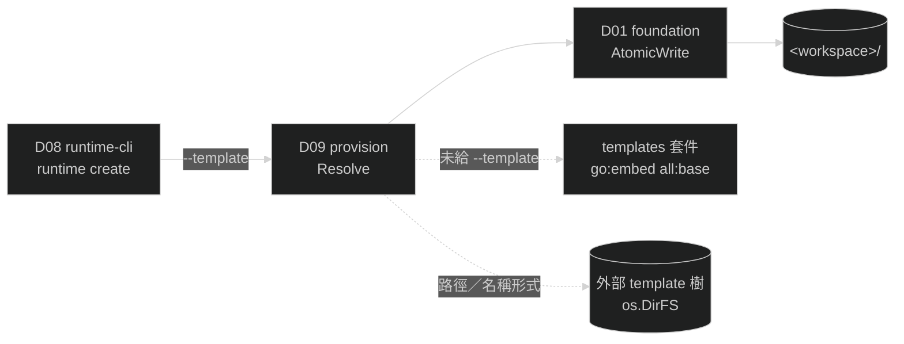

# D09 — provision

涵蓋需求：R13（Workspace 佈建）。

本模組由一棵 template 樹 materialize 出一個 workspace：解析出來源樹、走訪之、`.tmpl` 檔經 `text/template` 展開、其餘原樣複製，落到目標 workspace 的對應相對路徑。來源樹可為內建 template（以 `go:embed` 打包進 binary，使只取得 release binary 的使用者無需外部檔案即可佈建）或使用者指定的外部目錄（§3.1）。互動確認與終端輸出不屬本模組——本模組提供**來源解析**、**目標狀態判定**與**佈建計畫**供命令層決策，自身無 stdin／stdout 依賴。

## 1. 模組架構與周邊模組關聯

provision 是**純檔案系統 library**：輸入一個 `fs.FS`（template 來源）與一個目標路徑，輸出落地的檔案。它不讀 runtime.yaml、不碰註冊表、不啟動任何行程，也不決定「該不該覆蓋」——後者屬命令層（D08 `runtime create`）依 `Inspect` 結果與使用者確認決定。

`Resolve` 是唯一的來源決策點：`fs.FS` 之後的所有流程（`Plan` / `Materialize`）對來源是內建或外部**一律無感**，同一套規則適用兩者。

- **依賴**
  - **D01 foundation**：`AtomicWrite`（write-tmp → fsync → rename），與 `GlobalConfigStore` 共用同一份原子寫入實作。
  - **`templates` 套件**（repo 根）：`Base()`，內建 template 樹的 embed 宣告落點（§3.1）。
  - **標準庫**：`io/fs`（來源抽象）、`os`（`DirFS`，外部樹來源；`Getenv`，`GOGENTS_TEMPLATES`）、`text/template`（展開）。
  - **環境變數 `GOGENTS_TEMPLATES`**：名稱形式的展開基底（§3.1）。與 D01 的 `GlobalHome`／`GOGENTS_HOME` 各自獨立——全域家目錄是註冊表與日誌的狀態目錄，不作為 template 落點，故此解析不經 foundation。
- **被依賴**：D08 `runtime create` 子指令。
- **I/O 邊界**：讀 template 來源（embed FS 或外部目錄）；寫 `<workspace>/` 底下由 template 樹決定的相對路徑。**不刪除任何檔案**。



## 2. 行為契約

- **B0 來源解析**：`Resolve` 依 §3.1 的優先序選出**唯一一棵**來源樹並回傳 `fs.FS`。三個來源互斥，選定即不再參考其餘；**不做來源疊加**，不與內建 template 合併。外部來源解析不出目錄一律回 `ErrTemplateNotFound`，**不落回內建 template**——使用者明示 `--template` 就是要那棵樹，靜默落回會產出「看似成功、內容卻不是他要的」workspace。
- **B1 template 樹映射**：來源樹內的相對路徑即目標 workspace 內的相對路徑，無任何路徑映射規則，樹根與 workspace 根之間無中介層。目錄以 `0o750` 建立（已存在則沿用）；`*.tmpl` 檔經展開後去掉 `.tmpl` 後綴寫入；其餘檔案原樣複製，一律 `0o600`（不保留來源權限位元）。新增 template 檔案不需改本模組程式碼。
- **B1a 只處理一般檔案與目錄**：外部樹可能含 embed 不可能產生的項目（symlink、device、socket 等）。`Plan` 與 `Materialize` 走訪遇非一般檔案一律回 `ErrTemplateInvalid`，**不靜默略過**——略過會產出看似成功、卻缺檔的 workspace。`Plan` 亦檢查，使無效的樹在**確認提示之前**就失敗。
- **B2 展開嚴格性**：`text/template` 以 `Option("missingkey=error")` 執行；引用不存在的欄位或語法錯誤一律回 `ErrTemplateInvalid`，不 silently 留空。
- **B2a 不驗證樹的內容**：本模組不檢查來源樹是否含 `runtime.yaml.tmpl`、不驗證展開結果是否合 runtime.yaml schema。展開為無寫死單檔邏輯的通用規則（B1），外部樹的用途由使用者定義；後果由 `gogents start` 的既有 schema 驗證呈現。
- **B3 目標狀態判定**：`Inspect` 將目標路徑分類為 `Absent` / `EmptyDir` / `NonEmptyDir` / `NotDir`，供命令層決定放行、確認或拒絕。本模組不提示、不讀 stdin。
- **B4 佈建計畫**：`Plan` 走訪來源樹，回傳每個將落地的目標相對路徑與其是否覆蓋既有檔案，供命令層在確認提示中列出。`Plan` **不寫入任何檔案**，但套用 B1a 的檢查（無效的樹於提示前即失敗）。
- **B5 不刪除不變量**：`Materialize` 只新增檔案與覆蓋同名檔案；workspace 內其餘檔案一律不動。**失敗時不做任何回滾刪除**，已寫入的檔案保留，並隨 error 回傳其清單供呼叫端列出。
- **B6 原子寫入**：每個檔案經 `AtomicWrite` 落地，不留半寫檔案與暫存檔殘留。B5 的「保留已寫入檔案」指的是已完成落地的完整檔案。
- **B7 重跑收斂**：同一 `Spec` 與同一來源樹重跑 `Materialize`，以相同內容覆蓋同名檔案，目標狀態收斂至同一結果。
- **B8 無日誌**：本模組為短命 CLI 的被呼叫端，不發出任何 daemon 日誌事件；失敗一律以 error 回傳呼叫端。

## 3. 資料結構

### 3.1 template 來源

`Resolve(template string) (fs.FS, error)` 依下表選出唯一來源（B0）。`template` 為 `--template` 的值，空字串代表未給旗標（命令層負責把 `--template=` 的空值攔成旗標驗證錯誤，不傳到此）。

| 序 | 條件 | 來源樹 | 實作 |
| --- | --- | --- | --- |
| 1 | `template` 為路徑形式 | 該路徑對應的目錄 | `os.DirFS(template)` |
| 2 | `template` 為名稱形式、`$GOGENTS_TEMPLATES` 非空 | `$GOGENTS_TEMPLATES/<template>/` | `os.DirFS(filepath.Join(env, template))` |
| 3 | `template` 為名稱形式、`$GOGENTS_TEMPLATES` 空 | `<當前目錄>/<template>/` | `os.DirFS(template)` |
| 4 | `template` 為空字串 | 內建 template | `templates.Base()` |

序 1–3 解析出的路徑須存在且為目錄，否則回 `ErrTemplateNotFound`（§6）。**存在性檢查在 `Resolve` 內完成**：`os.DirFS` 不驗證路徑，錯誤會延到走訪時才浮現，屆時已無法分辨「來源不存在」與「走訪失敗」。

**形式判別**：值含路徑分隔符即路徑形式，否則名稱形式。只看字面形式，**不看目錄是否存在**——`rust-svc` 永遠是名稱，即使當前目錄剛好有該目錄；要指定當前目錄下的樹又繞過 `GOGENTS_TEMPLATES`，寫 `./rust-svc`。此規則使解析結果只由輸入決定，不隨檔案系統狀態漂移。

| 值 | 形式 |
| --- | --- |
| `./my-tpl`、`../tpl`、`/opt/tpl`、`a/b` | 路徑 |
| `rust-svc` | 名稱 |

**`GOGENTS_TEMPLATES` 是名稱形式的展開基底，不是搜尋路徑**：單一路徑值（非 `PATH` 式多路徑串接），且只在名稱形式下生效——序 4 不查該變數，設了變數但未給 `--template` 仍走內建 template。序 2 與序 3 互斥，不互為回退：變數設了就只查變數底下，查不到即報錯，不改查當前目錄。

**內建 template 樹**：

```
templates/base/                    →  <workspace>/
├── .gogents/
│   └── runtime.yaml.tmpl          →  .gogents/runtime.yaml
├── .claude/
│   ├── CLAUDE.md                  →  .claude/CLAUDE.md
│   └── skills/.gitkeep            →  .claude/skills/.gitkeep
└── .mcp.json                      →  .mcp.json
```

**embed 宣告位於 repo 根的 `templates` 套件**（`//go:embed all:base`，匯出 `templates.Base() fs.FS`），非 provision 套件內：`go:embed` 只能嵌入宣告所在套件目錄之下的檔案，而 template 樹按 R13 置於 repo 根。`provision.Builtin()` 轉呼叫 `templates.Base()`。

`all:` 前綴為必要——embed 的預設規則忽略 `.` 開頭的檔案與目錄，缺少該前綴時 `.gogents/`、`.claude/`、`.mcp.json` 皆不會進入 binary。

**外部樹與內建樹同構**：解析出的目錄本身即樹根（`templates.Base()` 亦 `fs.Sub` 到 `base/` 才回傳），兩者皆以樹根下的相對路徑對應 workspace 相對路徑。repo 內 `templates/` 是收納目錄、`base/` 才是樹根，故 `$GOGENTS_TEMPLATES` 對應的是收納目錄那層——使用者把 `templates/base/` 整棵複製到 `$GOGENTS_TEMPLATES/<name>/` 即可用。

### 3.2 `Spec` 欄位與 template 變數

`Spec` 的匯出欄位即 `runtime.yaml.tmpl` 可引用的變數（`{{.Name}}` 等）。

| 欄位 | 來源旗標 | runtime.yaml 落點 | 空值語意 |
| --- | --- | --- | --- |
| `Name` | `<name>` | `runtime_name` | 不允許空 |
| `RepoURL` | `--repo` | `project.repo.url` | 不允許空 |
| `Branch` | `--branch` | `project.repo.default_branch` | 不允許空（命令層預設 `main`） |
| `Agent` | `--agent` | `agent.type` | 不允許空 |
| `Model` | `--model` | `agent.model` | 不允許空 |
| `Source` | `--source` | `source.type` | 不允許空 |
| `Label` | `--label` | `source.filter.label` | 不允許空（命令層預設 `<name>`） |
| `Instance` | `--instance` | `source.instance` | 空＝該欄位不輸出 |
| `TicketsPath` | `--tickets-dir` | `source.path` | 空＝該欄位不輸出 |

`runtime.yaml.tmpl` 的條件展開：`source.instance` 僅在 `Source == "github_issue"` 時輸出；`source.path` 僅在 `TicketsPath` 非空時輸出。固定值（不進 `Spec`）：`source.sync_interval: 30s`、`task_policy.max_failures: 3`。

`Spec` 欄位的必填與 per-source 相容性驗證屬命令層（D08）；本模組只在展開時對缺值報錯（B2）。

### 3.3 目標狀態列舉

| 值 | 條件 | 命令層對應行為（見 D08 B8） |
| --- | --- | --- |
| `TargetAbsent` | 路徑不存在 | 直接佈建 |
| `TargetEmptyDir` | 存在、為目錄、無任何項目 | 直接佈建 |
| `TargetNonEmptyDir` | 存在、為目錄、有項目 | 需確認或 `--force` |
| `TargetNotDir` | 存在、非目錄 | 一律拒絕 |

### 3.4 事件

本模組不發出日誌事件（B8）。

## 4. 關鍵介面

以下為簽章（method signature：名稱 + 參數型別 + 回傳型別），不含實作邏輯。

```go
package provision

// Spec 是 template 展開的資料模型；匯出欄位即 template 可引用的變數（§3.2）。
type Spec struct {
    Name        string
    RepoURL     string
    Branch      string
    Agent       string
    Model       string
    Source      string
    Label       string
    Instance    string
    TicketsPath string
}

// TargetState 是目標 workspace 路徑的分類（§3.3）。
type TargetState int

const (
    TargetAbsent TargetState = iota
    TargetEmptyDir
    TargetNonEmptyDir
    TargetNotDir
)

// Entry 是佈建計畫的一筆：Path 為 workspace 相對路徑（已去 .tmpl 後綴），
// Overwrite 表示該路徑已存在既有檔案。
type Entry struct {
    Path      string
    Overwrite bool
}

// Builtin 回傳內建 template 樹（轉呼叫 templates.Base()，見 §3.1）。
func Builtin() fs.FS

// Resolve 依 §3.1 的優先序選出唯一一棵來源樹（B0）。template 為 --template 的
// 值,空字串代表未給旗標 → 內建樹。外部來源不存在或非目錄 → ErrTemplateNotFound。
func Resolve(template string) (fs.FS, error)

// Inspect 判定目標 workspace 路徑的狀態（B3）。
func Inspect(workspace string) (TargetState, error)

// Plan 走訪 src，回傳將落地的項目及其覆蓋狀態（B4）；不寫入任何檔案。
func Plan(src fs.FS, workspace string) ([]Entry, error)

// Materialize 將 src 展開到 workspace（B1）。written 為已完成落地的 workspace
// 相對路徑清單；失敗時一併回傳（B5），呼叫端據此告知使用者殘留檔案。
func Materialize(src fs.FS, workspace string, spec Spec) (written []string, err error)

var (
    ErrTemplateNotFound = errors.New("template not found")
    ErrTemplateInvalid  = errors.New("template invalid")
    ErrWorkspaceExists  = errors.New("workspace path exists and is not a directory")
    ErrIO               = errors.New("provision io error")
)
```

`ErrTemplateNotFound`（來源樹找不到）與 `ErrTemplateInvalid`（樹找到了但內容有問題：展開失敗、非一般檔案）分屬解析期與展開期，刻意不合併——前者一律發生於**寫入任何檔案之前**，後者可能留下殘留檔案（B5），使用者的後續動作不同。

`ErrWorkspaceNotEmpty` 不屬本模組——非空目錄是否放行由命令層依 `Inspect` 與 `--force`／確認決定（D08 B8）。

## 5. 程式資料流

### 5.1 Resolve

```
Resolve(template):
  if template == "":
    return templates.Base(), nil                         // 內建樹,無存在性檢查（embed 恆在）
  if 含路徑分隔符(template):
    dir := template                                      // 路徑形式,無視 GOGENTS_TEMPLATES
  else if env := getenv("GOGENTS_TEMPLATES"); env != "":
    dir := filepath.Join(env, template)                  // 名稱形式,展開基底
  else:
    dir := template                                      // 名稱形式,當前目錄
  info := os.Stat(dir)
    └─ 不存在 / 非目錄 → ErrTemplateNotFound（訊息含 dir 絕對路徑與其來源）
    └─ 其他失敗        → ErrIO
  return os.DirFS(dir), nil
  // 任一分支選定即返回;不回退、不疊加（B0）
```

### 5.2 Materialize

```
Materialize(src, ws, spec):
  written := []
  walk src (fs.WalkDir, 深度優先, 路徑穩定排序):
    dir  → MkdirAll(ws/rel, 0o750)                       // 失敗 → ErrIO, return written
    非一般檔案 → ErrTemplateInvalid, return written      // symlink / device 等（B1a）
    file →
      if strings.HasSuffix(rel, ".tmpl"):
        data := renderTemplate(content, spec)             // missingkey=error
           └─ 失敗 → ErrTemplateInvalid, return written
        target := strings.TrimSuffix(rel, ".tmpl")
      else:
        data, target := content, rel
      foundation.AtomicWrite(ws/target, data, 0o600)      // 失敗 → ErrIO, return written
      written = append(written, target)
  return written, nil
  // 任何失敗一律直接返回；不刪除 ws 底下任何已落地的檔案（B5）
```

### 5.3 命令層的呼叫序（D08 `runtime create`）

```
runtime create:
  spec := 旗標解析 + 驗證 + 預設值（Label←Name, Branch←"main"）
  src := provision.Resolve(opts.Template)    // 失敗 → 錯誤退出,不寫入
  state := provision.Inspect(ws)
  switch state:
    TargetNotDir       → 錯誤退出
    TargetNonEmptyDir  → 非 --force 時:
                            entries := provision.Plan(src, ws)
                            非互動終端 → 錯誤退出（提示 --force）
                            列出 entries（標示 Overwrite）→ 讀 stdin → 非 y → 中止退出
    其餘              → 直接進行
  written, err := provision.Materialize(src, ws, spec)
  err != nil → 錯誤訊息列出 written（殘留檔案）→ 非零 exit
  成功       → 印出 workspace 路徑與後續 `gogents start --workspace <ws>` 提示
```

## 6. 錯誤處理

| 情境 | 分類 | 處理 |
| --- | --- | --- |
| `--template` 解析出的目錄不存在／非目錄 | 使用者錯 | `Resolve` 回 `ErrTemplateNotFound`；命令層非零 exit，**不寫入**；訊息含查找的絕對路徑與其來自 `GOGENTS_TEMPLATES` 或當前目錄 |
| `Resolve` stat 失敗（權限） | 暫時 | 回 `ErrIO`；命令層非零 exit，不寫入 |
| 目標路徑存在但非目錄 | 使用者錯 | `Inspect` 回 `TargetNotDir`；命令層以 `ErrWorkspaceExists` 退出，不寫入 |
| `Inspect` stat／readdir 失敗（權限） | 暫時 | 回 `ErrIO`；命令層非零 exit，不寫入 |
| template 展開缺值／語法錯 | 使用者錯（外部樹）／程式錯誤（內建樹） | `ErrTemplateInvalid`；已寫入檔案保留並回傳清單 |
| 來源樹含非一般檔案（symlink／device 等） | 使用者錯（外部樹） | `ErrTemplateInvalid`；已寫入檔案保留並回傳清單（B1a） |
| 建目錄／寫檔失敗（磁碟滿、權限） | 暫時 | `ErrIO`；已寫入檔案保留並回傳清單 |
| 來源樹缺 `.gogents/runtime.yaml.tmpl` | 使用者錯（外部樹）／程式錯誤（內建樹損毀） | 本模組不攔截（B2a）；產出的 workspace 缺 runtime.yaml，由 `gogents start` 的 `ErrConfigParse` 攔截 |

本模組不重試、不藏錯：一律回 error 給命令層（library 不藏重試）。命令層為短命 CLI，錯誤寫 stderr + 非零 exit，不寫 daemon 日誌。

## 7. 驗收方式

本模組屬**基礎建設 library**，無獨立可執行產出，由 D08 `runtime create` 的驗收端到端覆蓋（見 D08 §7）。可觀測訊號為佈建後的檔案系統狀態：

- `<ws>/.gogents/runtime.yaml` 存在且欄位與旗標一致（含 `source` 條件展開的有無）。
- `<ws>/.claude/CLAUDE.md`、`<ws>/.claude/skills/`、`<ws>/.mcp.json` 存在。
- 檔案權限為 `0o600`、目錄為 `0o750`；無 `.tmp.*` 暫存檔殘留。
- 佈建前既有於 workspace 內、且不在 template 樹中的檔案，佈建後內容與 mtime 不變。
- 指定 `--template` 指向一棵外部樹時，落地的檔案集**恰為該樹的內容**：內建 template 有而外部樹無的路徑（如 `.mcp.json`）不得出現於 workspace（B0 不疊加）。
- `--template` 指向不存在的目錄時，workspace 未被建立、目標目錄下無任何新檔（`Resolve` 先於任何寫入）。
