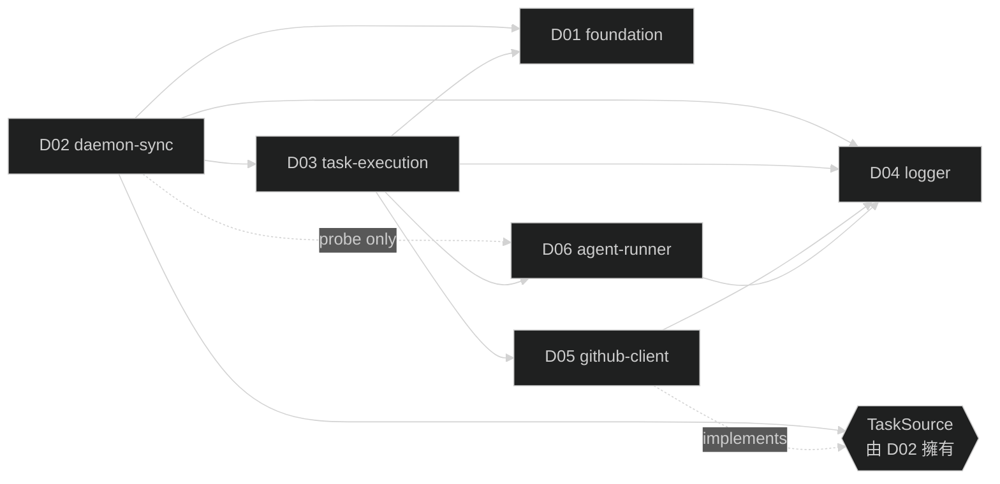

# Gogents 細部設計文件 — 規劃與撰寫指南

本檔案是 `docs/designs/` 的索引與撰寫規範。新 session 讀完即可接手撰寫未完成的設計文件，也作為後續閱讀 / 修改設計時的入口。

- **上游**：`docs/requirements/requirement.md`、`docs/requirements/reqs/R01–R13`
- **設計文件職責**：把需求轉為「coding agent 可直接依此開發」的規格；不寫實作程式碼（除關鍵介面的 method signature）

---

## 1. 模組與設計文件

以「一個階段 = 一個主模組」為原則，跨階段共用或可替換的能力獨立成模組。R10（錯誤處理）不獨立，以每份設計 §6 內嵌。

| 檔名 | 模組 | 角色 | 涵蓋需求 | 備註 |
|---|---|---|---|---|
| `D01-foundation.md` | `foundation` | Stage 1 主模組 | R01 + R02 + R03 | 資料模型 / 設定 / 路徑 / 狀態機；底層 library |
| `D02-daemon-sync.md` | `daemon-sync` | Stage 2 主模組 | R04 + R05 | 提供 `gogents start`；**擁有 `TaskSource` 抽象介面**（由 D05 實作） |
| `D03-task-execution.md` | `task-execution` | Stage 3 主模組 | R06 + R07 + R08 | 切 branch、組 input、呼 agent、解析 result、回報 GitHub |
| `D04-logger.md` | `logger` | 橫切共用 | R09 | JSONL 雙檔；事件 schema 早期釘死 |
| `D05-github-client.md` | `github-client` | 共用基礎 | 支援 R05 / R08 | `gh` CLI 封裝 + `TaskSource`（GitHub Issue）實作 + `SourceProbe` + `FeedbackReporter` |
| `D06-agent-runner.md` | `agent-runner` | 適配層 | 支援 R06 | Agent CLI 抽象；Claude 實作 |
| `D07-local-source.md` | `local-source` | concrete strategy | 支援 R11 | `local` 任務源：讀本地 ticket inbox 的 `TaskSource` / `SourceProbe` / `ContentFetcher` / `FeedbackReporter`（與 D05 並列） |
| `D08-runtime-cli.md` | `runtime-cli` | 命令介面 | R12 + R13（命令面） | `gogents runtime create/list/status/remove`、`gogents logs`；runtime 註冊寫入 `~/.gogents/config.yaml` |
| `D09-provision.md` | `provision` | 佈建 library | R13 | 由內建 template 樹 materialize 出 workspace；`go:embed` 打包 |

### 相依圖（實線 = 直接依賴；虛線 = 介面實作）

### 撰寫順序

依相依方向，下游引用上游已定義介面：**D01 → D04 → D02 → D05 → D06 → D03 → D07 → D09 → D08**。

D07（local-source）與 D05（github-client）並列，同為 `source.type` 的 concrete strategy——實作 D02 §4.3 的 `TaskSource`、D01 的 `SourceProbe`、D03 §4.3 的 `TaskContentFetcher`、D05 §4.3 的 `FeedbackReporter` 四個介面；dispatcher（依 `source.type` 選 concrete）仍在 D02 §4.4，新增 `local` case，OCP 不改上游。D08（runtime-cli）依賴 D01（`WorkspacePaths` / config.yaml）、D02（`state.yaml`）、D04（logs 路徑）、D09（materialize），提供 `start` 註冊寫入、觀測子指令與 `runtime create`。D09（provision）為純檔案系統 library，只依賴 D01 的 `AtomicWrite`；互動確認與終端輸出留在 D08，D09 僅提供目標狀態判定與佈建計畫。

### 階段對應實作範圍

| 階段 | 範圍 | 驗收目標 |
|---|---|---|
| Stage 1 | D01 全量 | 由 Stage 2 端到端覆蓋 |
| Stage 2 | D04 全量；D05（僅 `TaskSource` + `SourceProbe`）；D02 全量；D03 提供 no-op `TaskExecutor`；D06 僅 `AgentProbe` | `gogents start` 啟動、同步 issue 到本機、SIGTERM 優雅關閉、重啟恢復 |
| Stage 3 | D05 補 feedback（comment / label / mention）；D06 補 `AgentExecutor`；D03 全量 | 端到端：開 issue → agent 執行 → 開 PR → GitHub 回報 |
| Stage 4 | 各模組 §6 錯誤處理落實 | 故障注入驗證 |

### Stage 範圍邊界紀律（**極重要**）

**反模式**：撰寫 / 實作 A 模組時，為了讓 A 跑起來，順手把 B 模組的功能實作掉；後來真正做 B 時邏輯偏移、資料結構打架。

**紀律**：

- 若 A 模組依賴 Stage N+1 才完成的 B 模組，A 的 §1.1「Stage 範圍邊界」以表格列：B 在本階段需要什麼最小版、完整功能屬哪份設計、對接方式（no-op / Stub）。
- 最小版 / Stub 的**規格**寫在 B 自己的設計文件（例：D03 的 Stage 2 no-op 版、D06 的 probe-only 版），不是寫在呼叫端 A。
- 發現「缺的功能尚未設計」→ 回頭補 B 的設計文件，不就地實作。

D02 §1.1 是此原則的參考範例。

---

## 2. 設計文件章節結構（七章節，順序固定）

| # | 章節 | 內容 |
|---|---|---|
| 1 | 模組架構與周邊模組關聯 | 職責切面、依賴誰 / 被誰依賴、I/O 邊界、mermaid 圖（深色主題）。可加 §1.1「目前範圍邊界」子節 |
| 2 | 行為契約 | 對外承諾的行為與不變量（B1、B2、…），不寫實作 |
| 3 | 資料結構 | YAML / JSON / Struct schema、枚舉、欄位寫入者、事件命名表 |
| 4 | 關鍵介面 | **method signature**（名稱 + 參數型別 + 回傳型別）與必要型別、錯誤常數；不含實作邏輯；以 Go 語法呈現；第一段須釋義「簽章」 |
| 5 | 程式資料流 | 虛擬碼 / 序列描述，入口 → 呼叫序 → 出口；跨模組呼叫順序 |
| 6 | 錯誤處理 | R10 內嵌，表格化：情境 / 分類（暫時 / 永久 / 程式錯誤）/ 事件 / 處理動作 |
| 7 | 驗收方式 | 本階段如何實際跑起來觀察結果 |

**篇幅**：目標 300 字內（正文不含表格、程式碼、mermaid）。不為壓字數而精簡過度；表格與程式碼區塊承載細節。跨兩份以上需求的主模組可放寬，但每章仍緊湊。

---

## 3. 撰寫原則

### 介面 vs 實作

- 只寫「契約」：§2 行為、§3 資料、§4 method signature。
- 不寫實作：鎖策略、goroutine 佈線、parsing 細節、重試迴圈、檔案鎖實作等。
- **抽象介面由消費端擁有**：例 `TaskSource` 由 D02 擁有並定義，D05 實作；上游不綁死下游型別，便於擴充。

### 不為「測試」引入抽象

- 驗收採真實整合測試，不在設計加入只為 mock 而生的抽象（如 Clock / FakeFS）。
- 要調整時間節奏走**設定檔**（例：`sync_interval: 10s`），不替換時鐘。
- 測試性隔離若真需要，由實作者在實作時處理，不寫入設計文件。

### 抽象化來源與適配層

- Syncer / 主迴圈只認 `TaskSource`（`List` / `Get` / `Kind`）與抽象錯誤（`ErrSourceNotFound` / `ErrSourceAuth` / `ErrSourceTransient`）。
- Agent 執行只認 `AgentExecutor`；Claude 是實作，不是介面。
- 新增來源 / agent 型別 = 新增實作，不改上游設計。

### 事件日誌命名

- 格式 `domain.action`；分域：`daemon.*` / `sync.*` / `task.*` / `github.*` / `config.*` / `workspace.*`（詳見 D04 / R09）。
- 每份設計 §3 列本模組發出的事件表：事件名 / 何時發 / 關鍵 fields。

### 文風

- 設計文件是規格，不是 prompt。用陳述句寫明契約；不寫「請注意 X」、「建議使用 Y」。
- 繁體中文敘述；英文術語、識別字保留原文。
- **不以 Phase / Stage 幾作為時序描述**：設計文件呈現**最終規格**，某些能力目前版本較不完整屬實作進度、不屬設計差異。需要表達「已規劃但目前尚未實作」時，改用「目前版本」、「目前尚不」、「目前的唯一實作」等語氣；不寫「Phase 1」、「Stage 2 需要 / Stage 3 補」等字眼。既有設計文件仍沿用舊寫法時不回頭改寫，**新撰寫的設計文件**一律採此規範。
- §1.1 子節若需列出本模組在目前版本對相依的最小需求，以「**目前範圍邊界**」為章節標題；不寫「Stage N 範圍邊界」。

---

## 4. 錯誤處理（R10 內嵌）

- §6 **表格化**：情境 / 分類 / 事件 / 處理動作。
- **分期**：啟動 / 主迴圈 / 關閉 / 恢復；library 型改按「操作類別」分。
- **Library 不藏重試**：底層（如 D01 TaskStore）回 error 給呼叫端；重試與退避屬上游策略。
- **失敗一律走 logger**：error 事件同步寫 `daemon.jsonl` + `error.jsonl`。
- **分類要有後果**：每個分類對應「會不會改 task.status / 會不會退出 daemon / 會不會 +1 failure_count」。

---

## 5. 驗收原則

驗收＝**實際跑、實際觀察**，不寫單元測試，也不用 mock-only 驗收。

| 模組類型 | §7 寫法 |
|---|---|
| **基礎建設 library**（無獨立可執行產出） | 明寫「由上游模組端到端驗收覆蓋」，並列本模組發出的事件清單供上游 grep |
| **階段可執行產出** | 前置條件 → 正常路徑步驟表 → 關閉 / 恢復情境 → 錯誤路徑破壞清單 → 可觀測訊號彙整；使用真實命令、真實 repo、真實 `gh` |

**可觀測訊號**：`daemon.jsonl` / `error.jsonl` 事件 fields；`task.yaml` / `state.yaml`；真實 git branch / PR / GitHub comment / label（Stage 3）；程序 exit code。

**階段範圍**：只驗本階段範圍——Stage 2 不驗 agent 執行 / PR / 回報；Stage 3 涵蓋全鏈路；Stage 4 故障注入補錯誤路徑。

---

## 6. 檔名與格式規範

- 檔名 `D##-<module-name>.md`；兩位數編號；kebab-case；置於 `docs/designs/`。
- 首行標題 `# D## — <module-name>`；第二行（或標題段）明寫「涵蓋需求：R??、R??」。
- Mermaid 深色主題：`%%{init: {'theme':'dark'}}%%`。
- Commit 採 Conventional Commits：`docs: add D0X design`。

---

## 7. 單份設計撰寫 Checklist

- [ ] 七章節齊全（§1～§7）
- [ ] §1 含 mermaid 圖與 I/O 邊界
- [ ] 若對相依模組在目前版本有「最小能力」依賴，§1.1 目前範圍邊界表有填
- [ ] §2 行為契約為 B1、B2、… 可檢驗的不變量
- [ ] §3 含完整 schema + 事件命名表
- [ ] §4 第一段釋義「簽章」；所有介面以 method signature 呈現、無實作
- [ ] §5 資料流覆蓋正常路徑與關鍵分歧
- [ ] §6 表格呈現、覆蓋暫時 / 永久 / 程式錯誤三類
- [ ] §7 明確標示本模組屬「基礎建設」或「階段可執行產出」並給對應驗收形式
- [ ] 無 mock-only 設計、無為測試而生的抽象
- [ ] 無「順手實作其他模組功能」的暗示
