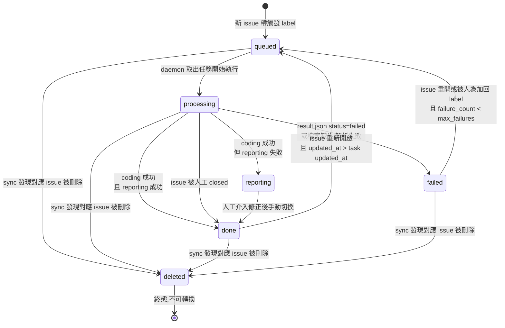

# R03 - 任務狀態模型

> 主需求檔：[requirement.md](../requirement.md)

## 目的

定義任務的狀態機、task.yaml 格式、以及狀態轉換規則。

## 狀態機



## 狀態列表

| 狀態         | 說明                                                                     |
|--------------|--------------------------------------------------------------------------|
| `queued`     | 任務已建立,等待執行                                                      |
| `processing` | 任務執行中(coding 階段)                                                 |
| `reporting`  | Coding 成功、PR 已開,但 GitHub 回寫失敗,需人工介入。不會自動轉回其他狀態 |
| `done`       | 任務完成且 GitHub 已同步(agent 成功 + reporting 成功,或人工 closed)    |
| `failed`     | Coding 階段失敗(agent 失敗、result.json 異常等)                         |
| `deleted`    | 對應的來源 issue 已被刪除,終態,不再轉換                                 |

## Coding 成功的斷點

判定「coding 階段成功」的條件:

- result.json 存在、可解析
- status 欄位為 `success`
- pr_url 欄位存在且非空

過了這個斷點,後續任何 GitHub 回寫失敗都歸為 `reporting`,**不會再往回改成 `failed`**。這樣可以明確區分「開發工作本身失敗」與「結果回寫失敗」,避免使用者誤以為 coding 沒做好而重跑。

## task.yaml 格式

位置:`<workspace>/.gogents/tasks/<task-id>/task.yaml`

```yaml
task_id: "github-42"
status: "reporting"           # queued | processing | reporting | done | failed | deleted

source:
  type: "github_issue"
  instance: "owner/repo"
  number: 42
  url: "https://github.com/owner/repo/issues/42"
  issue_state: "open"         # open | closed
  issue_updated_at: "2026-04-07T10:00:00Z"

execution:
  branch: "task/github-42"    # daemon 建立的分支名
  started_at: "2026-04-07T10:05:00Z"
  finished_at: null
  pr_url: null                # agent 開出的 PR,從 result.json 取得
  failure_count: 0            # 累計失敗次數,達 max_failures 後停止重跑
  reporting_error: null       # 若狀態為 reporting,記錄回寫失敗原因

feedback:
  comment_id: 123456789       # daemon 在 issue 建立的進度 comment ID
  last_label: "processing"

timestamps:
  created_at: "2026-04-07T10:00:00Z"
  updated_at: "2026-04-07T10:05:00Z"
```

## 狀態轉換規則

| 從             | 到         | 觸發條件                                                              |
|----------------|------------|----------------------------------------------------------------------|
| (無)           | queued     | 同步發現新 issue 帶有觸發 label                                       |
| queued         | processing | daemon 從 queue 取出此任務開始執行                                    |
| processing     | done       | coding 成功(達斷點)**且** reporting 成功                            |
| processing     | reporting  | coding 成功(達斷點)**但** reporting 失敗                            |
| processing     | failed     | result.json 顯示 failed、找不到、或解析失敗;`failure_count` +1        |
| processing     | done       | 同步時發現對應 issue 已 closed(人工結案)                             |
| reporting      | done       | 人工介入完成 GitHub 同步後,手動編輯 task.yaml(或未來 admin 通道)   |
| done           | queued     | issue 重新開啟且 updated_at 大於任務 updated_at                       |
| failed         | queued     | issue 重開或人為加回 label,**且** `failure_count < max_failures`      |
| 任意非 deleted | deleted    | sync 發現對應 issue 已被刪除                                          |

非法轉換(例如 done → processing、deleted → 任何狀態、reporting → queued)一律拒絕並記錄錯誤至 error.jsonl。

## reporting 狀態的性質

- **不自動重試**:避免重複發 comment、反覆切換 label
- **failure_count 不增加**:這不是 coding 失敗,不應累計計數
- **不會被 sync 自動轉回 queued**:即使 issue 被重開也不處理,因為 PR 已開、重跑無意義
- **人工介入方式**:
  - 手動到 GitHub 補 comment / 改 label,然後手動編輯 task.yaml 將 status 改為 `done`
  - 未來版本可由 admin 通道提供 `retry-reporting` 指令

## 連續失敗停止機制

當任務從 `processing` 轉為 `failed` 時,`execution.failure_count` 加 1。

當 `failure_count >= max_failures`(門檻來自 runtime.yaml 的 `task_policy.max_failures`,見 R02):

- 任務維持在 `failed` 狀態
- 即使 issue 被重開或重新加觸發 label,sync 不再將其轉回 `queued`
- 每次 sync 偵測到此情況時,僅在首次寫入 warning 日誌(避免每個 sync 週期都寫)
- 解除方式:需人工編輯 task.yaml 將 `failure_count` 歸零,或刪除整個 task 目錄讓 sync 重建

`failure_count` **不會自動歸零**,即使任務後續成功轉為 `done`。這保留累積的失敗紀錄供除錯使用。

## 任務檔案職責劃分

- **task.yaml**:daemon 管理的狀態與中繼資料
- **input.md**:daemon 產生,餵給 agent(見 R06)
- **output.jsonl**:agent 寫入的 stream 輸出(見 R06)
- **result.json**:agent 寫入的結案報告(見 R07)

四個檔案由不同角色寫入,職責明確分離,避免互相覆蓋。daemon 只寫 task.yaml 與 input.md,agent CLI 寫 output.jsonl,agent 自身在 prompt 指示下寫 result.json。

## 並發控制

目前版本單 daemon 一次只處理一個任務,因此 task.yaml 不需要檔案鎖。但 daemon 必須在每次讀寫 task.yaml 時採用「讀-改-寫入臨時檔-rename」的原子寫入模式,避免 daemon 崩潰導致檔案損毀。

## 相關需求

- R01 - Workspace 結構(檔案位置)
- R02 - Runtime 設定檔(max_failures 設定來源)
- R05 - GitHub Issue 同步(負責建立/更新 task.yaml、處理 deleted 狀態)
- R06 - 任務執行流程(負責 status 從 queued → processing)
- R07 - 結果處理(負責 status 從 processing → done/reporting/failed、更新 failure_count)
- R08 - GitHub 狀態回報(回傳成功/失敗決定 done 或 reporting)
