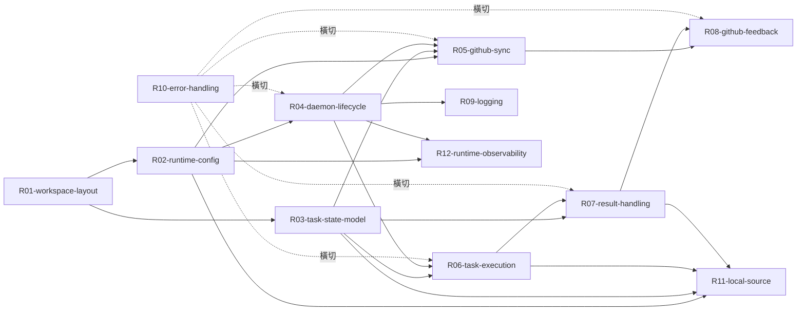

# Gogents 需求文件

## 目標

建立一個本機常駐 daemon,從設定的任務來源接收開發任務,在預先配置好的 workspace 內呼叫本機 coding agent CLI 執行,並將執行結果回報到任務來源。任務來源支援 GitHub Issue(`github_issue`)與本地 ticket inbox(`local`,對接 agent-manager)。

## 核心假設與範圍

- 單一 daemon 對應單一 workspace、單一 git repo、單一任務來源
- 任務來源型別由 `source.type` 決定:`github_issue`(遠端 GitHub Issue)或 `local`(本地 `~/.am/tickets/` ticket inbox);兩者共用同一套 task store、狀態機與執行流程
- Workspace 內的 agent runtime 元素(`.claude/CLAUDE.md`、`.claude/skills/`、`.mcp.json`、AGENTS.md 等)由使用者手動預先配置,daemon 不管理;agent 以 workspace 根為工作目錄,使 workspace 級專長配置生效
- 一次循序處理一個任務,避免 git 狀態衝突
- 目前版本不做容器化、不做 admin 通道、不做多 workspace 管理
- 目前版本不做 archive 機制,任務目錄完成後保留(retention policy 留待後續版本在 runtime.yaml 增加相關設定)

## 需求索引

| ID  | 主題                 | 檔案                                                         | 依賴     | 階段 |
| --- | -------------------- | ------------------------------------------------------------ | -------- | ---- |
| R01 | Workspace 與全域目錄 | [reqs/R01-workspace-layout.md](reqs/R01-workspace-layout.md) | -        | 1    |
| R02 | Runtime 設定檔       | [reqs/R02-runtime-config.md](reqs/R02-runtime-config.md)     | R01      | 1    |
| R03 | 任務狀態模型         | [reqs/R03-task-state-model.md](reqs/R03-task-state-model.md) | R01      | 1    |
| R04 | Daemon 生命週期      | [reqs/R04-daemon-lifecycle.md](reqs/R04-daemon-lifecycle.md) | R01, R02 | 2    |
| R05 | GitHub Issue 同步    | [reqs/R05-github-sync.md](reqs/R05-github-sync.md)           | R02, R03 | 2    |
| R06 | 任務執行流程         | [reqs/R06-task-execution.md](reqs/R06-task-execution.md)     | R03, R04 | 3    |
| R07 | 結果處理             | [reqs/R07-result-handling.md](reqs/R07-result-handling.md)   | R03, R06 | 3    |
| R08 | GitHub 狀態回報      | [reqs/R08-github-feedback.md](reqs/R08-github-feedback.md)   | R05, R07 | 3    |
| R09 | 日誌規範             | [reqs/R09-logging.md](reqs/R09-logging.md)                   | R04      | 2    |
| R10 | 錯誤處理             | [reqs/R10-error-handling.md](reqs/R10-error-handling.md)     | 全部     | 4    |
| R11 | 本地任務源 (local)   | [reqs/R11-local-source.md](reqs/R11-local-source.md)         | R02, R03, R06, R07 | 5 |
| R12 | Runtime 註冊與觀測   | [reqs/R12-runtime-observability.md](reqs/R12-runtime-observability.md) | R02, R04 | 5 |

## 開發階段建議

**Stage 1 — 資料模型與設定(基礎,無執行邏輯)**
R01 → R02 → R03。完成後可以手動建立 workspace、寫 runtime.yaml、手動產生一份 task 目錄,驗證資料結構合理。

**Stage 2 — Daemon 骨架與同步**
R04 → R09 → R05。完成後 daemon 能啟動、從任務來源同步任務到本機 task 檔案、能寫 log,但還不會執行任何 coding agent。這個階段就能驗證「遠端開任務 → 本機看到任務」的路徑。

**Stage 3 — 任務執行與回報**
R06 → R07 → R08。完成後系統就能跑完整流程: 開任務 → daemon 同步 → 呼叫 agent CLI → agent 執行任務 → agent 開 PR → daemon 回報結果到任務來源。

**Stage 4 — 健壯性**
R10。 處理各種失敗情境: agent CLI 崩潰、git 失敗、GitHub API 失敗、daemon 重啟後的狀態恢復。

**Stage 5 — agent-manager (am) 整合**
R11 → R12。新增 `local` 任務源(讀 `~/.am/tickets/` ticket inbox、依 label 過濾、ticket `verify` 驗證、終態 result 回寫 ticket 檔),以及 runtime 註冊(`start` 寫入 `~/.gogents/config.yaml`)與觀測 CLI(`gogents runtime list/status`、`gogents logs`)。完成後 am 可佈署 worker、派工、查詢執行狀態與匯出稽核。

## 依賴關係圖

實線箭頭表示直接依賴(被依賴者必須先定義),虛線箭頭表示橫切關注點(R10 錯誤處理需要參照其他需求的失敗情境)。R11(local 任務源)與 R05(GitHub Issue 同步)為兩個並列的 source concrete;R12 涵蓋 runtime 註冊與觀測 CLI。

## 關鍵檔案索引

本節列出目前版本涉及的所有檔案與其定義位置,方便快速跳轉。

### Workspace 層級檔案(位於 `<workspace>/`)

| 檔案路徑                                | 用途                    | 寫入者    | 定義於   |
| --------------------------------------- | ----------------------- | --------- | -------- |
| `.gogents/runtime.yaml`                 | Workspace 執行設定      | 使用者    | R02      |
| `.gogents/state.yaml`                   | Daemon 執行狀態(含 `runtime_state`) | Daemon | R04      |
| `.gogents/tasks/<task-id>/task.yaml`    | 任務狀態與中繼資料      | Daemon    | R03      |
| `.gogents/tasks/<task-id>/input.md`     | 餵給 agent 的提示詞     | Daemon    | R06      |
| `.gogents/tasks/<task-id>/output.jsonl` | Agent stream 輸出       | Agent CLI | R06      |
| `.gogents/tasks/<task-id>/result.json`  | Agent 結案報告          | Agent     | R07      |
| `<reponame>/`                           | Git clone 的目標 repo   | Daemon    | R01, R04 |
| `<reponame>/AGENTS.md`                  | 專案規範(被 agent 讀取) | 使用者    | R06      |

### 全域檔案(位於 `~/.gogents/`)

| 檔案路徑                             | 用途                      | 寫入者      | 定義於 |
| ------------------------------------ | ------------------------- | ----------- | ------ |
| `config.yaml`                        | runtime 註冊表(以 workspace 路徑為 key) | Daemon(`start`) | R02, R12 |
| `logs/<workspace-hash>/daemon.jsonl` | Daemon 執行日誌           | Daemon      | R09    |
| `logs/<workspace-hash>/error.jsonl`  | Daemon 錯誤日誌           | Daemon      | R09    |

### 本地任務源檔案(位於 `~/.am/tickets/`,`source.type: local` 時)

| 檔案路徑              | 用途                          | 寫入者              | 定義於 |
| --------------------- | ----------------------------- | ------------------- | ------ |
| `<ticket-id>.yaml`    | am 產出的 ticket(任務單);gogents 讀執行所需欄位、回寫 `status` 與 `result` | am(建立)/Daemon(回寫終態) | R11 |

## 術語表

- **Workspace**: 單一 daemon 管理的工作目錄,內含一個 git repo 與 `.gogents/` 管理檔案
- **Runtime**: 一組 workspace + daemon 的配對,以 `runtime_name` 識別;`start` 時以 **workspace 路徑為 key** 註冊到 `~/.gogents/config.yaml`
- **Task**: 從任務來源衍生的一個開發工作單位(GitHub Issue 或 am ticket)
- **Task ID**: 任務的唯一識別字串,格式依 `source.type` 決定:`github_issue` 為 `github-<issue-number>`;`local` 為 ticket 的 `id`
- **Agent CLI**: 本機已安裝好的 coding agent 命令列工具(如 `gemini`、`claude` 等)
- **Worker State**: `state.yaml` 記錄的顯式執行階段(`idle` / `executing` / `verifying` / `reporting` / `failed` / `broken`);`down` 由查詢端依 pid 不存在推得,不落檔
- **agent-manager (am)**: 本機 Agent 運作環境的控制面(Tower);產出 ticket 交 gogents 執行,並向 gogents 查詢 runtime 狀態與日誌。am 側「worker/ticket」對應 gogents 側「runtime/task」
- **Ticket**: am 產出的任務單,`source.type: local` 時為 gogents 的任務來源;YAML 檔置於 `~/.am/tickets/<id>.yaml`
- **Coding 階段**: 從任務 queued 轉為 processing 開始,直到 agent 寫出 result.json 並結束 CLI 為止。斷點為 result.json status=success 且 pr_url 存在
- **Reporting 階段**: Coding 階段成功結束後,daemon 將結果回寫到 GitHub(更新 comment、切換 label)的階段。此階段失敗會使任務停駐於 `reporting` 狀態
